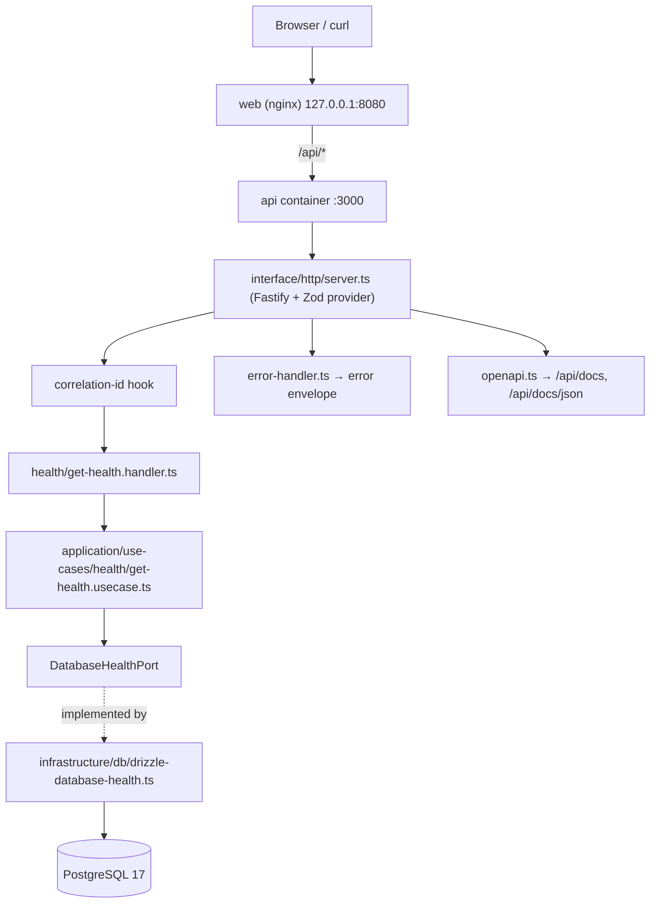
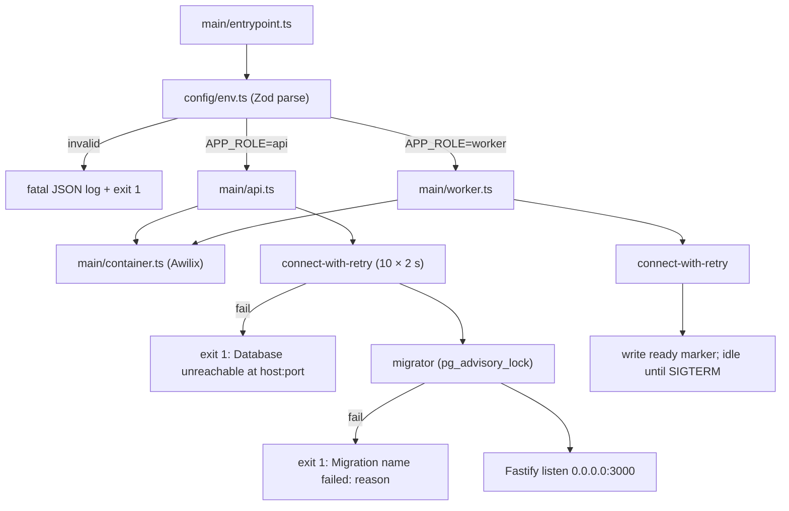
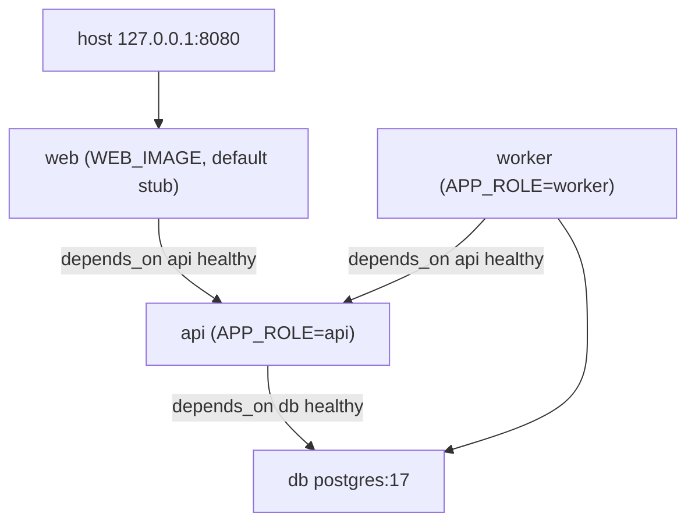

# Spec: F01. Project Foundation

**Complexity:** complex (multiple layers, migration infrastructure, containerization, four compose topologies)

## 1. Technical Overview

**What:** F01 scaffolds the `creator-insights-backend` service from scratch: a Node.js 24 + TypeScript 6 (strict, ESM) workspace at `apps/backend/` using the PRD layered layout (`src/domain`, `src/application`, `src/infrastructure`, `src/interface`, `src/main`), an Awilix composition root, a Fastify 5 HTTP server with Zod-typed routes and a generated OpenAPI 3.1 document, pino JSON logging with correlation IDs and secret redaction, PostgreSQL 17 access through Drizzle ORM with a lock-protected migration runner, an AES-256-GCM cipher, a `ClockPort`, a `settings` key-value store, one `GET /api/v1/health` endpoint, and the container setup: a multi-stage Dockerfile with `api`/`worker` roles, a stub `web` image, and four compose files.

**Why:** Every later feature plugs into this base. F02 adds the users/sessions schema and the session middleware; F03 and F14 encrypt tokens with the cipher; F05 stores settings in the key-value store; F06 adds pg-boss jobs to the worker entrypoint. Fixing the layering, error envelope, logging contract, and migration mechanics now keeps those features to "add a module" changes. The architecture gates (dependency-cruiser, check-architecture, madge, knip, ESLint, tsc) are installed now so violations never land.

**Scope:**

**Included:**
- Monorepo root: npm workspaces (`apps/backend`), root `package.json` scripts, `scripts/init.sh`, `scripts/stop.sh`, `scripts/resolve-env.sh`, `scripts/run-gates.mjs` (adapted from the clean-arch scaffold).
- Backend project tooling: `tsconfig.json`, `tsconfig.build.json`, ESLint flat config + Prettier, path aliases per layer, Vitest workspace (unit / integration / e2e projects) with 80% line-coverage thresholds on `src/domain` and `src/application`.
- Architecture gates retargeted to the PRD layout: `.dependency-cruiser.cjs`, `scripts/check-architecture.ts`, `knip.json`, ESLint restrictions (`process.env` only in `src/config/env.ts`; `new` of infrastructure classes only in `src/main/`).
- Config: Zod-validated env in `src/config/env.ts`. Boot fails fast with exit code 1 and a fatal JSON log listing the invalid variables.
- Domain shared kernel: `AppError` hierarchy with the PRD error codes, `Id` VO (UUID v7), pagination types, unit-of-work interface.
- Application ports: `ClockPort`, `CipherPort`, `DatabaseHealthPort`, `SettingsStorePort`, `LoggerPort`.
- Infrastructure: pg pool + Drizzle client with boot retry (10 × 2 s), migration runner under an advisory lock, `settings` schema + Drizzle store, DB health probe (2 s timeout), `AesGcmCipher`, `SystemClock`, pino logger factory with redaction.
- Interface (HTTP): Fastify server builder, Zod type provider, OpenAPI generation (`/api/docs`, `/api/docs/json`), error envelope mapping, 404 handler, correlation-ID handling, `GET /api/v1/health`, and test-only diagnostic routes behind `TEST_ROUTES_ENABLED`.
- Composition root: `src/main/container.ts` (Awilix), `src/main/api.ts`, `src/main/worker.ts`, `src/main/entrypoint.ts` (dispatch by `APP_ROLE`), `src/main/healthcheck.ts`.
- Worker role (minimal): boot, DB connect, ready marker for the container healthcheck, graceful SIGTERM shutdown.
- Containers: `docker/Dockerfile` (deps → build → prod-deps → runtime on `node:24-slim`, non-root), `docker/web/` (stub nginx image: placeholder page, `/healthz`, `/api` → `api:3000` proxy), `docker-compose.yml` (repo root, local production), `docker/docker-compose.dev.yml`, `docker/docker-compose.test.yml`, `docker/docker-compose.e2e.yml` (api, worker, db, WireMock).
- `.env.example` documenting every PRD variable; `.env` git-ignored.

**Deferred / owned elsewhere:**
- Users, sessions, auth middleware (F02).
- pg-boss queue/scheduler wiring and jobs (F06). `src/interface/jobs/` is created when the first job exists.
- Worker heartbeat-based health and backups (F15). F01's ready marker is replaced there.
- CI workflows and GHCR publishing (F16). F01 only provides the scripts and compose files CI will call.
- The real frontend image. `WEB_IMAGE` swaps it in once `creator-insights-frontend` is published.

**Input contracts (Consumes):** none. F01 has no upstream features.

**Output contracts (Provides):**
- Database connection (Drizzle client + pg pool) registered in the container as `db`.
- Drizzle schema module convention: `src/infrastructure/db/schema/<table>.schema.ts`, aggregated by `src/infrastructure/db/schema/schema.ts` for drizzle-kit.
- Migration runner applied by the `api` entrypoint before listening.
- `SettingsStorePort` (`get(key)`, `set(key, value)`, `getMany(prefix)`) backed by the `settings` table, consumed by F05.
- `CipherPort` (`encrypt`, `decrypt`), consumed by F03 and F14.
- `ClockPort`, consumed by every time-dependent feature.
- Error envelope, pagination convention, and route registration convention (`HttpRoute` with Zod schemas), consumed by every HTTP feature.

**Integrated cross-cutting concerns:** structured logging, correlation IDs, secret redaction, error envelope, OpenAPI generation, config validation.

## 2. Architecture Impact

**Repository layout (new):**

```
/                                   repo root (npm workspaces)
  package.json                      workspaces: ["apps/backend"]; scripts: test, lint, typecheck, gates, build
  docker-compose.yml                local production stack (web, api, worker, db)
  .env.example                      every PRD variable, documented
  scripts/{init.sh,stop.sh,resolve-env.sh,run-gates.mjs}
  docker/
    Dockerfile                      multi-stage backend image
    web/{Dockerfile,nginx.conf,index.html}   stub web image
    docker-compose.dev.yml
    docker-compose.test.yml
    docker-compose.e2e.yml
    wiremock/mappings/.gitkeep
  apps/backend/
    package.json, tsconfig.json, tsconfig.build.json, eslint.config.mjs, .prettierrc,
    vitest.config.ts, drizzle.config.ts, knip.json, .dependency-cruiser.cjs, .env.test
    scripts/check-architecture.ts
    src/
      config/env.ts
      domain/_shared/{errors.ts,id.vo.ts,pagination.ts,unit-of-work.ts}
      application/
        ports/{clock.port.ts,cipher.port.ts,database-health.port.ts,settings-store.port.ts,logger.port.ts}
        use-cases/health/get-health.usecase.ts
        dto/health/get-health.dto.ts
      infrastructure/
        db/{pool.ts,client.ts,connect-with-retry.ts,migrator.ts,drizzle-database-health.ts,settings.drizzle-store.ts}
        db/schema/{schema.ts,settings.schema.ts,schema-migrations.schema.ts}
        db/migrations/{0000_settings.sql,meta/_journal.json,meta/0000_snapshot.json}
        crypto/aes-gcm-cipher.ts
        clock/system-clock.ts
        logging/{pino-logger.ts,redaction.ts}
      interface/http/
        {server.ts,types.ts,error-handler.ts,not-found-handler.ts,correlation-id.ts,openapi.ts,routes.ts}
        health/{get-health.handler.ts,health.routes.ts}
        diagnostics/{diagnostics.handler.ts,diagnostics.routes.ts}
      main/{container.ts,api.ts,worker.ts,entrypoint.ts,healthcheck.ts}
    test/
      unit/…  integration/…  e2e/…  fixtures/  fakes/  helpers/
```

**Layer dependency rule (enforced by dependency-cruiser):**

| From | May import | Must not import |
|---|---|---|
| `src/domain` | itself; zod; date/numeric libs | `application`, `infrastructure`, `interface`, `main`, `config`; `fastify`, `drizzle-orm`, `pg`, `pg-boss`, `googleapis`, `awilix`, `pino`, `node:fs`, `node:http(s)`, `node:child_process` |
| `src/application` | `domain` | `infrastructure`, `interface`, `main`, `config`, the same I/O libraries |
| `src/infrastructure` | `domain`, `application` | `interface`, `main` |
| `src/interface` | `domain`, `application` | `infrastructure`, `main` (receives infrastructure through injected ports) |
| `src/main` | everything | — |
| `src/config` | zod, dotenv | every other layer |

**Request flow:**



**Boot sequence:**



**Compose topology (local production):**



## 3. Technical Decisions

| Decision | Chosen Approach | Alternative Considered | Trade-off |
|---|---|---|---|
| Source layout | PRD layout (`domain`, `application/{ports,use-cases,dto}`, `infrastructure`, `interface`, `main`) under `apps/backend/src` (user decision) | clean-arch canonical (`domain`, `usecase`, `infra`, `main.ts`) | Diverges from the clean-arch skill's default paths. The project copies of the gate configs are retargeted (same rules, PRD paths), and CLAUDE.md's "src/main.ts" line is updated to `src/main/container.ts`. |
| Dependency injection | Awilix in `src/main/container.ts`, `InjectionMode.CLASSIC`, `strict: true`, singletons for infra, scoped per request only when needed later (user decision) | Hand-wired `new` in a single `main.ts` | Adds a runtime DI library; CLASSIC mode relies on constructor parameter names, which is safe because the build is plain `tsc` (no minification). |
| ORM and migrations | Drizzle ORM (`drizzle-orm/node-postgres`) + drizzle-kit `generate` for SQL files; **custom runner** in `infrastructure/db/migrator.ts` that reads `meta/_journal.json`, applies each pending SQL file in its own transaction, records it in `schema_migrations`, all under `pg_advisory_lock(hashtext('creator-insights:migrations'))` (user decision: Drizzle) | drizzle-orm's built-in `migrate()`; Prisma (scaffold default) | The built-in migrator neither reports the failing migration name nor applies one transaction per file. A custom runner is ~100 lines that need their own integration tests, but it keeps `drizzle-kit` a devDependency (no ORM CLI in the runtime image). |
| HTTP validation and OpenAPI | Each route module declares Zod schemas (`params`, `querystring`, `body`, `response`) on an `HttpRoute` descriptor; `fastify-type-provider-zod` compiles them; `@fastify/swagger` + `@fastify/swagger-ui` build OpenAPI 3.1 from the same schemas | Hand-written OpenAPI; handler-level `schema.parse` only | The route schema is the handler's validation, which satisfies "handlers validate input". Fastify-level validation errors are mapped centrally to `VALIDATION_ERROR`, so handlers stay free of `try/catch`. |
| Zod version | Zod 4 (required by current `fastify-type-provider-zod`), shared by config, routes, and domain VOs | Zod 3 (scaffold pin) | Zod 4 API differences (`z.email()`, error formatting) are adopted from day one. |
| Correlation ID | Fastify `genReqId`: accept `x-correlation-id` when it matches `^[A-Za-z0-9._-]{1,128}$`, otherwise generate UUID v7 (`uuid` package); `requestIdLogLabel: "correlationId"`; `onSend` echoes `x-correlation-id`. Non-request logs carry a process-level correlationId generated at boot. | Accept any header value | Rejecting malformed IDs prevents log injection. A boot-level ID guarantees "every log line has correlationId", even outside requests. |
| Log redaction | pino `redact` with `censor: "[REDACTED]"` over: `req.headers.authorization`, `req.headers.cookie`, `res.headers["set-cookie"]`, `*.authorization`, `*.cookie`, `*.token`, `*.refreshToken`, `*.botToken`, `*.accessToken`, plus the same keys two levels deep (`*.*.token`, …) | Per-call manual masking | pino wildcards match one level only, so both depths are listed explicitly. Deeper nesting is not redacted; the unit test documents that limit. |
| Cipher | `AesGcmCipher`: AES-256-GCM via `node:crypto`, 12-byte random IV, 16-byte tag, format `v1:<iv_b64>:<tag_b64>:<ciphertext_b64>`. Any authentication failure (wrong key or tampered bytes) → `DecryptionFailedError` code `ENCRYPTION_KEY_MISMATCH`; a malformed envelope → `InvalidCiphertextError` code `INVALID_CIPHERTEXT` | Separate tamper vs wrong-key errors | GCM cannot tell a wrong key from tampering. The PRD's `ENCRYPTION_KEY_MISMATCH` is therefore the single auth-failure code, and callers (F02 `/me`) treat it as "integration error, reconnect". |
| Container roles | One image; `node dist/main/entrypoint.js` reads `APP_ROLE` (`api`\|`worker`); healthcheck `node dist/main/healthcheck.js` (api: GET `/api/v1/health` on 127.0.0.1:3000 with a 2 s timeout; worker: ready marker `/tmp/worker-ready` exists) | Two images | One build and one tag for F16. The worker marker is a stopgap until F15's heartbeat. |
| Web service | `docker/web` stub nginx image (placeholder `index.html`, `/healthz`, `location /api/ { proxy_pass http://api:3000; }`). Compose: `image: ${WEB_IMAGE:-creator-insights-web-stub:local}` + `build: docker/web`, so a clean machine builds the stub and `WEB_IMAGE=ghcr.io/<owner>/creator-insights-frontend:latest` swaps in the real frontend (user decision) | Depend on the published frontend image only | The stub has to keep the same `/api` proxy contract as the real frontend nginx. In exchange, F01's stack ACs are verifiable before the frontend exists. |
| Local dev | `scripts/init.sh` wraps `docker compose -f docker/docker-compose.dev.yml up -d --build`. `COMPOSE_PROJECT_NAME` is derived per worktree (`ci-<branch-slug>`). init.sh finds a free host port starting at 8080 for `WEB_PORT`, waits for `/api/v1/health` through web, and prints the URL. `stop.sh` runs `down`; `stop.sh --clean` runs `down -v` (user decision) | Host `tsx watch` + Dockerized Postgres (scaffold) | Everything runs in Docker, as the PRD wants, and parallel worktrees don't collide. Hot reload relies on bind mounts plus `tsx watch` inside the container. |
| Test layout | `apps/backend/test/{unit,integration,e2e,fixtures,fakes,helpers}` mirroring `src` paths; Vitest projects `unit` (no I/O), `integration` (real Postgres via `DATABASE_URL` from `.env.test` or the test compose), `e2e` (compose.e2e, `passWithNoTests` in F01) (user decision) | Co-located `*.spec.ts` | Departs from clean-arch co-location and follows the PRD. dependency-cruiser's `no-tests-in-src` rule is retargeted to `^test/`. |
| Integration DB isolation | `test/helpers/test-database.ts` creates a uniquely named database per test file (`ci_test_<random>`) from the admin URL, runs the migrator, and drops it after the suite | Truncate between tests in one shared DB | Slightly slower setup, but files are fully isolated and can run in parallel. |
| Config scope | `env.ts` requires only F01-owned variables (`APP_ROLE`, `PORT`, `DATABASE_URL`, `ENCRYPTION_KEY`, `LOG_LEVEL`, `APP_VERSION`, `TEST_ROUTES_ENABLED`, `WORKER_READY_FILE`). Later-feature variables are documented in `.env.example` and added to the schema by their owning feature. | Require every PRD variable now | Booting F01 doesn't need Google or Telegram secrets, and each feature owns its config validation. |
| Error-envelope test surface | `TEST_ROUTES_ENABLED=true` mounts `/api/v1/__diagnostics/fail` (throws an unexpected `Error`) and `/api/v1/__diagnostics/echo?count=<int>` (Zod-validated). Both are hidden from OpenAPI and never mounted when the flag is false (the default). | No diagnostic routes until a feature has real inputs | Adds two gated routes. Without them, the `INTERNAL` and `VALIDATION_ERROR` envelope paths couldn't be verified at the HTTP boundary in F01. |

### Assumptions

- **PRD layout over CLAUDE.md layout** (interview). CLAUDE.md lines "Follow clean architecture: `domain/` <- `usecase/` <- `infra/`" and "`src/main.ts` is the composition root" map to `domain ← application ← infrastructure/interface` and `src/main/container.ts`. Updating CLAUDE.md/AGENTS.md is part of this feature. `process.env` stays restricted to `src/config/env.ts`.
- **Gate retargeting** (interview): `run-gates.mjs` and its 6 tools are kept as-is. Only path patterns in the project copies of `.dependency-cruiser.cjs`, `scripts/check-architecture.ts` (suffix rules: `application/use-cases/<f>/*.usecase.ts`, `application/dto/<f>/*.dto.ts`, `application/ports/*.port.ts`, `infrastructure/**`, `interface/http/<f>/*.{handler,routes}.ts`) and `knip.json` change.
- Monorepo: backend at `apps/backend` per CLAUDE.md. `docker/` and `docker-compose.yml` sit at the repo root so `docker compose up -d` works from the root, as the PRD Experience describes.
- `docker/docker-compose.test.yml` builds the `deps` stage, starts `db`, and runs `npm run lint && npm run typecheck && npm run test && npm run test:integration && npm run test:e2e` in the `test` service.
- `npm test` at the repo root runs only the `unit` Vitest project (no DB), so it works on any host. Integration tests run inside the test compose or with a reachable `DATABASE_URL` from `apps/backend/.env.test`.
- Health 503 body: `{ status: "degraded", db: "unreachable", version }`. The PRD defines only the status code.
- `version` comes from `APP_VERSION` (Docker build arg, default `0.0.0-dev`).
- Restart policy `on-failure:3` for `api` and `worker` (PRD: "stops after 3 attempts").
- Fixture convention (first feature, becomes the project convention): static inputs under `apps/backend/test/fixtures/`; persistent state produced by the migrator plus per-test helpers in `apps/backend/test/helpers/`; test config in `apps/backend/.env.test`; external mocks as WireMock mappings under `docker/wiremock/mappings/`.
- Config error messages include the offending variable name and the expected shape. For secrets they report only the length/format observed, never the value (e.g., `ENCRYPTION_KEY: must be 32 bytes base64 (got 31 bytes)`).
- Exact versions are pinned at implementation time to the latest stable releases: Node 24 LTS, TypeScript 6.x, Fastify 5.x, Zod 4.x, drizzle-orm/drizzle-kit latest, pg 8.x, Awilix 12.x, pino (bundled with Fastify), Vitest 3.x, dependency-cruiser, madge, knip, ESLint 9 flat config.

### PRD Traceability

| PRD block | Spec destination |
|---|---|
| Provides (DB connection, schema module, migration runner, settings store) | §1 Output contracts; §4 infrastructure/db; §6 Data Model |
| Capabilities: runtime, layout, DI | §2 layout + dependency table; §3 layout/DI decisions |
| Capabilities: HTTP, OpenAPI, error envelope, pagination | §3 validation/OpenAPI decision; §5 API Contracts |
| Capabilities: logging | §3 correlation + redaction decisions; §4 logging files |
| Capabilities: database, migrations | §3 migration decision; §6 Data Model |
| Capabilities: crypto, ClockPort | §3 cipher decision; §4 ports and infrastructure |
| Capabilities: health, containers, compose, ports, `.env.example`, config validation | §4 Containers and Config; §3 role/web decisions |
| Experience | §2 boot sequence; §4 Containers; §3 local dev decision |
| Error Handling | Error Handling table below |

### Error Handling

| Condition | Behavior |
|---|---|
| Invalid/missing config | `{"level":"fatal","msg":"Invalid configuration","invalid":["ENCRYPTION_KEY: must be 32 bytes base64 (got 31 bytes)", …],"correlationId":"…"}` on stdout; exit code 1. |
| DB unreachable at boot | 10 connection attempts, 2 s apart, each logged at `warn` with the attempt number; then fatal `Database unreachable at <host>:<port>` and exit 1. |
| Migration fails | That migration's transaction rolls back; fatal `Migration <name> failed: <reason>`; advisory lock released; exit 1; earlier migrations stay applied, later ones are not attempted. |
| Concurrent migration | The second instance blocks on the advisory lock, then sees every migration already recorded and applies nothing. |
| Decryption auth failure | `DecryptionFailedError` (`ENCRYPTION_KEY_MISMATCH`); the stored value is never overwritten. |
| Malformed ciphertext | `InvalidCiphertextError` (`INVALID_CIPHERTEXT`) with the expected format `v1:<iv>:<tag>:<ciphertext>` in the message (no ciphertext echoed). |
| Unhandled route exception | 500 envelope `INTERNAL`, generic message, correlationId; stack logged at `error` only. |
| Route validation failure | 400 envelope `VALIDATION_ERROR` with `details: [{ path, message }]`. |
| Unknown route | 404 envelope `NOT_FOUND` with the method and path in the message. |
| DB ping timeout in health | Probe aborts after 2 s → 503 `{ status: "degraded", db: "unreachable" }`. |
| SIGTERM | api: `app.close()` then pool end. worker: remove ready marker, pool end. Exit 0 within 10 s. |

## 4. Component Overview

**Repository root:**

| File Path | New/Modified | Purpose | Key Responsibilities |
|---|---|---|---|
| `package.json` | New | Workspace root | Declares `apps/backend` workspace; scripts `test`, `lint`, `typecheck`, `build`, `gates` |
| `scripts/init.sh` | New | Dev environment start | Derives compose project and free web port; `compose.dev up -d --build`; waits for health via web; prints URL |
| `scripts/stop.sh` | New | Dev environment stop | `compose.dev down`; `--clean` adds `-v` (drops the branch DB volume) |
| `scripts/resolve-env.sh` | New | Shared env resolution | Project dir, compose project name, port helpers (adapted from the scaffold) |
| `scripts/run-gates.mjs` | New | Gate runner | Copied from the clean-arch scaffold unchanged; auto-detects `apps/backend` |
| `.env.example` | New | Config documentation | Every PRD variable with comment, default, and format |
| `.gitignore` | New | Ignore rules | `.env`, `node_modules`, `dist`, `.pids`, coverage |
| `docker-compose.yml` | New | Local production stack | web/api/worker/db; only `127.0.0.1:8080:80` published; healthchecks; `depends_on` conditions; `on-failure:3`; named `db-data` volume |
| `CLAUDE.md`, `AGENTS.md` | Modified | Agent instructions | Replace `src/main.ts` / `usecase` / `infra` wording with the PRD layout |

**Containers (`docker/`):**

| File Path | New/Modified | Purpose | Key Responsibilities |
|---|---|---|---|
| `docker/Dockerfile` | New | Backend image | Stages `deps` (npm ci, all deps), `build` (tsc), `prod-deps` (npm ci --omit=dev), `runtime` (`node:24-slim`, `USER node`, copies `dist` + prod `node_modules` + migrations, `HEALTHCHECK`, entrypoint) |
| `docker/web/Dockerfile`, `nginx.conf`, `index.html` | New | Stub web | nginx alpine; `/healthz` 200; `/api/` proxied to `api:3000` with `X-Correlation-Id` passthrough; placeholder page |
| `docker/docker-compose.dev.yml` | New | Hot reload | Backend `target: deps`, source bind-mounted, `tsx watch`; web built from `FRONTEND_PATH` when set, else stub; port `127.0.0.1:${WEB_PORT:-8080}` |
| `docker/docker-compose.test.yml` | New | Containerized test run | `db` + `test` service running lint, typecheck, unit, integration, e2e |
| `docker/docker-compose.e2e.yml` | New | E2E topology | api, worker, db, WireMock (`docker/wiremock/mappings`) for future Google/Telegram stubs |

**Backend tooling (`apps/backend/`):**

| File Path | New/Modified | Purpose | Key Responsibilities |
|---|---|---|---|
| `package.json` | New | Backend package | Scripts `dev`, `build`, `start`, `lint`, `typecheck`, `test`, `test:integration`, `test:e2e`, `db:generate`, `format` |
| `tsconfig.json` / `tsconfig.build.json` | New | TS config | Strict flags from the scaffold, `module: NodeNext`, aliases `@domain/*`, `@application/*`, `@infrastructure/*`, `@interface/*`, `@main/*`, `@config/*`; build excludes `test/` |
| `eslint.config.mjs`, `.prettierrc` | New | Lint/format | Typescript-eslint strict; `no-restricted-properties` on `process.env` outside `src/config/env.ts`; `no-restricted-syntax` on `new` of infra classes outside `src/main/` |
| `.dependency-cruiser.cjs` | New | Layer gate | Rules from §2 table; `no-tests-in-src` → `^test/`; barrel ban with exception `src/interface/http/routes.ts` |
| `scripts/check-architecture.ts` | New | Structure gate | Scaffold script with path patterns retargeted to the PRD layout |
| `knip.json` | New | Orphan gate | Entries `src/main/entrypoint.ts`, `src/main/healthcheck.ts`, `scripts/*.ts`, `drizzle.config.ts`; ignores `src/domain/_shared/**` |
| `vitest.config.ts` | New | Test runner | Projects unit/integration/e2e; coverage v8 thresholds 80% lines on `src/domain/**`, `src/application/**` |
| `drizzle.config.ts` | New | drizzle-kit | Schema `src/infrastructure/db/schema/schema.ts`, out `src/infrastructure/db/migrations`, dialect postgresql |
| `.env.test` | New | Test config | `DATABASE_URL` admin URL for test DB creation, fixed test `ENCRYPTION_KEY`, `LOG_LEVEL=silent` |

**Backend source (`apps/backend/src/`):**

| File Path | New/Modified | Purpose | Key Responsibilities |
|---|---|---|---|
| `config/env.ts` | New | Config | Exports pure `parseEnv(source)` returning a typed result or a list of invalid entries, plus the frozen `config` built from `process.env`; the only `process.env` reader |
| `domain/_shared/errors.ts` | New | Error hierarchy | `AppError` (code, status, details); `ValidationError` 400, `UnauthenticatedError` 401, `ForbiddenError` 403, `NotFoundError` 404, `ConflictError` 409, `UpstreamError` 502; `DecryptionFailedError`, `InvalidCiphertextError` |
| `domain/_shared/id.vo.ts` | New | Typed IDs | `Id` base with `generate()` (UUID v7), `from(raw)` validating UUID, `equals` |
| `domain/_shared/pagination.ts` | New | Pagination types | `PageInput { page, pageSize }`, `PageOutput<T> { items, page, pageSize, total }`, defaults 1/20, max 100 |
| `domain/_shared/unit-of-work.ts` | New | UoW interface | Opt-in transactional boundary for later features |
| `application/ports/clock.port.ts` | New | Time | `now(): Date` |
| `application/ports/cipher.port.ts` | New | Encryption | `encrypt(plain): string`, `decrypt(envelope): string` |
| `application/ports/database-health.port.ts` | New | DB probe | `check(): Promise<"ok" \| "unreachable">` |
| `application/ports/settings-store.port.ts` | New | Key-value store | `get<T>(key)`, `set(key, value)`, `getMany(prefix)` (JSON values) |
| `application/ports/logger.port.ts` | New | Logging | Minimal `info/warn/error/fatal(obj, msg)` so use cases never import pino |
| `application/use-cases/health/get-health.usecase.ts` | New | Health use case | Calls `DatabaseHealthPort`, returns `{ status, db, version }` |
| `application/dto/health/get-health.dto.ts` | New | Health DTOs | `GetHealthInput`, `GetHealthOutput` |
| `infrastructure/db/pool.ts` | New | pg pool factory | Pool from `DATABASE_URL`, `application_name` per role |
| `infrastructure/db/client.ts` | New | Drizzle client | `drizzle(pool, { schema })` |
| `infrastructure/db/connect-with-retry.ts` | New | Boot retry | 10 attempts × 2 s, logs each, throws `Database unreachable at <host>:<port>` |
| `infrastructure/db/migrator.ts` | New | Migration runner | Advisory lock; reads journal; per-file transaction; records `schema_migrations`; logs applied/skipped counts |
| `infrastructure/db/drizzle-database-health.ts` | New | DB probe impl | `SELECT 1` with a 2 s `statement_timeout` and a client-side abort |
| `infrastructure/db/settings.drizzle-store.ts` | New | Settings store impl | Upsert by key with `updated_at` from `ClockPort`; JSON values |
| `infrastructure/db/schema/settings.schema.ts` | New | Drizzle table | `settings` |
| `infrastructure/db/schema/schema-migrations.schema.ts` | New | Drizzle table | `schema_migrations` (read-only from the app; written by the migrator) |
| `infrastructure/db/schema/schema.ts` | New | Schema aggregate | Re-exports table definitions for drizzle-kit and the client (allowed exception to the barrel ban, configured in depcruise) |
| `infrastructure/db/migrations/0000_settings.sql` + `meta/` | New | First migration | Creates `settings` (and `schema_migrations` is created by the runner itself before reading the journal) |
| `infrastructure/crypto/aes-gcm-cipher.ts` | New | Cipher impl | Validates the key is 32 bytes at construction; `v1:` envelope; maps auth failure to `DecryptionFailedError` |
| `infrastructure/clock/system-clock.ts` | New | Clock impl | `new Date()` |
| `infrastructure/logging/redaction.ts` | New | Redaction paths | Exported path list + censor constant |
| `infrastructure/logging/pino-logger.ts` | New | Logger factory | pino JSON, ISO time, level from config, base `{ service, role, correlationId: bootId }`, redaction; implements `LoggerPort` |
| `interface/http/types.ts` | New | Route descriptor | `HttpRoute { method, url, schema, handler, hide? }`, `HttpRequest`, `HttpResponse` |
| `interface/http/server.ts` | New | Fastify builder | Zod compilers, genReqId, logger injection, swagger + UI, error handler, not-found handler, route registration under `/api/v1` |
| `interface/http/correlation-id.ts` | New | Correlation | Header parse/validate, UUID v7 fallback, `onSend` echo |
| `interface/http/error-handler.ts` | New | Envelope mapping | `AppError` → status/code; Zod/Fastify validation → 400 `VALIDATION_ERROR` + details; else 500 `INTERNAL`; always adds correlationId |
| `interface/http/not-found-handler.ts` | New | 404 | `NOT_FOUND` envelope |
| `interface/http/openapi.ts` | New | Docs config | OpenAPI 3.1 info (title, version), `jsonSchemaTransform`, UI at `/api/docs`, JSON at `/api/docs/json` |
| `interface/http/routes.ts` | New | Route builder | `buildHttpRoutes(deps): HttpRoute[]` (the single allowed aggregator) |
| `interface/http/health/get-health.handler.ts` | New | Health handler | Calls the use case; 200 when `db: ok`, else 503 |
| `interface/http/health/health.routes.ts` | New | Health route | `GET /health` with response schemas 200/503 |
| `interface/http/diagnostics/diagnostics.handler.ts` | New | Test-only handlers | `fail` throws `Error("diagnostic failure")`; `echo` returns `{ count }` |
| `interface/http/diagnostics/diagnostics.routes.ts` | New | Test-only routes | `GET /__diagnostics/fail`, `GET /__diagnostics/echo` (`count` int ≥ 0), `hide: true` |
| `main/container.ts` | New | Composition root | Awilix registrations: config, logger, clock, pool, db, cipher, settingsStore, databaseHealth, use cases, handlers, routes |
| `main/api.ts` | New | API role | Retry connect → migrate → build server → listen `0.0.0.0:${PORT}`; SIGTERM handling |
| `main/worker.ts` | New | Worker role | Retry connect → log `worker started` → write `WORKER_READY_FILE` → wait for SIGTERM → cleanup |
| `main/entrypoint.ts` | New | Role dispatch | Parse config (fatal + exit 1 on failure), dynamic-import api or worker |
| `main/healthcheck.ts` | New | Container healthcheck | Role-aware probe; exit 0/1 |

**Database:**

| Migration File | Tables Affected | Operation | Notes |
|---|---|---|---|
| (runner bootstrap) | `schema_migrations` | CREATE IF NOT EXISTS | Created by the migrator inside the lock before reading the journal |
| `src/infrastructure/db/migrations/0000_settings.sql` | `settings` | CREATE | Key-value store consumed by F05 |

## 5. API Contracts

All routes are prefixed with `/api/v1` unless noted. Every response carries an `x-correlation-id` header.

**Standard error envelope (all non-2xx):**

| Field | Type | Description |
|---|---|---|
| `error.code` | `string` | One of `VALIDATION_ERROR`, `UNAUTHENTICATED`, `FORBIDDEN`, `NOT_FOUND`, `CONFLICT`, `UPSTREAM_ERROR`, `INTERNAL` |
| `error.message` | `string` | Human-readable; includes the offending value and expected shape where applicable |
| `error.details` | `array` | Optional; for validation: `[{ path: string, message: string }]` |
| `error.correlationId` | `string` | Same value as the `x-correlation-id` response header |

```json
{
  "error": {
    "code": "VALIDATION_ERROR",
    "message": "Invalid request querystring",
    "details": [{ "path": "count", "message": "Expected integer >= 0, received \"abc\"" }],
    "correlationId": "0192f7a4-6b1e-7c3a-9d2f-1a2b3c4d5e6f"
  }
}
```

**Pagination convention (for later list endpoints):** query `page` (int ≥ 1, default 1), `pageSize` (int 1–100, default 20); response `{ items, page, pageSize, total }`.

### Endpoint: Health

- **Method:** GET
- **Path:** `/api/v1/health`
- **Authentication:** none

**Request:** no parameters.

**Response (200):**

| Field | Type | Description |
|---|---|---|
| `status` | `"ok"` | Service and DB healthy |
| `db` | `"ok"` | DB ping succeeded within 2 s |
| `version` | `string` | `APP_VERSION` |

```json
{ "status": "ok", "db": "ok", "version": "0.1.0" }
```

**Response (503):**

```json
{ "status": "degraded", "db": "unreachable", "version": "0.1.0" }
```

| Code | HTTP Status | Description |
|---|---|---|
| — | 503 | DB ping failed or exceeded 2 s (body above, not the error envelope, so health probes can read it) |

### Endpoint: OpenAPI document

- **Method:** GET
- **Path:** `/api/docs/json` (not versioned)
- **Authentication:** none
- **Response (200):** OpenAPI 3.1 JSON document (`openapi: "3.1.x"`, `info.title: "Creator Insights API"`, `info.version: APP_VERSION`, `paths` containing every non-hidden `/api/v1/*` route).

### Endpoint: OpenAPI UI

- **Method:** GET
- **Path:** `/api/docs`
- **Authentication:** none
- **Response (200):** Swagger UI HTML rendering `/api/docs/json`.

### Endpoint: Diagnostics — fail (test-only)

- **Method:** GET
- **Path:** `/api/v1/__diagnostics/fail`
- **Mounted only when:** `TEST_ROUTES_ENABLED=true`; hidden from OpenAPI.
- **Response (500):** envelope `{ error: { code: "INTERNAL", message: "Internal server error", correlationId } }`. No stack trace in the body.

### Endpoint: Diagnostics — echo (test-only)

- **Method:** GET
- **Path:** `/api/v1/__diagnostics/echo`
- **Mounted only when:** `TEST_ROUTES_ENABLED=true`; hidden from OpenAPI.

| Field | Type | Required | Validation | Description |
|---|---|---|---|---|
| `count` (query) | `integer` | Yes | int ≥ 0 | Value echoed back |

**Response (200):** `{ "count": 3 }`. **Errors:** 400 `VALIDATION_ERROR` with `details[].path = "count"`.

### Not-found

Any unregistered path → 404 `{ error: { code: "NOT_FOUND", message: "Route GET /api/v1/nope not found", correlationId } }`.

## 6. Data Model

**Table: `schema_migrations`** (owned by the migrator)

| Column | Type | Nullable | Default | Description |
|---|---|---|---|---|
| `name` | `varchar(255)` | No | - | Journal tag, e.g. `0000_settings` |
| `hash` | `char(64)` | No | - | SHA-256 of the SQL file; a mismatch on an applied migration aborts boot |
| `applied_at` | `timestamptz` | No | `now()` | When applied |

| Constraint | Type | Definition | Purpose |
|---|---|---|---|
| `pk_schema_migrations` | PRIMARY KEY | `name` | Each migration recorded once |

**Table: `settings`**

| Column | Type | Nullable | Default | Description |
|---|---|---|---|---|
| `key` | `varchar(200)` | No | - | Namespaced key, e.g. `scoring.weights` |
| `value` | `jsonb` | No | - | Arbitrary JSON value |
| `updated_at` | `timestamptz` | No | `now()` | Set from `ClockPort` on write |

| Constraint | Type | Definition | Purpose |
|---|---|---|---|
| `pk_settings` | PRIMARY KEY | `key` | One value per key |
| `ck_settings_key_format` | CHECK | `key ~ '^[a-z0-9_]+(\.[a-z0-9_]+)*$'` | Enforce namespaced lowercase keys |

| Index Name | Columns | Type | Purpose |
|---|---|---|---|
| `pk_settings` | `key` | btree (PK) | Point lookups and prefix scans via `key LIKE 'prefix.%'` with `text_pattern_ops` |
| `ix_settings_key_prefix` | `key text_pattern_ops` | btree | `getMany(prefix)` |

**Migration (`0000_settings.sql`):**

```sql
CREATE TABLE settings (
    key VARCHAR(200) PRIMARY KEY,
    value JSONB NOT NULL,
    updated_at TIMESTAMPTZ NOT NULL DEFAULT NOW(),
    CONSTRAINT ck_settings_key_format CHECK (key ~ '^[a-z0-9_]+(\.[a-z0-9_]+)*$')
);

CREATE INDEX ix_settings_key_prefix ON settings (key text_pattern_ops);
```

**Migrator bootstrap (executed inside the advisory lock, not a journal entry):**

```sql
CREATE TABLE IF NOT EXISTS schema_migrations (
    name VARCHAR(255) PRIMARY KEY,
    hash CHAR(64) NOT NULL,
    applied_at TIMESTAMPTZ NOT NULL DEFAULT NOW()
);
```

## 7. Testing Strategy

**Test File Structure:**

| Test File | Test Type | Target | Coverage Goal |
|---|---|---|---|
| `test/unit/config/env.spec.ts` | Unit | `parseEnv` | 100% |
| `test/unit/domain/_shared/id.vo.spec.ts` | Unit | `Id` | 100% |
| `test/unit/domain/_shared/errors.spec.ts` | Unit | Error codes/status | 100% |
| `test/unit/application/use-cases/health/get-health.usecase.spec.ts` | Unit | `GetHealthUseCase` | 100% |
| `test/unit/infrastructure/crypto/aes-gcm-cipher.spec.ts` | Unit | `AesGcmCipher` | 95% |
| `test/unit/infrastructure/logging/pino-logger.spec.ts` | Unit | Redaction + base fields | 90% |
| `test/unit/interface/http/correlation-id.spec.ts` | Unit | Header parsing | 100% |
| `test/unit/interface/http/error-handler.spec.ts` | Unit | Envelope mapping | 100% |
| `test/integration/infrastructure/db/migrator.spec.ts` | Integration | Migrator vs real Postgres | 90% |
| `test/integration/infrastructure/db/connect-with-retry.spec.ts` | Integration | Retry/exhaustion | 90% |
| `test/integration/infrastructure/db/settings.drizzle-store.spec.ts` | Integration | Settings store | 90% |
| `test/integration/infrastructure/db/drizzle-database-health.spec.ts` | Integration | Probe + timeout | 90% |
| `test/integration/interface/http/health.spec.ts` | Integration | `GET /health` via `app.inject` | — |
| `test/integration/interface/http/openapi.spec.ts` | Integration | Docs JSON validity | — |
| `test/integration/interface/http/error-envelope.spec.ts` | Integration | 400/404/500 envelopes | — |
| `test/integration/main/entrypoint.spec.ts` | Integration | Process boot exit codes (spawned child) | — |

**Fakes and helpers (named classes, no inline stubs):** `test/fakes/fixed-clock.ts` (`FixedClock`), `test/fakes/fake-database-health.ts` (`FakeDatabaseHealth` with a settable outcome), `test/fakes/in-memory-settings-store.ts` (`InMemorySettingsStore`), `test/fakes/captured-log-stream.ts` (`CapturedLogStream`, a writable that collects pino lines), `test/helpers/test-database.ts` (create/migrate/drop a per-file database), `test/helpers/build-test-app.ts` (Fastify instance from the real container with fake overrides).

**Key test functions:**

| Test Function | Description | Assertions |
|---|---|---|
| `parseEnv › rejects missing ENCRYPTION_KEY` | No key in source | Result lists `ENCRYPTION_KEY: required…` |
| `parseEnv › rejects 31-byte key` | base64 of 31 bytes | Invalid list contains `got 31 bytes`; key value absent from the message |
| `parseEnv › applies defaults` | Minimal valid source | `PORT=3000`, `LOG_LEVEL=info`, `TEST_ROUTES_ENABLED=false` |
| `AesGcmCipher › round-trips` | encrypt → decrypt | Plaintext equal; envelope matches `^v1:[^:]+:[^:]+:[^:]+$` |
| `AesGcmCipher › unique IV per call` | Encrypt the same value twice | Envelopes differ |
| `AesGcmCipher › tampered ciphertext fails` | Flip one byte of ciphertext | Throws `DecryptionFailedError` |
| `AesGcmCipher › wrong key fails` | Decrypt with another key | Throws code `ENCRYPTION_KEY_MISMATCH` |
| `AesGcmCipher › malformed envelope` | `"garbage"` | Throws `INVALID_CIPHERTEXT` |
| `pino-logger › redacts secrets` | Log objects with `token`, `refreshToken`, `botToken`, `cookie`, `authorization` at depths 1–2 | Output contains `[REDACTED]`; no raw secret substring |
| `pino-logger › every line has correlationId` | Log outside a request | Parsed JSON has a non-empty `correlationId` |
| `correlation-id › accepts valid header` / `› replaces malformed header` | `abc-123` vs `bad value\n` | Reused vs new UUID v7 |
| `error-handler › maps AppError subclasses` | Each subclass | Status and code per PRD table |
| `error-handler › hides internals` | Plain `Error` | 500 `INTERNAL`, message generic |
| `GetHealthUseCase › ok` / `› unreachable` | `FakeDatabaseHealth` | `{status:"ok",db:"ok"}` / `{status:"degraded",db:"unreachable"}` |
| `migrator › applies all on empty db` | Fresh database | `schema_migrations` row count = journal length; `settings` exists |
| `migrator › idempotent` | Run twice | Second run applies 0; row count unchanged |
| `migrator › concurrent runners apply once` | Two runners via `Promise.all` on separate pools | Each migration recorded once; no error from either |
| `migrator › failing migration rolls back and names file` | Fixture journal with a broken SQL file (`test/fixtures/migrations/broken/`) | Throws `Migration 0001_broken failed: …`; its partial DDL is absent |
| `migrator › hash mismatch aborts` | Applied migration edited | Throws, naming the migration |
| `connect-with-retry › gives up after 10` | Unroutable host, fake sleep | 10 attempts; error `Database unreachable at host:port` |
| `settings store › set/get/getMany/overwrite` | Real DB + `FixedClock` | JSON round-trip; `updated_at` equals the fixed clock |
| `drizzle-database-health › timeout` | Probe with `pg_sleep(3)` substituted via test hook | Returns `unreachable` within ~2 s |
| `health route › 200` / `› 503` | inject with real DB / `FakeDatabaseHealth` unreachable | Status and body per §5 |
| `openapi › valid 3.1 and lists routes` | GET `/api/docs/json` | Validates with an OpenAPI 3.1 validator; contains `/api/v1/health`; excludes `__diagnostics` |
| `error-envelope › 400/404/500` | Diagnostics routes enabled | Envelope shape; `correlationId` equals the response header |
| `entrypoint › invalid config exits 1` | Spawn with a 31-byte key | Exit code 1; stdout fatal JSON with `invalid` array |

**Container-level verification (scripted, run inside the e2e/test compose or manually):** stack healthy within 90 s; only `127.0.0.1:8080` published; runtime image runs as uid ≠ 0 and has no devDependencies in `node_modules`; `depcruise` clean.
