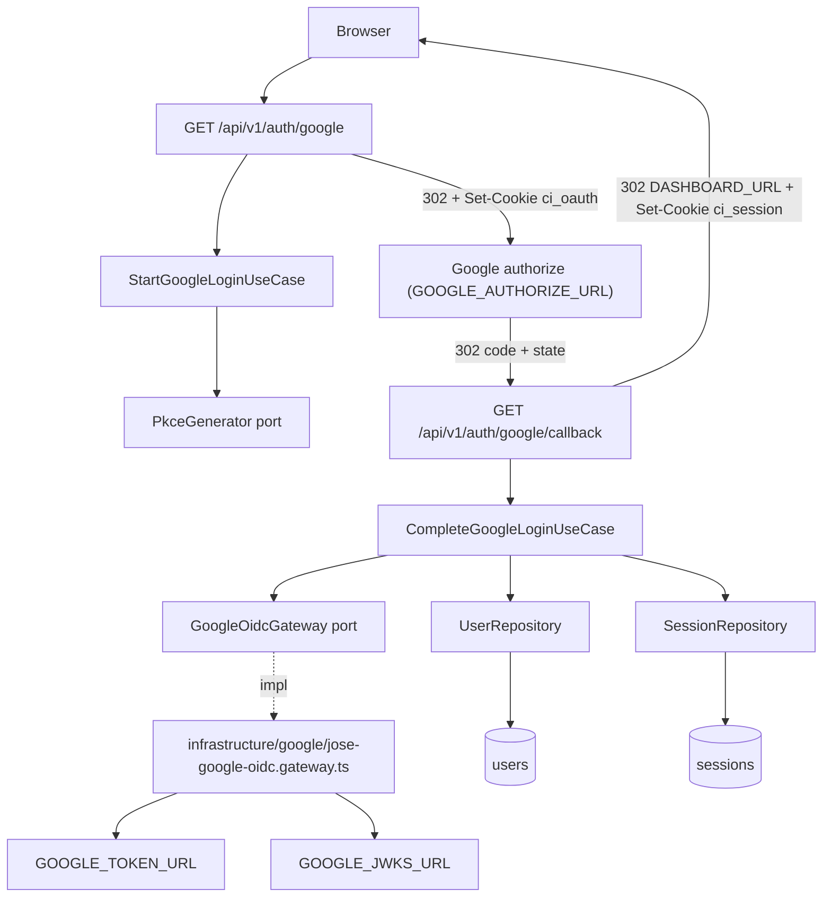
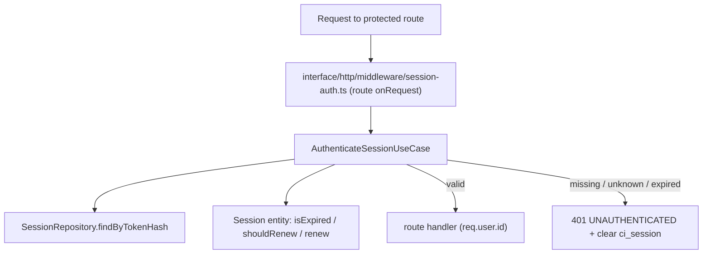

# Spec: F02. Google Authentication

**Complexity:** medium (4 endpoints, 2 new tables, one external OAuth/OIDC integration, cross-cutting route protection)

## 1. Technical Overview

**What:** F02 adds single-user sign-in with Google, using the OAuth 2.0 authorization-code flow with PKCE S256 and OIDC ID-token verification. It adds the `users` and `sessions` tables, server-side sessions carried in the `ci_session` cookie (with sliding and absolute expiry), route protection that applies to every route except an explicit public list, logout, and `GET /me` with the user profile and integration statuses. Google is reached through a `GoogleOidcGateway` port whose endpoints come from config, so tests and the contract run against WireMock instead of Google.

**Why:** Every later feature's data belongs to the one allowed user. F03 links the YouTube platform account to `users.id`, and all dashboard routes rely on the session check introduced here. Opaque tokens stored only as hashes, in a server-side table, make logout and expiry real server-side invalidations; a JWT-in-cookie couldn't be revoked.

**Scope:**

**Included:**
- Routes `GET /api/v1/auth/google`, `GET /api/v1/auth/google/callback`, `POST /api/v1/auth/logout`, `GET /api/v1/me`.
- Login start: random `state`, PKCE verifier and S256 challenge, held in a signed 10-minute `ci_oauth` cookie.
- Callback: state check, code exchange (with `code_verifier`), ID-token verification (signature via JWKS, `iss`, `aud`, `exp`), `email_verified=true` and case-insensitive trimmed equality with `ALLOWED_EMAIL`, upsert of the single `users` row, session creation, 302 to `DASHBOARD_URL`.
- Error redirects to `DASHBOARD_URL/login?error=<code>`: `not_allowed`, `invalid_state`, `google_unavailable`, `invalid_token`, `access_denied`.
- Sessions: 32-byte random token (base64url) in the `ci_session` cookie, stored only as SHA-256 hex; 30-day sliding expiry (renewal written at most once per hour) and a 90-day absolute cap; expired rows deleted when encountered.
- Route protection: an auth check on every registered route not marked public. The public list is `/api/v1/health`, `/api/v1/auth/*`, `/api/docs*`, plus F01's `/api/v1/__diagnostics/*` when `TEST_ROUTES_ENABLED=true`.
- 401 `UNAUTHENTICATED` responses; the `ci_session` cookie is cleared when an invalid one was sent.
- `GET /me` with `user` and `integrations`. Integration statuses come from `YoutubeIntegrationStatusPort` and `TelegramIntegrationStatusPort`; F02 ships default providers (`disconnected`, `not_configured`) that F03 and F14 replace.
- Rejected logins logged with a hashed email only; Google failures logged with the HTTP status only.
- Config additions to F01's `src/config/env.ts`, and the WireMock Google stubs plus the stub `web` service in `docker/docker-compose.e2e.yml`.

**Deferred / owned elsewhere:**
- Real YouTube connection status (F03) and Telegram status (F14), including the `error` status when decryption fails with `ENCRYPTION_KEY_MISMATCH`.
- Scheduled cleanup of expired sessions (no scheduler before F06; expired rows are deleted lazily).

**Input contracts (Consumes):** F01 infrastructure — `HttpRoute` registration, error envelope, `AppError` hierarchy (`UnauthenticatedError`), `ClockPort`, Drizzle client and migration runner, logger with redaction, config module, test/fixture conventions, WireMock in `docker-compose.e2e.yml`.

**Output contracts (Provides):**
- `users` row (`id`, `email`, `name`, `avatarUrl`) and the `UserRepository` interface. F03 references `users.id` as the integration owner.
- The authenticated actor: protected handlers receive `req.user = { id }`, which they pass to use cases as `actorId`.
- Route descriptor flag `auth: "public" | "required"` (default `required`), so later features opt out explicitly instead of opting in.
- `YoutubeIntegrationStatusPort` and `TelegramIntegrationStatusPort`, implemented for real by F03 and F14.

**Integrated cross-cutting concerns:** authentication for every later route; log redaction of `ci_session`/`ci_oauth` cookies (covered by F01's `cookie` redaction path).

## 2. Architecture Impact

**Login flow:**



**Request authentication:**



**Affected F01 components:** `src/config/env.ts` (new variables), `src/interface/http/types.ts` (`auth` flag, `user` on request), `src/interface/http/server.ts` (registers `@fastify/cookie`, attaches the auth hook per route), `src/interface/http/routes.ts` (auth and me routes), `src/interface/http/diagnostics/diagnostics.routes.ts` (marked public), `src/interface/http/health/health.routes.ts` (marked public), `src/main/container.ts`, `docker/docker-compose.e2e.yml`, `.env.example`.

## 3. Technical Decisions

| Decision | Chosen Approach | Alternative Considered | Trade-off |
|---|---|---|---|
| OIDC client | `GoogleOidcGateway` port; `JoseGoogleOidcGateway` uses `fetch` for the token exchange (10 s timeout) and `jose` (`createRemoteJWKSet`, `jwtVerify`) for ID tokens. Authorize, token and JWKS URLs plus accepted issuers come from config, defaulting to Google's (user decision) | `google-auth-library`; `openid-client` | A small amount of protocol code to own, but WireMock can stand in for Google with static mappings, so contract items need no in-process fake. |
| Test ID tokens | Pre-signed RS256 fixtures (test key in `test/fixtures/oidc/`) with `aud` = test client ID, `iss` = `https://accounts.google.com`, `exp` = 2099-12-31, plus one expired fixture. WireMock returns them by matching the `code` form parameter | WireMock JWT templating extension | Static, deterministic files; a script (`test/helpers/generate-oidc-fixtures.ts`) regenerates them when claims change. |
| Nonce | Not used; CSRF protection comes from `state` + PKCE, bound to the signed `ci_oauth` cookie | OIDC `nonce` claim | The flow is server-side code exchange with a confidential client, so `nonce` adds little. Skipping it keeps WireMock token responses static. |
| OAuth transient cookie | `ci_oauth` = JSON `{ state, codeVerifier, issuedAt }`, signed by `@fastify/cookie` with `SESSION_SECRET`; `HttpOnly`, `Secure`, `SameSite=Lax`, `Path=/api/v1/auth/google`, `Max-Age=600`; always cleared on callback | Server-side state table | Nothing is persisted before login succeeds (PRD: "nothing persisted"). The `issuedAt` check enforces the 10-minute window even if the browser keeps the cookie. |
| Session token | 32 bytes from `node:crypto.randomBytes`, base64url (43 chars) as the cookie value; `token_hash` = SHA-256 hex; lookups by hash only | Signed JWT cookie | Requires a DB read per request, but logout and expiry take effect on the server immediately. |
| Sliding expiry | `expires_at = min(last_seen_at + 30d, absolute_expires_at)`, `absolute_expires_at = created_at + 90d`; `Session.shouldRenew(now)` is true when `now - last_seen_at ≥ 1h`, and only then is the row updated (user decision) | Update every request | Inactivity is measured with up to 1 h of slack, so a session can end up to 1 h before exactly 30 days after the last request. |
| Cookie Max-Age | `ci_session` is issued with `Max-Age` = seconds until `expires_at`, and re-issued with the new `Max-Age` whenever the row is renewed | Session cookie (no Max-Age) | Browser expiry tracks server expiry; the server stays authoritative. |
| Route protection | Per-route `onRequest` hook added by `server.ts` to every `HttpRoute` whose `auth !== "public"` (default `required`) | Global `onRequest` with a path allowlist | F01's not-found handler still returns 404 for unknown paths, without a 401 first, which keeps F01 contract item `API-ERRORS-01` valid. Public routes are declared next to the route itself. |
| Email matching | `Email` VO normalizes with trim + lowercase; `AllowedEmailPolicy` (domain) compares normalized values and requires `emailVerified === true` | Compare raw strings | Matches the PRD rule exactly; unit-testable without I/O. |
| User upsert | `users` keyed by Google `sub` (unique) and normalized email (unique); a successful login updates `name`, `avatar_url` and `last_login_at` | Insert-only | Keeps the profile current; at most one row can exist because only one email is ever accepted. |
| Integration statuses | `GetMeUseCase` depends on `YoutubeIntegrationStatusPort.statusFor(userId)` and `TelegramIntegrationStatusPort.statusFor(userId)`; F02 registers `DefaultYoutubeIntegrationStatus` (`{ status: "disconnected" }`) and `DefaultTelegramIntegrationStatus` (`{ status: "not_configured" }`) (user decision) | Omit the fields until F03/F14 | The `/me` shape is final from day one. F03/F14 only swap the container registration. |
| Logging rejected logins | `Login rejected` at `warn` with `emailHash` = first 16 hex chars of SHA-256(normalized email) and `reason` | Log raw email | Correlatable without storing PII in logs. |
| Logout semantics | `POST /api/v1/auth/logout` is public; it deletes the session matching the cookie if one exists, always clears `ci_session`, and returns 204 | 401 when no session | Idempotent. `SameSite=Lax` blocks cross-site POST cookie use, so no extra CSRF token is needed. |

### Assumptions

- All F02 routes live under `/api/v1`, following F01's convention; the PRD's `/auth/*` and `/me` are read as `/api/v1/auth/*` and `/api/v1/me`. The Google redirect URI is `${GOOGLE_REDIRECT_BASE_URL}/api/v1/auth/google/callback` (default base `http://localhost:8080`).
- Login errors redirect to `new URL("login", DASHBOARD_URL)` with an `error` query parameter. Besides the PRD's `not_allowed`, `invalid_state` and `google_unavailable`, two codes are added: `invalid_token` (signature/`iss`/`aud`/`exp` failure) and `access_denied` (Google returned `error=access_denied`, e.g. the user cancelled consent).
- `email_verified=false` is treated as `not_allowed`, since the PRD accepts only verified matching emails.
- A request with no cookie gets 401 with message `Authentication required. Sign in with Google.`; an unknown or expired cookie gets the PRD message `Session expired. Sign in again.` and a clearing `Set-Cookie`.
- `Secure` is always set; browsers accept `Secure` cookies on `http://localhost` and `http://127.0.0.1` as secure contexts, which is how the stack is served.
- New required config: `ALLOWED_EMAIL` (email), `GOOGLE_CLIENT_ID`, `GOOGLE_CLIENT_SECRET`, `SESSION_SECRET` (≥ 32 chars). Defaulted: `GOOGLE_REDIRECT_BASE_URL=http://localhost:8080`, `DASHBOARD_URL=http://localhost:8080/`, `GOOGLE_AUTHORIZE_URL=https://accounts.google.com/o/oauth2/v2/auth`, `GOOGLE_TOKEN_URL=https://oauth2.googleapis.com/token`, `GOOGLE_JWKS_URL=https://www.googleapis.com/oauth2/v3/certs`, `GOOGLE_ISSUERS=https://accounts.google.com,accounts.google.com`.
- `docker/docker-compose.e2e.yml` gains the F01 stub `web` service on `127.0.0.1:8080` and points the Google URL variables at `http://wiremock:8080`. WireMock mappings live in `docker/wiremock/mappings/google/`, with response bodies in `docker/wiremock/__files/google/` (F01 mock convention).
- New dependencies: `@fastify/cookie`, `jose`.
- Quality gates are the same as F01's (`node scripts/run-gates.mjs`, `npm test`, containerized suite).

### PRD Traceability

| PRD block | Spec destination |
|---|---|
| Provides (authenticated user record) | §1 Output contracts; §6 `users` |
| Capabilities: routes, email rule, sessions, PKCE cookie, protection, `/me` shape, redirect | §1 Included; §3 decisions; §5 API Contracts; §6 Data Model |
| Experience | §2 login flow; §5 callback and logout contracts |
| Error Handling | Error Handling table below |

### Error Handling

| Condition | Behavior |
|---|---|
| Email ≠ `ALLOWED_EMAIL` or `email_verified=false` | No user or session written; `ci_oauth` cleared; 302 `…/login?error=not_allowed`; `warn` log `Login rejected` with `emailHash`, `reason`. |
| `state` query ≠ cookie state, `ci_oauth` missing/unsigned/tampered, or older than 10 min | 302 `…/login?error=invalid_state`; Google is never called; nothing persisted. |
| Google token endpoint 4xx/5xx, network error, or timeout (10 s) | 302 `…/login?error=google_unavailable`; `error` log with `status` (or `timeout`); no tokens or response body logged. |
| ID token signature, `iss`, `aud` or `exp` invalid, or JWKS unreachable | 302 `…/login?error=invalid_token` (JWKS unreachable → `google_unavailable`). |
| Callback with `error=access_denied` from Google | 302 `…/login?error=access_denied`; Google never called. |
| Callback missing `code` or `state` | 302 `…/login?error=invalid_state`. |
| Protected route, no cookie | 401 `UNAUTHENTICATED`, `Authentication required. Sign in with Google.` |
| Protected route, unknown or expired cookie | 401 `UNAUTHENTICATED`, `Session expired. Sign in again.`; `Set-Cookie: ci_session=; Max-Age=0`; an expired row is deleted. |
| Logout with no or unknown cookie | 204; cookie cleared. |

## 4. Component Overview

**Backend (`apps/backend/`):**

| File Path | New/Modified | Purpose | Key Responsibilities |
|---|---|---|---|
| `src/config/env.ts` | Modified | Config | Adds the F02 variables and validation listed in Assumptions |
| `src/domain/user/user.entity.ts` | New | User aggregate | `create({ googleSubject, email, name, avatarUrl, now })`, `restore`, `recordLogin({ name, avatarUrl, now })`, getters |
| `src/domain/user/email.vo.ts` | New | Email VO | Trim + lowercase + format validation |
| `src/domain/user/user-id.vo.ts` | New | Typed ID | `UserId extends Id` |
| `src/domain/user/allowed-email.policy.vo.ts` | New | Access rule | `isAllowed(email, emailVerified)` against the configured allowed email |
| `src/domain/user/user.repository.ts` | New | Write port | `findById`, `findByGoogleSubject`, `save`, `delete` |
| `src/domain/user/user.queries.ts` | New | Read port | `getProfile(userId)` → `{ email, name, avatarUrl }` |
| `src/domain/user/errors.ts` | New | Errors | `InvalidEmailError`, `UserNotFoundError` |
| `src/domain/session/session.entity.ts` | New | Session aggregate | `create({ userId, tokenHash, now })`, `restore`, `isExpired(now)`, `shouldRenew(now)`, `renew(now)`; holds the 30/90-day and 1 h constants |
| `src/domain/session/session-id.vo.ts` | New | Typed ID | `SessionId extends Id` |
| `src/domain/session/session-token-hash.vo.ts` | New | Hash VO | 64-char lowercase hex validation |
| `src/domain/session/session.repository.ts` | New | Write port | `findById`, `findByTokenHash`, `save`, `delete`, `deleteByTokenHash` |
| `src/domain/session/errors.ts` | New | Errors | `SessionRequiredError`, `SessionExpiredError` (both `UnauthenticatedError` subclasses with PRD messages) |
| `src/application/ports/google-oidc.port.ts` | New | Gateway port | `buildAuthorizeUrl({ state, codeChallenge })`, `exchangeCode({ code, codeVerifier })` → verified identity `{ subject, email, emailVerified, name, picture }`; typed failures `GoogleUnavailable`, `InvalidIdToken` |
| `src/application/ports/pkce.port.ts` | New | Randomness | `createState()`, `createVerifier()`, `challengeFor(verifier)` |
| `src/application/ports/session-token.port.ts` | New | Token issuance | `generate()` → raw token; `hash(raw)` → hex |
| `src/application/ports/youtube-integration-status.port.ts` | New | Extension port | `statusFor(userId)` → `{ status, channelTitle?, lastRefreshAt? }` |
| `src/application/ports/telegram-integration-status.port.ts` | New | Extension port | `statusFor(userId)` → `{ status }` |
| `src/application/use-cases/auth/start-google-login.usecase.ts` | New | Login start | Returns authorize URL + transient payload `{ state, codeVerifier, issuedAt }` |
| `src/application/use-cases/auth/complete-google-login.usecase.ts` | New | Callback | Validates state/age; exchanges code; applies the email policy; upserts the user; creates a session; returns raw token + expiry or a typed rejection reason |
| `src/application/use-cases/auth/authenticate-session.usecase.ts` | New | Session check | Hash lookup; expiry (deletes expired row); conditional renewal; returns `{ userId, renewedExpiresAt? }` |
| `src/application/use-cases/auth/logout.usecase.ts` | New | Logout | Deletes the session by token hash if present |
| `src/application/use-cases/user/get-me.usecase.ts` | New | Profile | Combines `UserQueries` with both integration status ports |
| `src/application/dto/auth/*.dto.ts`, `src/application/dto/user/get-me.dto.ts` | New | DTOs | Inputs/outputs for the use cases above |
| `src/infrastructure/google/jose-google-oidc.gateway.ts` | New | Gateway impl | fetch + jose; 10 s timeout; maps non-2xx/timeout to `GoogleUnavailable` and verification failures to `InvalidIdToken` |
| `src/infrastructure/crypto/node-pkce.ts` | New | PKCE impl | 32-byte state/verifier (base64url); S256 challenge |
| `src/infrastructure/crypto/node-session-token.ts` | New | Token impl | randomBytes(32) base64url; SHA-256 hex |
| `src/infrastructure/db/schema/users.schema.ts`, `sessions.schema.ts` | New | Drizzle tables | §6 |
| `src/infrastructure/db/migrations/0001_users_sessions.sql` | New | Migration | §6 |
| `src/infrastructure/db/user.drizzle-repository.ts`, `user.drizzle-queries.ts`, `user.mapper.ts` | New | User persistence | Upsert on `google_sub`; mapping |
| `src/infrastructure/db/session.drizzle-repository.ts`, `session.mapper.ts` | New | Session persistence | CRUD by id/hash |
| `src/infrastructure/integrations/default-youtube-integration-status.ts` | New | Default provider | Always `disconnected` (replaced by F03) |
| `src/infrastructure/integrations/default-telegram-integration-status.ts` | New | Default provider | Always `not_configured` (replaced by F14) |
| `src/interface/http/types.ts` | Modified | Route descriptor | `auth?: "public" \| "required"`; `user?: { id: string }` on `HttpRequest`; `cookies` in/out on request/response |
| `src/interface/http/server.ts` | Modified | Server | Registers `@fastify/cookie` (secret = `SESSION_SECRET`); attaches `session-auth` to non-public routes; writes response cookies |
| `src/interface/http/middleware/session-auth.ts` | New | Auth hook | Reads `ci_session`; calls `AuthenticateSessionUseCase`; sets `req.user`; re-issues the cookie on renewal; throws the 401 errors (clearing the cookie through the error handler) |
| `src/interface/http/auth/session-cookie.ts` | New | Cookie options | Single source for `ci_session`/`ci_oauth` names and attributes |
| `src/interface/http/auth/start-google-login.handler.ts` | New | Handler | 302 to Google; sets `ci_oauth` |
| `src/interface/http/auth/google-callback.handler.ts` | New | Handler | Validates query shape; calls the use case; 302 to the dashboard (sets `ci_session`) or to the error URL; clears `ci_oauth` |
| `src/interface/http/auth/logout.handler.ts` | New | Handler | 204; clears `ci_session` |
| `src/interface/http/auth/auth.routes.ts` | New | Routes | Three public routes with Zod schemas |
| `src/interface/http/user/get-me.handler.ts`, `user.routes.ts` | New | `/me` | Protected route; response schema |
| `src/interface/http/health/health.routes.ts`, `diagnostics/diagnostics.routes.ts` | Modified | Public flag | `auth: "public"` |
| `src/main/container.ts` | Modified | Wiring | Registers the new repositories, gateways, ports, default providers, use cases and handlers |

**Containers and config:**

| File Path | New/Modified | Purpose | Key Responsibilities |
|---|---|---|---|
| `.env.example` | Modified | Docs | Comments for the new Google/session variables and the override URLs |
| `docker/docker-compose.e2e.yml` | Modified | E2E topology | Adds the stub `web` on `127.0.0.1:8080`; Google URLs pointed at WireMock; test client ID/secret, `ALLOWED_EMAIL` |
| `docker/wiremock/mappings/google/*.json` | New | Google stubs | Token endpoint keyed by `code` (+ `code_verifier` present); JWKS endpoint |
| `docker/wiremock/__files/google/*.json` | New | Stub bodies | Token responses embedding the pre-signed ID tokens; test JWKS |

**Database:**

| Migration File | Tables Affected | Operation | Notes |
|---|---|---|---|
| `src/infrastructure/db/migrations/0001_users_sessions.sql` | `users`, `sessions` | CREATE | Applied by F01's migrator |

## 5. API Contracts

Every protected route returns `401` with the F01 envelope when unauthenticated. Cookie names: `ci_session` (session), `ci_oauth` (transient login state).

### Endpoint: Start Google login

- **Method:** GET
- **Path:** `/api/v1/auth/google`
- **Authentication:** public

**Response (302):**

| Header | Value |
|---|---|
| `Location` | `GOOGLE_AUTHORIZE_URL?client_id=…&redirect_uri=<base>/api/v1/auth/google/callback&response_type=code&scope=openid%20email%20profile&state=<state>&code_challenge=<challenge>&code_challenge_method=S256&prompt=select_account` |
| `Set-Cookie` | `ci_oauth=<signed>; Path=/api/v1/auth/google; Max-Age=600; HttpOnly; Secure; SameSite=Lax` |

### Endpoint: Google callback

- **Method:** GET
- **Path:** `/api/v1/auth/google/callback`
- **Authentication:** public (requires the `ci_oauth` cookie)

**Request (query):**

| Field | Type | Required | Validation | Description |
|---|---|---|---|---|
| `code` | `string` | Conditional | 1–2048 chars | Authorization code (absent when Google returns `error`) |
| `state` | `string` | Conditional | 1–256 chars | Must equal the `state` in `ci_oauth` |
| `error` | `string` | No | 1–100 chars | Google error, e.g. `access_denied` |

**Response (302 success):**

| Header | Value |
|---|---|
| `Location` | `DASHBOARD_URL` (e.g. `http://localhost:8080/`) |
| `Set-Cookie` | `ci_session=<43-char base64url>; Path=/; Max-Age=2592000; HttpOnly; Secure; SameSite=Lax` |
| `Set-Cookie` | `ci_oauth=; Path=/api/v1/auth/google; Max-Age=0` |

**Response (302 failure):** `Location: <DASHBOARD_URL>login?error=<code>`; no `ci_session` set; `ci_oauth` cleared.

| `error` code | Trigger |
|---|---|
| `not_allowed` | Email mismatch or unverified |
| `invalid_state` | State mismatch, or missing/invalid/stale `ci_oauth`, `code` or `state` |
| `google_unavailable` | Token endpoint or JWKS failure/timeout |
| `invalid_token` | ID token verification failure |
| `access_denied` | Google returned `error=access_denied` |

### Endpoint: Logout

- **Method:** POST
- **Path:** `/api/v1/auth/logout`
- **Authentication:** public (acts on the `ci_session` cookie when present)
- **Request:** no body.
- **Response (204):** empty body; `Set-Cookie: ci_session=; Path=/; Max-Age=0; HttpOnly; Secure; SameSite=Lax`.

### Endpoint: Current user

- **Method:** GET
- **Path:** `/api/v1/me`
- **Authentication:** `ci_session` required

**Response (200):**

| Field | Type | Description |
|---|---|---|
| `user.email` | `string` | Normalized email |
| `user.name` | `string \| null` | Google profile name |
| `user.avatarUrl` | `string \| null` | Google `picture` URL |
| `integrations.youtube.status` | `"connected" \| "disconnected" \| "expired" \| "error"` | From `YoutubeIntegrationStatusPort` (F02 default `disconnected`) |
| `integrations.youtube.channelTitle` | `string` | Optional (F03) |
| `integrations.youtube.lastRefreshAt` | `string` (ISO 8601) | Optional (F03) |
| `integrations.telegram.status` | `"configured" \| "not_configured" \| "error"` | From `TelegramIntegrationStatusPort` (F02 default `not_configured`) |

```json
{
  "user": { "email": "pedro@example.com", "name": "Pedro", "avatarUrl": "https://lh3.googleusercontent.com/a/test" },
  "integrations": {
    "youtube": { "status": "disconnected" },
    "telegram": { "status": "not_configured" }
  }
}
```

**Error Codes:**

| Code | HTTP Status | Description |
|---|---|---|
| `UNAUTHENTICATED` | 401 | No cookie (`Authentication required. Sign in with Google.`), or unknown/expired session (`Session expired. Sign in again.`) |

```json
{
  "error": {
    "code": "UNAUTHENTICATED",
    "message": "Session expired. Sign in again.",
    "correlationId": "0192f7a4-6b1e-7c3a-9d2f-1a2b3c4d5e6f"
  }
}
```

## 6. Data Model

**Table: `users`**

| Column | Type | Nullable | Default | Description |
|---|---|---|---|---|
| `id` | `uuid` | No | - | UUID v7 generated in the domain |
| `google_sub` | `varchar(255)` | No | - | Google subject (`sub`) |
| `email` | `varchar(320)` | No | - | Normalized (trimmed, lowercase) |
| `name` | `varchar(200)` | Yes | - | Profile name |
| `avatar_url` | `text` | Yes | - | Profile picture |
| `created_at` | `timestamptz` | No | `now()` | First login |
| `updated_at` | `timestamptz` | No | `now()` | Last profile update |
| `last_login_at` | `timestamptz` | No | `now()` | Last successful login |

| Constraint | Type | Definition | Purpose |
|---|---|---|---|
| `pk_users` | PRIMARY KEY | `id` | Identity |
| `uq_users_google_sub` | UNIQUE | `google_sub` | Upsert key |
| `uq_users_email` | UNIQUE | `email` | One row per email |
| `ck_users_email_lowercase` | CHECK | `email = lower(email)` | Guards normalization |

**Table: `sessions`**

| Column | Type | Nullable | Default | Description |
|---|---|---|---|---|
| `id` | `uuid` | No | - | UUID v7 |
| `user_id` | `uuid` | No | - | Owner |
| `token_hash` | `char(64)` | No | - | SHA-256 hex of the cookie token (raw token never stored) |
| `created_at` | `timestamptz` | No | - | Issue time (from `ClockPort`) |
| `last_seen_at` | `timestamptz` | No | - | Last renewal |
| `expires_at` | `timestamptz` | No | - | `min(last_seen_at + 30d, absolute_expires_at)` |
| `absolute_expires_at` | `timestamptz` | No | - | `created_at + 90d` |

| Constraint | Type | Definition | Purpose |
|---|---|---|---|
| `pk_sessions` | PRIMARY KEY | `id` | Identity |
| `uq_sessions_token_hash` | UNIQUE | `token_hash` | Lookup + collision guard |
| `fk_sessions_user` | FOREIGN KEY | `user_id REFERENCES users(id) ON DELETE CASCADE` | Ownership |
| `ck_sessions_token_hash_hex` | CHECK | `token_hash ~ '^[0-9a-f]{64}$'` | Only hashes can be stored |
| `ck_sessions_expiry_order` | CHECK | `expires_at <= absolute_expires_at` | Absolute cap |

| Index Name | Columns | Type | Purpose |
|---|---|---|---|
| `uq_sessions_token_hash` | `token_hash` | btree unique | Per-request lookup |
| `ix_sessions_user_id` | `user_id` | btree | Cascade and per-user queries |
| `ix_sessions_expires_at` | `expires_at` | btree | Future cleanup job |

**Migration (`0001_users_sessions.sql`):**

```sql
CREATE TABLE users (
    id UUID PRIMARY KEY,
    google_sub VARCHAR(255) NOT NULL,
    email VARCHAR(320) NOT NULL,
    name VARCHAR(200),
    avatar_url TEXT,
    created_at TIMESTAMPTZ NOT NULL DEFAULT NOW(),
    updated_at TIMESTAMPTZ NOT NULL DEFAULT NOW(),
    last_login_at TIMESTAMPTZ NOT NULL DEFAULT NOW(),
    CONSTRAINT uq_users_google_sub UNIQUE (google_sub),
    CONSTRAINT uq_users_email UNIQUE (email),
    CONSTRAINT ck_users_email_lowercase CHECK (email = lower(email))
);

CREATE TABLE sessions (
    id UUID PRIMARY KEY,
    user_id UUID NOT NULL REFERENCES users(id) ON DELETE CASCADE,
    token_hash CHAR(64) NOT NULL,
    created_at TIMESTAMPTZ NOT NULL,
    last_seen_at TIMESTAMPTZ NOT NULL,
    expires_at TIMESTAMPTZ NOT NULL,
    absolute_expires_at TIMESTAMPTZ NOT NULL,
    CONSTRAINT uq_sessions_token_hash UNIQUE (token_hash),
    CONSTRAINT ck_sessions_token_hash_hex CHECK (token_hash ~ '^[0-9a-f]{64}$'),
    CONSTRAINT ck_sessions_expiry_order CHECK (expires_at <= absolute_expires_at)
);

CREATE INDEX ix_sessions_user_id ON sessions (user_id);
CREATE INDEX ix_sessions_expires_at ON sessions (expires_at);
```

## 7. Testing Strategy

**Test File Structure:**

| Test File | Test Type | Target | Coverage Goal |
|---|---|---|---|
| `test/unit/domain/user/email.vo.spec.ts` | Unit | `Email` | 100% |
| `test/unit/domain/user/allowed-email.policy.vo.spec.ts` | Unit | Allowed-email rule | 100% |
| `test/unit/domain/user/user.entity.spec.ts` | Unit | `User` | 100% |
| `test/unit/domain/session/session.entity.spec.ts` | Unit | Expiry/renewal math | 100% |
| `test/unit/application/use-cases/auth/start-google-login.usecase.spec.ts` | Unit | Login start | 100% |
| `test/unit/application/use-cases/auth/complete-google-login.usecase.spec.ts` | Unit | Callback logic | 100% |
| `test/unit/application/use-cases/auth/authenticate-session.usecase.spec.ts` | Unit | Session check | 100% |
| `test/unit/application/use-cases/auth/logout.usecase.spec.ts` | Unit | Logout | 100% |
| `test/unit/application/use-cases/user/get-me.usecase.spec.ts` | Unit | `/me` composition | 100% |
| `test/unit/infrastructure/crypto/node-pkce.spec.ts` | Unit | S256 vector | 100% |
| `test/unit/infrastructure/crypto/node-session-token.spec.ts` | Unit | Token/hash | 100% |
| `test/integration/infrastructure/google/jose-google-oidc.gateway.spec.ts` | Integration | Gateway vs local HTTP stub | 90% |
| `test/integration/infrastructure/db/user.drizzle-repository.spec.ts` | Integration | Upsert/uniqueness | 90% |
| `test/integration/infrastructure/db/session.drizzle-repository.spec.ts` | Integration | Hash lookup, constraints | 90% |
| `test/integration/interface/http/auth-flow.spec.ts` | Integration | Start → callback → `/me` → logout via `app.inject` with `FakeGoogleOidc` | — |
| `test/integration/interface/http/route-protection.spec.ts` | Integration | Public vs protected routes, 404 unaffected | — |

**Fakes (named classes):** `test/fakes/fake-google-oidc.ts` (`FakeGoogleOidc`: scripted identity or failure per code), `test/fakes/in-memory-user-repository.ts`, `test/fakes/in-memory-session-repository.ts`, `test/fakes/sequence-pkce.ts` (`SequencePkce`, deterministic values), `test/fakes/fixed-session-token.ts`, plus F01's `FixedClock` and `CapturedLogStream`.

**Key test functions:**

| Test Function | Description | Assertions |
|---|---|---|
| `Email › normalizes` | `"  Pedro@Example.COM "` | value `pedro@example.com` |
| `AllowedEmailPolicy › rejects unverified` | Matching email, `emailVerified=false` | `false` |
| `Session › expires after 30 days idle` | `last_seen` = now − 30d − 1s | `isExpired` true |
| `Session › absolute cap at 90 days` | Active daily for 90 days | `expires_at` never exceeds `created + 90d`; expired at 90d + 1s |
| `Session › renews only after 1 h` | last seen 59 min vs 61 min ago | `shouldRenew` false / true |
| `CompleteGoogleLogin › state mismatch` | Cookie state ≠ query | reason `invalid_state`; `FakeGoogleOidc` never called |
| `CompleteGoogleLogin › stale transient` | `issuedAt` 11 min ago | `invalid_state` |
| `CompleteGoogleLogin › not allowed` | Identity `other@example.com` | `not_allowed`; repositories empty; `warn` log has `emailHash`, no email |
| `CompleteGoogleLogin › first login creates user` | Allowed identity | 1 user, 1 session; returned token hashes to the stored hash |
| `CompleteGoogleLogin › second login updates profile` | New name | still 1 user; name updated |
| `AuthenticateSession › expired deletes row` | Expired session | throws `SessionExpiredError`; row removed |
| `AuthenticateSession › renews` | last seen 2 h ago | `expires_at` moved; `renewedExpiresAt` returned |
| `GetMe › default integrations` | Default providers | youtube `disconnected`, telegram `not_configured` |
| `node-pkce › RFC 7636 vector` | Verifier `dBjftJeZ4CVP-mB92K27uhbUJU1p1r_wW1gFWFOEjXk` | challenge `E9Melhoa2OwvFrEMTJguCHaoeK1t8URWbuGJSstw-cM` |
| `jose gateway › maps 500 to GoogleUnavailable` | Local stub returns 500 | typed failure, no body logged |
| `jose gateway › rejects wrong audience` | Token signed with `aud`=other | `InvalidIdToken` |
| `auth-flow › full happy path` | inject start → callback → me → logout → me | 302/302/200/204/401 |
| `route-protection › unknown path stays 404` | GET `/api/v1/nope` without cookie | 404 `NOT_FOUND` |
| `route-protection › diagnostics stay public` | `TEST_ROUTES_ENABLED=true` | `/api/v1/__diagnostics/echo?count=1` → 200 without cookie |
