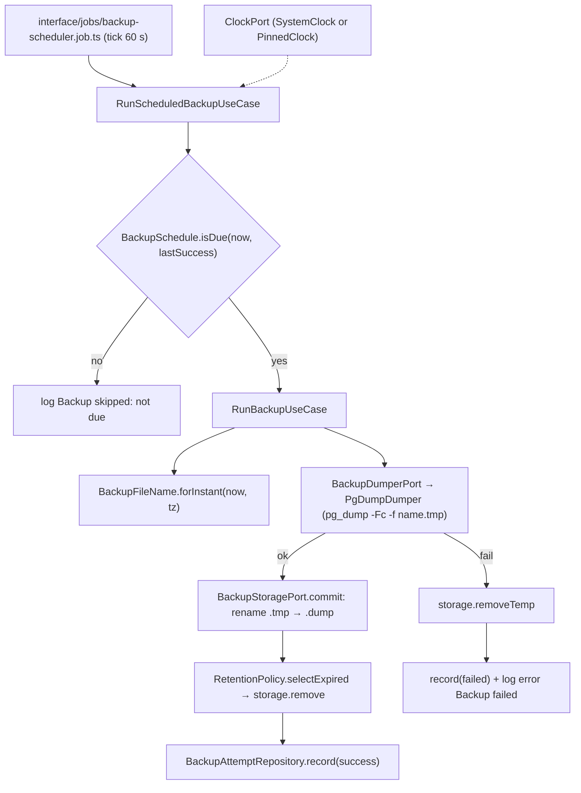
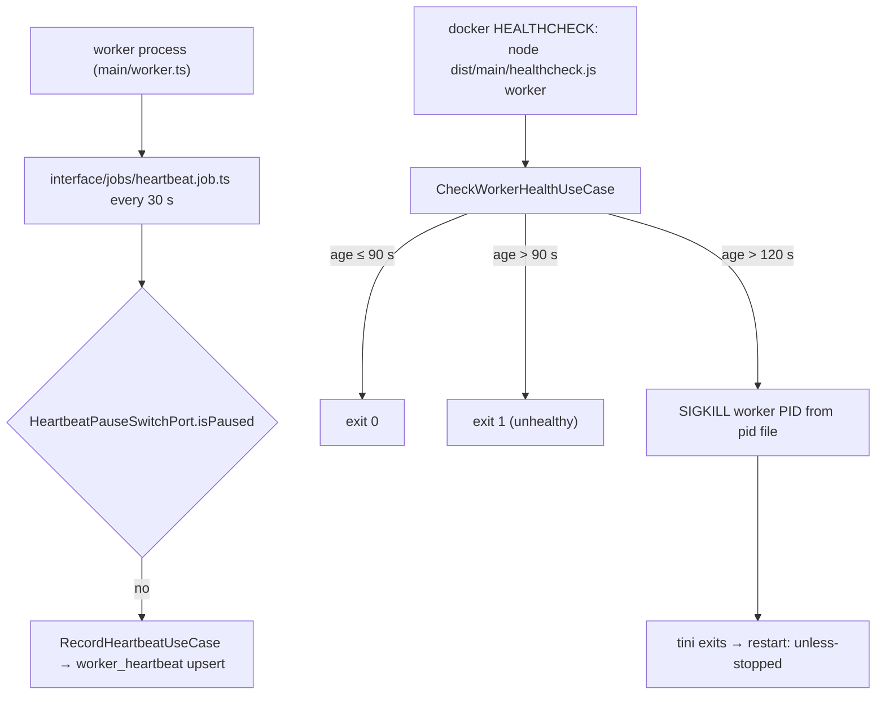
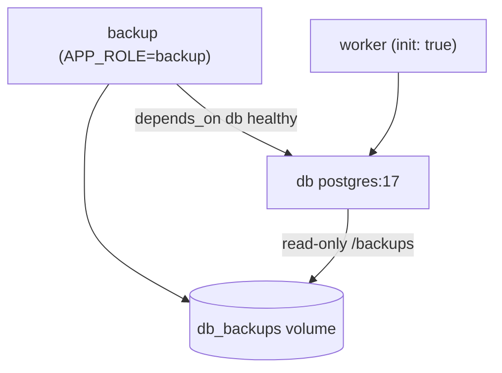

# Spec: F15. Backup and Operations

**Complexity:** medium (backup role, worker heartbeat, two tables, one endpoint, restore script, compose and image changes)

## 1. Technical Overview

**What:** F15 adds the operational layer of the local production stack. It has five parts:

- A `backup` service that runs `pg_dump -Fc` once a day at 03:00 America/Sao_Paulo. Each dump goes to the `db_backups` volume as `creator-insights-YYYYMMDD-HHmm.dump`. A dump is written to a `.tmp` file first and renamed when it completes. Files older than 30 days are deleted only after a successful dump, and every attempt is recorded in `backup_status`.
- `scripts/restore.sh <file>`, which validates the archive, stops the services that write to the database, restores with `pg_restore --clean --if-exists` in a single transaction, and restarts the services.
- A worker heartbeat stored in `worker_heartbeat`, plus a worker container healthcheck that reports `unhealthy` once the heartbeat is older than 90 s and forces a restart if it stays stale.
- `unless-stopped` restart policies for api, worker, db, and backup.
- `GET /api/v1/ops/status`, which summarizes backups and worker liveness.

**Why:** F01 left two stopgaps. The worker's health is only a ready-marker file, so a hung worker still looks healthy, and nothing protects the database from operator mistakes. F15 replaces the marker with a database-backed heartbeat and adds a tested backup/restore path. The backup scheduling, naming, retention, and staleness rules sit in the domain layer and read time through F01's `ClockPort`, so the PRD's "fixed clock at 03:00" scenario is deterministic in tests and also reachable in a running container through a pinned-clock override.

**Scope:**

**Included:**
- New `backup` application role in the existing backend image (`APP_ROLE=backup`): a scheduler loop that ticks every 60 s, a one-shot mode for operators and tests, and a pinned-clock override for deterministic runs.
- Backup domain rules: file naming in the configured time zone, daily due-check against 03:00 local, 30-day retention selection based on the timestamp in each file name, and the backup attempt record.
- Atomic dump writing (`.tmp`, then rename), temp-file cleanup on failure, JSON `Backup failed` error log, and a `backup_status` row after every attempt.
- `scripts/restore.sh` at the repository root.
- Worker heartbeat: an upsert every 30 s, a role-aware healthcheck for `worker` (stale after 90 s; kills the worker process when the heartbeat is older than 120 s so Docker restarts the container), and a test-only heartbeat pause switch.
- Backup service healthcheck: a liveness file touched on each tick.
- `GET /api/v1/ops/status`.
- Compose changes: `backup` service, `db_backups` volume (read-write in backup, read-only in db at `/backups`), `restart: unless-stopped` on api/worker/db/backup, `init: true` on worker, and worker healthcheck timings.
- Runtime image: `postgresql-client-17` installed so `pg_dump` matches the server major version; `/backups` created and owned by the non-root user.

**Deferred / owned elsewhere:**
- Closing collection runs left open by a restarted worker. Orphan recovery belongs to F06; F15 only gets the worker restarted.
- Session protection of `/api/v1/ops/status`. The route is registered without a public flag, so it follows whatever route-protection default exists in the build (F02).
- Off-machine backups (PRD Out of Scope).
- CI execution of the container-level checks (F16).

**Input contracts (Consumes):** none from features. From F01 F15 uses `ClockPort`, `LoggerPort`, the Drizzle client and migrator, the error envelope, the `HttpRoute` descriptor and route builder, the Awilix container, the role entrypoint and healthcheck, the Dockerfile, and the compose files.

**Output contracts (Provides):**
- `GET /api/v1/ops/status` → `{ lastBackupAt, lastBackupSizeBytes, lastBackupError, workerLastSeenAt }`.
- `worker_heartbeat` and `backup_status` tables.
- The `backup` compose service, the `db_backups` volume, and `scripts/restore.sh`.

**Integrated cross-cutting concerns:** structured JSON logs (pino, from F01) for every backup outcome and heartbeat failure; secrets kept out of logs (no database URL or password in `pg_dump` arguments or log lines); time read only through `ClockPort`.

## 2. Architecture Impact

**Affected F01 components:** `src/config/env.ts` (new variables, `APP_ROLE` gains `backup`, `WORKER_READY_FILE` removed), `src/main/entrypoint.ts` (dispatches `backup`), `src/main/worker.ts` (heartbeat job replaces the ready marker), `src/main/healthcheck.ts` (worker heartbeat check and backup liveness check), `src/main/container.ts`, `src/interface/http/routes.ts`, `src/infrastructure/db/schema/schema.ts`, `scripts/check-architecture.ts` (accepts `interface/jobs/*.job.ts`), `knip.json` (adds the `backup` entry), `docker/Dockerfile`, `docker-compose.yml`, `docker/docker-compose.e2e.yml`, `.env.example`.

**Backup flow:**



**Heartbeat and restart flow:**



**Restore flow (`scripts/restore.sh <file>`):** argument check → file exists in `/backups` inside `db` → `pg_restore --list` validation (no service touched on failure) → `docker compose stop api worker backup` → `pg_restore --clean --if-exists --single-transaction --no-owner` → `docker compose start api worker backup` → wait for api and worker to be healthy.

**Compose topology additions (local production):**



## 3. Technical Decisions

| Decision | Chosen Approach | Alternative Considered | Trade-off |
|---|---|---|---|
| Backup runtime | `backup` role of the existing backend image (`APP_ROLE=backup`), with `postgresql-client-17` from the PGDG apt repository installed in the runtime stage | Plain `postgres:17` image running a shell loop (PRD wording) | The image grows by about 15 MB and the PRD's literal "image postgres:17" is not used. In return, scheduling, naming, retention, and status recording run as typed domain and use-case code with unit tests and `ClockPort`, which the "fixed clock at 03:00" AC needs. `pg_dump` 17 still matches the server major version. |
| Scheduling | A 60-second tick loop calls `BackupSchedule.isDue(now, lastSuccessLocalDate)`. A backup is due when local time (America/Sao_Paulo) is at or past 03:00 and no successful backup exists for that local date | Sleeping until the next 03:00 | A missed 03:00 (container down) is caught up the same day, and a restart doesn't cause a second dump. The tick costs one indexed query per minute. |
| Deterministic clock in containers | `BACKUP_CLOCK_FIXED_AT` (ISO-8601 instant, optional) makes the container register `PinnedClock` instead of `SystemClock` for the backup role only | Faking time with `libfaketime` | The override is explicit, scoped to one role, and visible in config. It has to stay unset in production, and `.env.example` documents it as test-only. |
| One-shot mode | `BACKUP_RUN_ONCE=true` runs one scheduled tick and exits: 0 when the dump succeeded or was not due, 1 when it failed | Separate `backup-once` binary | Operators and tests share one code path with the loop. |
| Atomic write | `pg_dump -Fc -f <name>.tmp`, then `fs.rename` to `<name>.dump` on the same volume. Any failure removes `<name>.tmp`. On startup, leftover `*.tmp` files from a crash are removed | Write directly to `.dump` | Rename is atomic within a filesystem, so a `.dump` file is always complete. |
| Retention basis | Age comes from the timestamp in the file name (`YYYYMMDD-HHmm`, local time), compared with `ClockPort.now()`. Only names matching `^creator-insights-\d{8}-\d{4}\.dump$` are considered | File mtime | Results are deterministic with a pinned clock and unaffected by `cp`/restore touching mtimes. Unrelated files in the volume are never deleted. |
| Credentials for `pg_dump` | `PgDumpDumper` parses `DATABASE_URL` into `PGHOST`/`PGPORT`/`PGUSER`/`PGPASSWORD`/`PGDATABASE` child-process env vars. Arguments contain no secrets | Passing the URL as `--dbname` | The password doesn't appear in the process list or in error output that echoes arguments. |
| Heartbeat storage | Single-row `worker_heartbeat` (`id = 1`) upserted every 30 s with `ClockPort.now()` | pg-boss liveness or a file | Visible to `/ops/status` from the api container and survives worker restarts. |
| Unhealthy → restart | Compose healthcheck (`interval: 15s`, `timeout: 5s`, `retries: 1`, `start_period: 30s`) exits 1 when age > 90 s. When age > 120 s, the healthcheck also sends `SIGKILL` to the worker PID read from `WORKER_RUNTIME_DIR/worker.pid`. `init: true` makes tini PID 1, so the kill exits the container and `unless-stopped` restarts it | `autoheal` sidecar with the Docker socket mounted | Plain Docker never restarts a container just because it is unhealthy. Killing from the healthcheck avoids exposing the Docker socket. The 30-second gap between "unhealthy" and "killed" keeps the unhealthy state observable. |
| Healthcheck with DB unreachable | Worker healthcheck exits 1 (unhealthy) but does not kill, because heartbeat age is unknown | Kill on any failure | A database outage doesn't trigger a restart loop on the worker. |
| Test-only heartbeat pause | When `TEST_ROUTES_ENABLED=true`, the heartbeat job skips writes while the file `WORKER_RUNTIME_DIR/heartbeat-paused` exists. `WORKER_RUNTIME_DIR` is a tmpfs mount (`/run/worker`), so a container restart clears it | Freezing the event loop with a debug route | This simulates a hung worker without touching production code paths, and the restarted container recovers on its own. |
| Restore safety | Validate with `pg_restore --list` before stopping anything; restore with `--single-transaction` so a mid-restore error rolls back to the original data; always restart the stopped services (trap on exit) | `--clean` without a transaction | A restore needs as much free WAL/disk as the restore itself, which is acceptable for this database size. |
| `/ops/status` derivation | `lastBackupAt` and `lastBackupSizeBytes` come from the latest successful attempt. `lastBackupError` is the latest attempt's error when that attempt failed, otherwise `null`. `workerLastSeenAt` comes from `worker_heartbeat` | Only the latest attempt | A failure after a good backup still shows when the last good backup happened. |

### Assumptions

Batch-mode Auto-Accept decisions (policy row in parentheses), for later review:

- **Backend image instead of `postgres:17` for the `backup` service** ("Technical decisions with a clear recommendation"). The `db` container (`postgres:17`) still provides `pg_restore` for `scripts/restore.sh`.
- **Restart policy** (PRD Capabilities): `restart: unless-stopped` replaces F01's `on-failure:3` for api, worker, db, and backup in `docker-compose.yml`. A permanently failing migration now restarts indefinitely instead of stopping after 3 attempts. The PRD's F15 capability takes precedence over F01's error-handling wording.
- **Pinned-clock and one-shot knobs** ("Partial PRD specifications"): `BACKUP_CLOCK_FIXED_AT` and `BACKUP_RUN_ONCE` are the mechanism behind "With a fixed clock at 03:00". `.env.example` marks both as test/operator-only.
- **Time zone:** `BACKUP_TIMEZONE` defaults to `TZ_COLLECTION` (`America/Sao_Paulo`). Brazil has had no DST since 2019, so 03:00 local is 06:00 UTC. The domain still converts through `Intl.DateTimeFormat` so it doesn't hard-code an offset.
- **File name time:** local time of the pinned or system clock at dump start, minute precision (`HHmm`). Two successful dumps in the same minute cannot happen because the due-check is once per local day.
- **"Older than 30 days"** means the file-name timestamp is strictly more than 30 × 24 h before `now`. A file exactly 30 days old is kept.
- **Heartbeat timings** are configurable for tests but default to the PRD values: `WORKER_HEARTBEAT_INTERVAL_SECONDS=30`, `WORKER_HEARTBEAT_STALE_SECONDS=90`, `WORKER_KILL_AFTER_SECONDS=120`.
- **`/ops/status` path and protection:** `/api/v1/ops/status`, following F01's `/api/v1` prefix and F02's reading of PRD paths. The route is registered without `auth: "public"`, so it is protected once F02's route protection is in the build and open in an F01 + F15 build.
- **Restore script exit codes:** `0` restored, `2` usage error, `3` file not found in the backups volume, `4` archive failed validation (no service stopped), `5` restore failed and rolled back (services restarted). It honours `COMPOSE_FILE` / `COMPOSE_PROJECT_NAME`, so it works against the production and e2e stacks.
- **Restore stops the backup service too** (in addition to the PRD's api and worker), so a scheduled dump cannot run against a half-restored database.
- **`backup_status` rows are never pruned** in v1 (one or two rows a day).
- **New interface folder:** `src/interface/jobs/` is created here for the timer-driven `heartbeat.job.ts` and `backup-scheduler.job.ts`. F06 later adds pg-boss jobs to the same folder. `scripts/check-architecture.ts` gains the `interface/jobs/*.job.ts` suffix rule.
- **Project conventions reused from F01/F02:** layout `apps/backend/src/{domain,application,infrastructure,interface,main}`; repository interfaces in `src/domain/<area>/`; ports in `src/application/ports/`; fixtures under `apps/backend/test/fixtures/`; persistent state through the migrator plus helpers in `apps/backend/test/helpers/`; test config in `apps/backend/.env.test`; named fakes in `apps/backend/test/fakes/`.
- **Quality gates** ("Quality gates — detected"): the same three gates declared by the F01 and F02 contracts are auto-included: `node scripts/run-gates.mjs` (the consolidated clean-arch wrapper required by CLAUDE.md/AGENTS.md), `npm test`, and `docker compose -f docker/docker-compose.test.yml run --rm test`.
- **Contract surfaces** ("Contract surface set ambiguous"): HTTP API (`/ops/status`), CLI (backup run, restore script), Worker (heartbeat writes), and the custom `Deployment` surface introduced by F01 (container health, restart, policies). No `Service` section, because no feature outside F15 consumes its use cases.
- **Disk-full simulation** for verification: the backups directory is mounted as a small tmpfs (256 KiB) while the database holds more than 1 MiB of incompressible data, so `pg_dump` hits `ENOSPC` partway through the write.

### PRD Traceability

| PRD block | Spec destination |
|---|---|
| Capabilities: backup service, schedule, naming, retention | §1 Included; §3 runtime/scheduling/retention decisions; §4 backup components |
| Capabilities: `.tmp` + rename, failure log | §3 atomic write decision; Error Handling |
| Capabilities: `scripts/restore.sh` | §2 restore flow; §3 restore safety; §4 repository root |
| Capabilities: worker heartbeat, healthchecks | §2 heartbeat flow; §3 heartbeat decisions; §6 `worker_heartbeat` |
| Capabilities: restart policy | §4 compose changes; Assumptions |
| Capabilities: `GET /ops/status`, `backup_status` | §5 API Contracts; §6 `backup_status` |
| Experience | §4 compose healthchecks for every service; retention keeps ≤ 30 daily dumps |
| Error Handling | Error Handling table below |

### Error Handling

| Condition | Behavior |
|---|---|
| `pg_dump` exits non-zero (disk full, DB unreachable, auth failure) | `<name>.tmp` removed; no `.dump` created for this attempt; existing dumps untouched; retention not run; `backup_status` row `failed` with `error_message` (stderr tail ≤ 500 chars, no credentials); log `{"level":"error","msg":"Backup failed","file":"<name>.dump","reason":"<message>"}`; one-shot mode exits 1; loop mode continues and retries on the next tick (the next attempt is due again because no success exists for the day). |
| Rename fails | Same as a dump failure; the `.tmp` is removed. |
| Retention delete fails for one file | Logged at `warn` with the file name and reason; the attempt stays `success`; other files are still processed. |
| `backup_status` insert fails | Logged at `error` with `msg: "Backup status not recorded"`; the dump file is kept. |
| Leftover `*.tmp` at backup role start | Removed and logged at `warn` (`Removed stale temp backup <name>`). |
| Invalid `BACKUP_CLOCK_FIXED_AT` / `BACKUP_TIMEZONE` / numeric knobs | Boot fails through F01's config validation with an exit code 1 and messages such as `BACKUP_CLOCK_FIXED_AT: must be an ISO-8601 instant (got "tomorrow")`. |
| Restore without an argument | Prints `Usage: scripts/restore.sh <backup-file-name>` and lists available dumps; exit 2. |
| Restore with a file not in the volume | `Backup file not found in db_backups: <name>`; exit 3; no service touched. |
| Restore with an invalid archive | `pg_restore --list` fails → `Invalid backup archive <name>: <reason>`; exit 4; no service stopped; data unchanged. |
| `pg_restore` fails during the restore | Single transaction rolls back; services restarted; `Restore failed, original data kept: <reason>`; exit 5. |
| Heartbeat write fails (DB down) | Logged at `error` (`Heartbeat not recorded`); the worker keeps running; the heartbeat goes stale; the healthcheck reports unhealthy without killing while the DB is unreachable. |
| Heartbeat stale > 120 s with DB reachable | Healthcheck kills the worker; Docker restarts it; orphaned runs are F06's responsibility. |
| `GET /ops/status` with no data | 200 with all four fields `null`. |

## 4. Component Overview

**Repository root and containers:**

| File Path | New/Modified | Purpose | Key Responsibilities |
|---|---|---|---|
| `scripts/restore.sh` | New | Restore command | Arg/usage check; existence and `pg_restore --list` validation inside `db`; stop api/worker/backup; single-transaction `pg_restore --clean --if-exists --no-owner`; trap-based restart; wait for health; documented exit codes |
| `docker-compose.yml` | Modified | Local production | `backup` service (backend image, `APP_ROLE=backup`, `/backups` volume, healthcheck, `depends_on: db healthy`); `db` mounts `db_backups:/backups:ro`; worker `init: true`, `tmpfs: /run/worker`, healthcheck timings; `restart: unless-stopped` on api/worker/db/backup; `db_backups` volume |
| `docker/docker-compose.e2e.yml` | Modified | E2E topology | Same `backup` service and volume wiring, plus worker tmpfs and healthcheck, so ops checks run in the e2e stack |
| `docker/docker-compose.backup-diskfull.yml` | New | Test overlay | For `backup` only: `/backups` as a 256 KiB tmpfs owned by the runtime user; mounts `apps/backend/test/fixtures/backups/aged/` read-only at `/seed-backups`; its entrypoint copies the seed files into `/backups`, runs one pinned one-shot backup, prints `BACKUPS-AFTER:` followed by one file name per line, and exits with the backup's exit code |
| `docker/Dockerfile` | Modified | Runtime image | Install `postgresql-client-17` (PGDG apt repo) in `runtime`; create `/backups` and `/run/worker` owned by `node` |
| `.env.example` | Modified | Config docs | Documents every F15 variable; marks `BACKUP_CLOCK_FIXED_AT` / `BACKUP_RUN_ONCE` as test/operator-only |
| `README.md` | Modified | Operator docs | "Backups and restore" section: listing dumps, running a one-shot backup, `scripts/restore.sh` usage and exit codes |

**Backend source (`apps/backend/src/`):**

| File Path | New/Modified | Purpose | Key Responsibilities |
|---|---|---|---|
| `config/env.ts` | Modified | Config | `APP_ROLE` enum adds `backup`; adds `BACKUP_DIR` (default `/backups`), `BACKUP_SCHEDULE_TIME` (`HH:mm`, default `03:00`), `BACKUP_TIMEZONE` (IANA, default `TZ_COLLECTION`), `BACKUP_RETENTION_DAYS` (int ≥ 1, default 30), `BACKUP_TICK_SECONDS` (default 60), `BACKUP_RUN_ONCE` (bool, default false), `BACKUP_CLOCK_FIXED_AT` (optional ISO instant), `WORKER_RUNTIME_DIR` (default `/run/worker`), `WORKER_HEARTBEAT_INTERVAL_SECONDS` (30), `WORKER_HEARTBEAT_STALE_SECONDS` (90), `WORKER_KILL_AFTER_SECONDS` (120, must be > stale); removes `WORKER_READY_FILE` |
| `domain/ops/backup-file-name.vo.ts` | New | File name VO | `forInstant(instant, timeZone)` → `creator-insights-YYYYMMDD-HHmm.dump`; `parse(name)` → local timestamp or null; `tempName` |
| `domain/ops/backup-schedule.ts` | New | Due rule | `isDue({ now, timeZone, scheduleTime, lastSuccessAt })` |
| `domain/ops/retention-policy.ts` | New | Retention rule | `selectExpired(names, now, retentionDays, timeZone)` → names strictly older than the window; ignores non-matching names |
| `domain/ops/backup-attempt.entity.ts` | New | Attempt record | `succeeded({ startedAt, finishedAt, fileName, sizeBytes })`, `failed({ startedAt, finishedAt, fileName, error })`; invariants (success ⇒ file and size) |
| `domain/ops/heartbeat-staleness.ts` | New | Staleness rule | `assess({ lastSeenAt, now, staleSeconds, killAfterSeconds })` → `healthy` \| `stale` \| `kill` |
| `domain/ops/backup-attempt.repository.ts` | New | Write/read port | `record(attempt)`, `latestSuccess()`, `latestAttempt()` |
| `domain/ops/worker-heartbeat.repository.ts` | New | Port | `beat(at, instance)`, `lastSeen()` |
| `domain/ops/errors.ts` | New | Errors | `BackupDumpFailedError` (file name + reason), `InvalidBackupFileNameError` (value + expected pattern) |
| `application/ports/backup-dumper.port.ts` | New | Dump port | `dump(targetPath): Promise<void>`; throws `BackupDumpFailedError` |
| `application/ports/backup-storage.port.ts` | New | Storage port | `list()`, `tempPath(name)`, `commit(name)`, `removeTemp(name)`, `remove(name)`, `sizeOf(name)`, `removeStaleTemps()` |
| `application/ports/heartbeat-pause-switch.port.ts` | New | Test hook port | `isPaused(): Promise<boolean>` |
| `application/use-cases/ops/run-backup.usecase.ts` | New | One backup | Name → dump to temp → commit → size → retention → record success; on failure remove temp, record failure, log `Backup failed`, rethrow |
| `application/use-cases/ops/run-scheduled-backup.usecase.ts` | New | Tick | Reads latest success; asks `BackupSchedule`; delegates or returns `not_due` |
| `application/use-cases/ops/record-heartbeat.usecase.ts` | New | Heartbeat | Skips when paused; upserts `now` |
| `application/use-cases/ops/check-worker-health.usecase.ts` | New | Health verdict | Reads last seen; returns `healthy` / `stale` / `kill` / `unknown` |
| `application/use-cases/ops/get-ops-status.usecase.ts` | New | Status read | Combines latest success, latest attempt, heartbeat |
| `application/dto/ops/*.dto.ts` | New | DTOs | `RunBackupOutput`, `ScheduledBackupOutcome`, `WorkerHealthVerdict`, `OpsStatusOutput` |
| `infrastructure/backup/pg-dump-dumper.ts` | New | Dump adapter | Spawns `pg_dump -Fc --no-owner -f <tmp>` with PG* env from `DATABASE_URL`; captures stderr tail; maps exit code to `BackupDumpFailedError` |
| `infrastructure/backup/fs-backup-storage.ts` | New | Storage adapter | `node:fs/promises` over `BACKUP_DIR`; rename-commit; stat size; regex-filtered listing |
| `infrastructure/backup/backup-liveness-file.ts` | New | Liveness | Touch and read the mtime of the liveness file `/tmp/backup-alive` |
| `infrastructure/clock/pinned-clock.ts` | New | Clock impl | Returns the configured instant; used only when `BACKUP_CLOCK_FIXED_AT` is set |
| `infrastructure/heartbeat/pause-file-switch.ts` | New | Pause impl | `isPaused` = pause file exists in `WORKER_RUNTIME_DIR` |
| `infrastructure/heartbeat/never-paused-switch.ts` | New | Default impl | Always `false` (wired when `TEST_ROUTES_ENABLED=false`) |
| `infrastructure/process/pid-file.ts` | New | PID file | Write own PID at worker boot; read + `process.kill(pid, "SIGKILL")` for the healthcheck |
| `infrastructure/db/backup-attempt.drizzle-repository.ts` | New | Repo impl | Insert; latest success; latest attempt (ordered by `finished_at desc`) |
| `infrastructure/db/worker-heartbeat.drizzle-repository.ts` | New | Repo impl | `INSERT … ON CONFLICT (id) DO UPDATE`; select single row |
| `infrastructure/db/schema/backup-status.schema.ts`, `worker-heartbeat.schema.ts` | New | Drizzle tables | See §6 |
| `infrastructure/db/schema/schema.ts` | Modified | Aggregate | Re-exports the two tables |
| `infrastructure/db/migrations/<next>_backup_ops.sql` + `meta/` | New | Migration | Creates both tables (next journal index after the existing migrations) |
| `interface/jobs/heartbeat.job.ts` | New | Timer job | Immediate beat, then every interval; error logged, never throws out of the timer |
| `interface/jobs/backup-scheduler.job.ts` | New | Timer job | Tick loop or single tick (`BACKUP_RUN_ONCE`); touches liveness; returns exit code in once mode |
| `interface/http/ops/get-ops-status.handler.ts` | New | Handler | Calls the use case; maps dates to ISO strings |
| `interface/http/ops/ops.routes.ts` | New | Route | `GET /ops/status` with Zod response schema (appears in OpenAPI) |
| `interface/http/routes.ts` | Modified | Route builder | Adds ops routes |
| `main/backup.ts` | New | Backup role | Connect with retry → remove stale temps → start scheduler job (or run once and exit) → SIGTERM handling |
| `main/worker.ts` | Modified | Worker role | Writes the PID file, starts the heartbeat job (replacing the ready marker), and stops it on SIGTERM |
| `main/entrypoint.ts` | Modified | Dispatch | `backup` role |
| `main/healthcheck.ts` | Modified | Healthcheck | `worker`: short-lived pool (2 s timeout) → verdict → exit 0/1 printing `Heartbeat stale: <age>s > 90s` (or `Heartbeat unknown: <reason>`) on failure, kill on `kill`; `backup`: liveness file fresher than 3 × tick; `api` unchanged |
| `main/container.ts` | Modified | Composition | Registers ops repos, dumper, storage, clock choice per role, pause switch choice, use cases, handler, routes |

**Database:**

| Migration File | Tables Affected | Operation | Notes |
|---|---|---|---|
| `src/infrastructure/db/migrations/<next>_backup_ops.sql` | `backup_status`, `worker_heartbeat` | CREATE | Applied by F01's migrator on api boot |

## 5. API Contracts

### Endpoint: Operations status

- **Method:** GET
- **Path:** `/api/v1/ops/status`
- **Authentication:** follows the build's default route protection (not marked public)

**Request:** no parameters.

**Response (200):**

| Field | Type | Description |
|---|---|---|
| `lastBackupAt` | `string (ISO-8601) \| null` | `finished_at` of the latest successful attempt |
| `lastBackupSizeBytes` | `integer \| null` | Size of that dump in bytes |
| `lastBackupError` | `string \| null` | Error message of the latest attempt when it failed; `null` when the latest attempt succeeded or none exist |
| `workerLastSeenAt` | `string (ISO-8601) \| null` | `worker_heartbeat.last_seen_at` |

```json
{
  "lastBackupAt": "2026-01-06T06:00:41.000Z",
  "lastBackupSizeBytes": 184320,
  "lastBackupError": null,
  "workerLastSeenAt": "2026-01-06T11:59:45.000Z"
}
```

After a failed attempt that follows a good one:

```json
{
  "lastBackupAt": "2026-01-05T06:00:39.000Z",
  "lastBackupSizeBytes": 183296,
  "lastBackupError": "pg_dump: error: could not write to output file: No space left on device",
  "workerLastSeenAt": "2026-01-06T11:59:45.000Z"
}
```

**Error Codes:**

| Code | HTTP Status | Description |
|---|---|---|
| `UNAUTHENTICATED` | 401 | Only when F02's route protection is present and no valid session is sent |
| `INTERNAL` | 500 | Unexpected failure (F01 envelope) |

## 6. Data Model

**Table: `backup_status`**

| Column | Type | Nullable | Default | Description |
|---|---|---|---|---|
| `id` | `uuid` | No | - | UUID v7 from `Id.generate()` |
| `started_at` | `timestamptz` | No | - | Attempt start (`ClockPort`) |
| `finished_at` | `timestamptz` | No | - | Attempt end (`ClockPort`) |
| `outcome` | `varchar(16)` | No | - | `success` \| `failed` |
| `file_name` | `varchar(64)` | Yes | - | Final `.dump` name (target name on failure) |
| `size_bytes` | `bigint` | Yes | - | Set on success |
| `error_message` | `text` | Yes | - | Set on failure; ≤ 500 chars, no credentials |

**Indexes:**

| Index Name | Columns | Type | Purpose |
|---|---|---|---|
| `ix_backup_status_finished_at` | `finished_at DESC` | btree | Latest attempt |
| `ix_backup_status_success_finished_at` | `finished_at DESC` WHERE `outcome = 'success'` | btree partial | Latest success (due-check every tick, `/ops/status`) |

**Constraints:**

| Constraint | Type | Definition | Purpose |
|---|---|---|---|
| `pk_backup_status` | PRIMARY KEY | `id` | Identity |
| `ck_backup_status_outcome` | CHECK | `outcome IN ('success','failed')` | Enum |
| `ck_backup_status_success_fields` | CHECK | `outcome <> 'success' OR (file_name IS NOT NULL AND size_bytes IS NOT NULL)` | Success carries file and size |
| `ck_backup_status_failed_fields` | CHECK | `outcome <> 'failed' OR error_message IS NOT NULL` | Failure carries a reason |

**Table: `worker_heartbeat`**

| Column | Type | Nullable | Default | Description |
|---|---|---|---|---|
| `id` | `smallint` | No | `1` | Single-row key |
| `last_seen_at` | `timestamptz` | No | - | Last beat (`ClockPort`) |
| `instance` | `varchar(128)` | No | - | Container hostname, for diagnosing restarts |
| `started_at` | `timestamptz` | No | - | Boot time of the instance that wrote the row |

| Constraint | Type | Definition | Purpose |
|---|---|---|---|
| `pk_worker_heartbeat` | PRIMARY KEY | `id` | Upsert target |
| `ck_worker_heartbeat_single_row` | CHECK | `id = 1` | Exactly one row |

**Migration (`<next>_backup_ops.sql`):**

```sql
CREATE TABLE backup_status (
    id UUID PRIMARY KEY,
    started_at TIMESTAMPTZ NOT NULL,
    finished_at TIMESTAMPTZ NOT NULL,
    outcome VARCHAR(16) NOT NULL,
    file_name VARCHAR(64),
    size_bytes BIGINT,
    error_message TEXT,
    CONSTRAINT ck_backup_status_outcome CHECK (outcome IN ('success', 'failed')),
    CONSTRAINT ck_backup_status_success_fields CHECK (outcome <> 'success' OR (file_name IS NOT NULL AND size_bytes IS NOT NULL)),
    CONSTRAINT ck_backup_status_failed_fields CHECK (outcome <> 'failed' OR error_message IS NOT NULL)
);

CREATE INDEX ix_backup_status_finished_at ON backup_status (finished_at DESC);
CREATE INDEX ix_backup_status_success_finished_at ON backup_status (finished_at DESC) WHERE outcome = 'success';

CREATE TABLE worker_heartbeat (
    id SMALLINT PRIMARY KEY DEFAULT 1,
    last_seen_at TIMESTAMPTZ NOT NULL,
    instance VARCHAR(128) NOT NULL,
    started_at TIMESTAMPTZ NOT NULL,
    CONSTRAINT ck_worker_heartbeat_single_row CHECK (id = 1)
);
```

## 7. Testing Strategy

**Test File Structure:**

| Test File | Test Type | Target | Coverage Goal |
|---|---|---|---|
| `test/unit/domain/ops/backup-file-name.vo.spec.ts` | Unit | `BackupFileName` | 100% |
| `test/unit/domain/ops/backup-schedule.spec.ts` | Unit | `BackupSchedule` | 100% |
| `test/unit/domain/ops/retention-policy.spec.ts` | Unit | `RetentionPolicy` | 100% |
| `test/unit/domain/ops/backup-attempt.entity.spec.ts` | Unit | `BackupAttempt` | 100% |
| `test/unit/domain/ops/heartbeat-staleness.spec.ts` | Unit | `HeartbeatStaleness` | 100% |
| `test/unit/application/use-cases/ops/run-backup.usecase.spec.ts` | Unit | `RunBackupUseCase` | 95% |
| `test/unit/application/use-cases/ops/run-scheduled-backup.usecase.spec.ts` | Unit | `RunScheduledBackupUseCase` | 95% |
| `test/unit/application/use-cases/ops/record-heartbeat.usecase.spec.ts` | Unit | `RecordHeartbeatUseCase` | 100% |
| `test/unit/application/use-cases/ops/check-worker-health.usecase.spec.ts` | Unit | `CheckWorkerHealthUseCase` | 100% |
| `test/unit/application/use-cases/ops/get-ops-status.usecase.spec.ts` | Unit | `GetOpsStatusUseCase` | 100% |
| `test/unit/config/env.ops.spec.ts` | Unit | F15 config parsing | 100% |
| `test/integration/infrastructure/backup/pg-dump-dumper.spec.ts` | Integration | Real `pg_dump` vs test DB | 85% |
| `test/integration/infrastructure/backup/fs-backup-storage.spec.ts` | Integration | Temp dir filesystem | 90% |
| `test/integration/infrastructure/db/backup-attempt.drizzle-repository.spec.ts` | Integration | Repo vs Postgres | 90% |
| `test/integration/infrastructure/db/worker-heartbeat.drizzle-repository.spec.ts` | Integration | Repo vs Postgres | 90% |
| `test/integration/interface/http/ops-status.spec.ts` | Integration | `GET /ops/status` via `app.inject` | — |
| `test/integration/interface/jobs/heartbeat.job.spec.ts` | Integration | Timer job with fake timers + pause switch | — |
| `test/integration/main/backup-role.spec.ts` | Integration | Spawned `APP_ROLE=backup BACKUP_RUN_ONCE=true` with pinned clock | — |

**Fakes (named classes in `test/fakes/`, no inline stubs):** `FakeBackupDumper` (writes N bytes or fails with a configured reason, optionally after a partial write), `InMemoryBackupStorage` (tracks temp/final names and sizes), `InMemoryBackupAttemptRepository`, `InMemoryWorkerHeartbeatRepository`, `StaticHeartbeatPauseSwitch`, `CapturingLogger` (`LoggerPort`), plus F01's `FixedClock`.

**Key test functions:**

| Test Function | Description | Assertions |
|---|---|---|
| `BackupFileName › formats in Sao Paulo time` | `2026-01-06T06:00:00Z` | `creator-insights-20260106-0300.dump` |
| `BackupFileName › parse rejects foreign names` | `notes.txt`, `creator-insights-2026.dump` | `null` |
| `BackupSchedule › due at 03:00 with no success today` | Clock 03:00 local, last success yesterday | `true` |
| `BackupSchedule › not due before 03:00` | 02:59 local | `false` |
| `BackupSchedule › not due after today's success` | 03:05 local, success at 03:00 today | `false` |
| `BackupSchedule › catches up later the same day` | 14:00 local, last success yesterday | `true` |
| `RetentionPolicy › selects strictly older than 30 days` | Files at 29 d, 30 d, 31 d, 45 d | Returns 31 d and 45 d only |
| `RetentionPolicy › ignores non-matching names` | `notes.txt` | Not selected |
| `BackupAttempt › success requires file and size` | Missing size | Throws with the offending value |
| `HeartbeatStaleness › thresholds` | Ages 89, 91, 121 s | `healthy`, `stale`, `kill` |
| `RunBackupUseCase › success commits and prunes` | Fakes + FixedClock | Final name present, temp absent, expired removed, success recorded with size |
| `RunBackupUseCase › failure keeps old files` | Dumper fails after partial write | Temp removed, no final, old files intact, failure recorded, `Backup failed` logged at error, retention not called |
| `RunBackupUseCase › retention delete failure is non-fatal` | Storage `remove` throws once | Attempt recorded as success; warn logged |
| `RunScheduledBackupUseCase › not due returns not_due` | 02:59 | Dumper never called |
| `RecordHeartbeatUseCase › paused skips write` | Pause switch on | Repo untouched |
| `CheckWorkerHealthUseCase › unknown when repo throws` | Repo rejects | `unknown` (no kill) |
| `GetOpsStatusUseCase › failure after success` | Success yesterday, failure today | `lastBackupAt` = yesterday, `lastBackupError` = today's reason |
| `GetOpsStatusUseCase › empty` | No rows | All `null` |
| `pg-dump-dumper › produces a restorable archive` | Real test DB | `pg_restore --list` on output exits 0 |
| `pg-dump-dumper › wrong credentials fail without leaking password` | Bad password URL | `BackupDumpFailedError`; message lacks the password |
| `fs-backup-storage › commit is atomic rename` | Temp written then committed | Only `.dump` remains; size matches |
| `fs-backup-storage › removeStaleTemps` | Leftover `.tmp` | Removed |
| `ops-status route › 200 shape` | Seeded rows | Body per §5; OpenAPI lists `/api/v1/ops/status` |
| `heartbeat job › beats immediately and every interval` | Fake timers | Repo `beat` called at 0 s, 30 s, 60 s |
| `backup role › pinned 03:00 run creates restorable dump` | Spawned process, temp `BACKUP_DIR` | Exit 0; `creator-insights-20260106-0300.dump` exists; `backup_status` success row |
| `env › rejects kill-after ≤ stale` | 90/90 | Invalid list names `WORKER_KILL_AFTER_SECONDS` with expected shape |

**Container-level verification (scripted against the compose stacks):** pinned-clock one-shot backup followed by `scripts/restore.sh` round-trip; restore with an invalid archive leaves services running; disk-full one-shot with a 256 KiB tmpfs; worker heartbeat pause → `unhealthy` → restart; `docker inspect` restart policies.
