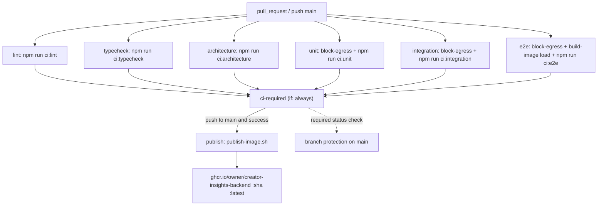
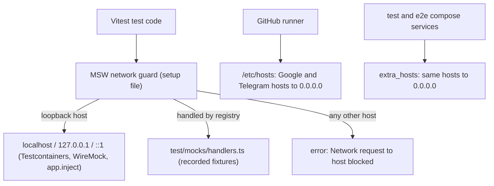

# Spec: F16. CI/CD Pipeline

**Complexity:** medium (several components across the workflow, shell scripts, the test runner config, and compose files; integrations with GitHub Actions and GHCR; no endpoints or schema changes)

## 1. Technical Overview

**What:** F16 adds a GitHub Actions workflow `.github/workflows/ci.yml` that runs on every `pull_request` and on `push` to `main`. It has six check jobs (`lint`, `typecheck`, `architecture`, `unit`, `integration`, `e2e`), an aggregate `ci-required` job that branch protection on `main` requires, and a `publish` job that pushes the multi-stage backend image to `ghcr.io/<owner>/creator-insights-backend:<sha>` and `:latest`, but only on a green push to `main`. Every check job is a thin wrapper around one root npm script (`npm run ci:<job>`), so the behavior a PR sees in CI can be reproduced on a developer machine with the same command. F16 also adds the test-isolation pieces the PRD requires: an in-process network guard (MSW) in every Vitest project, Testcontainers PostgreSQL 17 for the integration job, DNS black-holing of Google and Telegram hosts on the runner and in test containers, a fixture-anonymization check, and an 80% branch threshold next to F01's 80% line threshold.

**Why:** F01 installed the gates (ESLint, tsc, dependency-cruiser, check-architecture, madge, knip, Vitest coverage thresholds) and the compose topologies, but nothing runs them automatically. Without CI, a PR can merge a domain-to-infrastructure import or a coverage drop, and the local production compose has no published image to pull. Putting each job's logic in a repo script instead of inline YAML keeps the workflow declarative. It also means the contract can exercise every job locally without opening PRs or pushing to `main`.

**Scope:**

**Included:**
- `.github/workflows/ci.yml`: triggers, concurrency, least-privilege permissions, the six check jobs, `ci-required`, and `publish`.
- Root npm scripts `ci:lint`, `ci:typecheck`, `ci:architecture`, `ci:unit`, `ci:integration`, `ci:e2e`, `ci:required`.
- Lint job content: ESLint (`--max-warnings=0`), `prettier --check`, and the fixture-anonymization check.
- Architecture job content: the provided gate runner `node scripts/run-gates.mjs` (dependency-cruiser, check-architecture, madge, knip, plus tsc and ESLint). No replacement gate is created.
- Unit job content: Vitest `unit` project with coverage. Thresholds of 80% lines **and** 80% branches apply per glob to `src/domain/**` and `src/application/**`.
- Integration job content: Vitest `integration` project. A global setup starts a Testcontainers `postgres:17` container when `TESTCONTAINERS_ENABLED=true`, and F01's per-file database helper uses it as the admin URL.
- MSW network guard registered as a setup file in every Vitest project. Requests to non-loopback hosts are rejected with an error naming the host. A shared handler registry (`test/mocks/handlers.ts`) is where later features add recorded YouTube/Telegram handlers.
- Egress blocking: `scripts/ci/block-egress.sh` maps the Google and Telegram API hosts to `0.0.0.0` in the runner's hosts file; the same hosts are mapped through `extra_hosts` in `docker/docker-compose.test.yml` and `docker/docker-compose.e2e.yml`.
- E2E job content: `scripts/ci/run-e2e.sh` brings up `docker/docker-compose.e2e.yml`, runs the Vitest `e2e` project against it, dumps service logs on failure, and always tears the stack down.
- Image build and publish: `scripts/ci/build-image.sh` (buildx, optional GHA layer cache, `load` or `push`) and `scripts/ci/publish-image.sh` (validates inputs, computes the two tags, pushes).
- Required-check aggregation: `apps/backend/scripts/ci/assert-needs-success.ts`, which reads the workflow `needs` context and fails when any of the six jobs did not succeed.
- Branch protection as code: `scripts/ci/configure-branch-protection.sh` (requires `ci-required`, strict, PRs required, admins included).
- npm cache (`actions/setup-node` `cache: npm`) and Docker layer cache (`type=gha`) in the `e2e` and `publish` jobs.

**Deferred / owned elsewhere:**
- The content of the e2e suite (simulated login, manual collection, idea listing, status change, 409 on concurrent collection). Those flows are written by F02, F06 and F13 inside the e2e project this pipeline runs.
- Recorded YouTube and Telegram MSW handlers and their fixtures (`test/fixtures/youtube/`, `test/fixtures/telegram/`). F03, F07, F10, F11 and F14 add them to the handler registry when their adapters exist.
- Deployment of the pulled image. The local production compose pulling from GHCR is F01's `docker-compose.yml`; switching its backend services to `image: ghcr.io/...` is a later operational change.

**Input contracts (Consumes):** F01 deliverables only: root `package.json` and its workspace, `scripts/run-gates.mjs`, the backend `lint`, `typecheck`, `test`, `test:integration` and `test:e2e` scripts, `vitest.config.ts` (projects and coverage), `.dependency-cruiser.cjs`, `knip.json`, `apps/backend/.env.test`, `test/helpers/test-database.ts`, `docker/Dockerfile` (target `runtime`, build arg `APP_VERSION`), `docker/docker-compose.test.yml`, `docker/docker-compose.e2e.yml` (with WireMock), and the fixture `test/fixtures/architecture/domain-imports-drizzle.ts`.

**Output contracts (Provides):**
- The required status check `ci-required` on `main`.
- The image `ghcr.io/<owner>/creator-insights-backend` with tags `<40-char sha>` and `latest`, built from `docker/Dockerfile` target `runtime` with `APP_VERSION=<sha>`.
- The MSW handler registry `apps/backend/test/mocks/handlers.ts` and the network-guard behavior that every later feature's tests inherit.
- The Testcontainers-provided admin database URL injected into F01's per-file test database helper.

## 2. Architecture Impact

**Affected components:**
- `.github/workflows/ci.yml` (new)
- `scripts/ci/` (new): `block-egress.sh`, `run-e2e.sh`, `build-image.sh`, `publish-image.sh`, `configure-branch-protection.sh`, `blocked-hosts.txt`
- `package.json` (root, modified): `ci:*` scripts
- `apps/backend/package.json` (modified): `format:check`, `check:fixtures`, `test:coverage` scripts; devDependencies `msw`, `testcontainers`, `@testcontainers/postgresql`
- `apps/backend/vitest.config.ts` (modified): branch thresholds, setup file, integration global setup
- `apps/backend/test/setup/` (new): `network-guard.ts`, `integration-global-setup.ts`
- `apps/backend/test/mocks/handlers.ts` (new)
- `apps/backend/test/helpers/test-database.ts` (modified): prefers the injected admin URL
- `apps/backend/scripts/ci/` (new): `assert-needs-success.ts`, `check-fixture-anonymization.ts`, plus their pure helpers
- `apps/backend/knip.json` (modified): entries `scripts/**/*.ts`, `test/setup/*.ts`
- `docker/docker-compose.test.yml`, `docker/docker-compose.e2e.yml` (modified): `extra_hosts` black-holing; e2e backend services accept a prebuilt image

**Workflow topology:**



**Test isolation layers:**



## 3. Technical Decisions

| Decision | Chosen Approach | Alternative Considered | Trade-off |
|---|---|---|---|
| Where job logic lives | Each check job runs exactly one root npm script `ci:<job>`; non-trivial steps live in `scripts/ci/*.sh` or `apps/backend/scripts/ci/*.ts` | Inline `run:` blocks in the YAML | One more indirection when reading the workflow. In return, each job runs identically on a laptop, and the contract can verify it without GitHub. |
| Jobs run on the runner, not inside `docker-compose.test.yml` | `ubuntu-24.04` runner with `actions/setup-node` (Node 24, `cache: npm`) and `npm ci` per job | One job running the F01 test compose | Parallel jobs and per-job status checks, as the PRD lists them. The test compose stays for local "everything in a container" runs and also gets egress blocking. |
| Architecture job content | `node scripts/run-gates.mjs` (the provided wrapper) | A depcruise-only step | The wrapper also re-runs tsc and ESLint, which costs some duplicated time. Using it follows the project rule "use the provided gates, do not create replacement gates", and madge/knip are enforced too. |
| Coverage gate | Vitest v8 per-glob thresholds `src/domain/**` and `src/application/**` at `lines: 80, branches: 80` in `vitest.config.ts`; `test:coverage` = `vitest run --project unit --coverage` | A separate script parsing `coverage-summary.json` | No extra gate to maintain. Vitest's own threshold message is the "threshold report" the PRD Experience describes. |
| Network guard | MSW `setupServer(...handlers)` started in a setup file for every Vitest project, with `onUnhandledRequest` that bypasses loopback hosts and rejects everything else with `Network request to <url> blocked: tests may only reach loopback hosts or registered MSW handlers` | Rely on hosts-file blocking only | MSW only intercepts the HTTP/fetch stack. Raw TCP (pg) is not intercepted, which is why loopback DB connections keep working; DNS black-holing covers non-HTTP clients. |
| Runner and container egress blocking | `scripts/ci/blocked-hosts.txt` lists the hosts: `googleapis.com`, `www.googleapis.com`, `oauth2.googleapis.com`, `youtube.googleapis.com`, `youtubeanalytics.googleapis.com`, `accounts.google.com`, `api.telegram.org`. `block-egress.sh` appends `0.0.0.0 <host>` to the hosts file idempotently; compose services get matching `extra_hosts` | iptables egress firewall on the runner | Hosts files can't express wildcards, so only listed hosts are covered. Every endpoint the PRD's adapters use is listed, and the MSW guard covers the rest for in-process HTTP. |
| Integration database | `test/setup/integration-global-setup.ts`: when `TESTCONTAINERS_ENABLED=true`, start `PostgreSqlContainer("postgres:17")` and `provide("databaseAdminUrl", url)`; F01's `test-database.ts` uses `inject("databaseAdminUrl")` when present, else the `.env.test` URL. The setup prints `[integration-setup] PostgreSQL 17 container ready at <host>:<port>` (plain text, CLI output) | GitHub `services: postgres` | Matches the PRD's choice of Testcontainers and keeps the local compose path working. Ryuk removes the container after the run. |
| E2E runner | `scripts/ci/run-e2e.sh`: `docker compose -p ci-e2e -f docker/docker-compose.e2e.yml up -d --wait` (with `--no-build` when `E2E_NO_BUILD=true`), then `npm run test:e2e -w apps/backend`, logs on failure, `down -v --remove-orphans` in a `trap` | Inline workflow steps | Teardown happens on every exit path. The script exits with the test command's exit code. |
| Image build | `scripts/ci/build-image.sh` wraps `docker buildx build -f docker/Dockerfile --target runtime --build-arg APP_VERSION=<version>`, with `--cache-from/--cache-to` from `CACHE_FROM`/`CACHE_TO` when set and `--load` or `--push` from `OUTPUT`. The `e2e` job loads `creator-insights-backend:local`; `publish` pushes | `docker/build-push-action` | Exposing the GHA cache to a shell script needs one extra step (`crazy-max/ghaction-github-runtime`). In return, publish can be verified against a local registry. |
| Publish inputs | `publish-image.sh` requires `REGISTRY`, `IMAGE_OWNER`, `GIT_SHA`; lowercases the owner; rejects a `GIT_SHA` that is not 40 lowercase hex; tags `<registry>/<owner>/creator-insights-backend:<sha>` and `:latest` in one buildx push (same digest); adds the label `org.opencontainers.image.revision=<sha>` | Tags computed in YAML | Input validation happens before any build, and error messages name the offending value and the expected shape. |
| Publish gating | `publish` has `needs: ci-required` and `if: github.event_name == 'push' && github.ref == 'refs/heads/main'`, `permissions: { contents: read, packages: write }`, and logs in to `ghcr.io` with `GITHUB_TOKEN` (`docker/login-action`) | Publish on tags/releases | Every green `main` commit becomes `latest`. That fits a single-maintainer local deployment. |
| Merge blocking | `ci-required` (`needs` all six, `if: always()`) runs `npm run ci:required` with `NEEDS_JSON: ${{ toJSON(needs) }}`; any result other than `success` (including `skipped`/`cancelled`) or a missing job fails it. Branch protection requires only `ci-required` | Require six checks individually | Branch protection references one stable name, so jobs can be added or renamed without editing repository settings. |
| Workflow hygiene | Top-level `permissions: contents: read`; `concurrency: ci-${{ github.ref }}` with `cancel-in-progress` for PRs only; actions pinned to major versions (`actions/checkout@v4`, `actions/setup-node@v4`, `docker/setup-buildx-action@v3`, `docker/login-action@v3`, `crazy-max/ghaction-github-runtime@v3`); `timeout-minutes` per job (10 for check jobs, 15 for e2e and publish) | SHA-pinned actions | Major-version pins are easier to read. SHA pinning can come later through Dependabot. |
| Workflow validation | `actionlint` (Docker image `rhysd/actionlint:1.7.7`) runs inside `ci:lint` when Docker is available and is always run in the `lint` job | No workflow linting | Adds a container pull in the lint job, but catches broken expressions before merge. |

### Assumptions

Batch Mode Auto-Accept applied. Each row names the policy row that produced it.

- **Hosting** (codebase detection): `git remote` is `github.com/pedromeneghel/creator-insights-backend`, so the pipeline targets GitHub Actions and GHCR, and `<owner>` resolves to `pedromeneghel` (lowercased from `github.repository_owner`).
- **Codebase state** (Empty codebase bootstrap): no `apps/` exists yet. F01's spec, plan and contract are treated as the authoritative description of the stack, layout, scripts and conventions F16 builds on.
- **Quality gates** (Quality gates — detected): the three gates declared by the F01 and F02 contracts are included unchanged: `node scripts/run-gates.mjs`, `npm test`, `docker compose -f docker/docker-compose.test.yml run --rm test`.
- **Fixture convention** (reuse of F01): static inputs live under `apps/backend/test/fixtures/`, and F16's own probes go under `apps/backend/test/fixtures/ci/`. Probe files are copied into `src/` or `test/` under a `_probe/` folder for one item and removed afterwards (F01's CLI-ARCH-02 pattern).
- **Mock convention** (new technology, auto-confirmed): MSW is new; its handlers live in `apps/backend/test/mocks/`. WireMock under `docker/wiremock/` remains the e2e mock mechanism (F01/F02).
- **New dependencies** (new technology, auto-confirmed): `msw` 2.x, `testcontainers` and `@testcontainers/postgresql` (latest 10.x/11.x), Docker image `rhysd/actionlint:1.7.7`, GitHub actions listed above, and the local `registry:2` image for publish verification.
- **Prettier check scope** (partial PRD spec): `prettier --check .` from `apps/backend`, honoring `.prettierignore` (`dist`, `coverage`, `src/infrastructure/db/migrations/meta`).
- **Fixture anonymization rule** (partial PRD spec): in files under `apps/backend/test/fixtures/` and `docker/wiremock/`, any YouTube channel ID (`UC` followed by 22 chars of `[A-Za-z0-9_-]`) must start with `UCanon`. Any Google API key pattern (`AIza` + 35 chars) or Telegram bot token pattern (`<8–10 digits>:<35 chars>`) fails the check. The error names the file, the line and the offending value, plus the expected shape. Names and comment authors are reviewed by the author of each fixture, since they can't be pattern-matched reliably.
- **Coverage branch threshold** (PRD Capability): F01 set lines only; F16 adds `branches: 80` for both globs, as the PRD's F16 capability lists.
- **Branch protection** (recommendation applied): `configure-branch-protection.sh` sets required status check `ci-required` (strict), required pull request with 0 approvals (single maintainer), `enforce_admins: true`, no push restrictions. It must be run once by a repository admin with `gh` authenticated. If the plan does not support branch protection, the script exits 1 and prints the API's status and message.
- **Pipeline duration target** (PRD Capability): < 15 minutes wall-clock per run. It is measured on GitHub and not enforced by a job.
- **Runner image** (recommendation applied): `ubuntu-24.04`, which ships Docker and Compose v2.
- **PR trigger scope** (recommendation applied): `pull_request` without a branch filter (every PR) and `push` filtered to `main`. Pushes to other branches do not trigger the workflow.

### PRD Traceability

| PRD block | Spec destination |
|---|---|
| Consumes (implicit: F01 infrastructure) | §1 Input contracts |
| Provides (implicit: published image, required check) | §1 Output contracts |
| Capabilities: workflow triggers and six jobs | §2 workflow topology; §3 job-logic, runner, architecture, coverage, integration and e2e decisions; §4 workflow and scripts |
| Capabilities: no real Google/Telegram calls; egress blocked | §3 network guard and egress decisions; §4 test setup and compose changes |
| Capabilities: anonymized fixtures | §3 Assumptions (anonymization rule); §4 `check-fixture-anonymization.ts` |
| Capabilities: publish to GHCR | §3 build, publish inputs and publish gating decisions; §5 script interfaces |
| Capabilities: caches, duration target | §3 build decision and Assumptions |
| Experience (architecture failure names the import; coverage failure shows the threshold report) | §3 architecture and coverage decisions; Error Handling |

### Error Handling

| Condition | Behavior |
|---|---|
| Lint, format or anonymization violation | `ci:lint` exits non-zero; ESLint/Prettier name the file; the anonymization check prints `<file>:<line> channel ID "<value>" is not anonymized; expected UCanon followed by 18 chars of [A-Za-z0-9_-]` |
| Type error | `ci:typecheck` exits non-zero with tsc's `<file>(<line>,<col>): error TS<code>` output |
| Forbidden import | `ci:architecture` exits non-zero; dependency-cruiser names the rule, the importing file and the imported module; run-gates lists `Dependency Cruiser exited <n>` |
| Coverage below threshold | `ci:unit` exits non-zero; Vitest prints `Coverage for <lines/branches> (<n>%) does not meet "<glob>" threshold (80%)` |
| Test attempts external HTTP | The request rejects with `Network request to <url> blocked: tests may only reach loopback hosts or registered MSW handlers`; the test fails |
| Non-HTTP client resolves a blocked host on the runner or in containers | Resolves to `0.0.0.0`; the connection is refused immediately |
| Docker unavailable for integration with `TESTCONTAINERS_ENABLED=true` | Global setup fails with `Testcontainers could not start postgres:17: <reason>; set TESTCONTAINERS_ENABLED=false to use DATABASE_URL from .env.test` |
| E2E stack fails to become healthy | `run-e2e.sh` prints the service logs under `[ci:e2e] service logs`, tears down, exits non-zero |
| One or more check jobs not `success` | `ci-required` exits 1 and prints `Required jobs not successful: <job>=<result>, ...` |
| `NEEDS_JSON` missing, invalid, or lacking a job | Exits 1 with `NEEDS_JSON missing job "<name>"; expected keys: lint, typecheck, architecture, unit, integration, e2e` (or the parse error with the expected shape `{ "<job>": { "result": "success" } }`) |
| `publish-image.sh` invalid input | Exits 1 before building: `GIT_SHA "<value>" is invalid; expected 40 lowercase hex characters` / `REGISTRY is required; expected a registry host such as ghcr.io` |
| GHCR push denied | `publish` fails; no tag is moved because both tags are pushed by one buildx invocation |
| Branch protection API rejects | `configure-branch-protection.sh` exits 1 and prints the HTTP status and API message |

## 4. Component Overview

**Repository root:**

| File Path | New/Modified | Purpose | Key Responsibilities |
|---|---|---|---|
| `.github/workflows/ci.yml` | New | CI/CD workflow | Triggers, concurrency, permissions; jobs `lint`, `typecheck`, `architecture`, `unit`, `integration`, `e2e`, `ci-required`, `publish`; npm and GHA layer caches; coverage artifact upload from `unit` |
| `package.json` | Modified | Root scripts | `ci:lint`, `ci:typecheck`, `ci:architecture` (`node scripts/run-gates.mjs`), `ci:unit`, `ci:integration`, `ci:e2e` (`scripts/ci/run-e2e.sh`), `ci:required` |
| `scripts/ci/blocked-hosts.txt` | New | Single host list | One host per line, used by `block-egress.sh` and mirrored in the compose `extra_hosts` |
| `scripts/ci/block-egress.sh` | New | Runner egress block | `--hosts-file <path>` (default `/etc/hosts`, via sudo when needed); idempotent append of `0.0.0.0 <host>` |
| `scripts/ci/run-e2e.sh` | New | E2E job | Compose up `--wait` under project `ci-e2e`, run the e2e project, log dump on failure, trap-based teardown, propagate the exit code |
| `scripts/ci/build-image.sh` | New | Image build | buildx with target `runtime`, `APP_VERSION`, optional cache, `OUTPUT=load\|push`, one or more `IMAGE_TAGS` |
| `scripts/ci/publish-image.sh` | New | Publish | Validates `REGISTRY`/`IMAGE_OWNER`/`GIT_SHA`, lowercases the owner, calls `build-image.sh` with `OUTPUT=push` and both tags plus the revision label |
| `scripts/ci/configure-branch-protection.sh` | New | Repo settings as code | `gh api -X PUT repos/<owner>/<repo>/branches/main/protection` with the settings in §3 Assumptions |
| `docker/docker-compose.test.yml` | Modified | Test topology | `extra_hosts` black-holing on the `test` service |
| `docker/docker-compose.e2e.yml` | Modified | E2E topology | `extra_hosts` on `api` and `worker`; `image: ${BACKEND_IMAGE:-creator-insights-backend:local}` alongside `build` so a prebuilt image is reused |

**Backend (`apps/backend/`):**

| File Path | New/Modified | Purpose | Key Responsibilities |
|---|---|---|---|
| `package.json` | Modified | Scripts and deps | `format:check`, `check:fixtures` (`tsx scripts/ci/check-fixture-anonymization.ts`), `test:coverage`; devDeps `msw`, `testcontainers`, `@testcontainers/postgresql` |
| `vitest.config.ts` | Modified | Runner config | `setupFiles: ["test/setup/network-guard.ts"]` on every project; `globalSetup` on `integration`; per-glob thresholds `lines: 80, branches: 80`; `json-summary` and `text` reporters |
| `knip.json` | Modified | Orphan gate | Entries for `scripts/**/*.ts` and `test/setup/*.ts` |
| `.prettierignore` | New | Format scope | `dist`, `coverage`, migration `meta` |
| `scripts/ci/assert-needs-success.ts` | New | Required-check CLI | Reads `NEEDS_JSON`, delegates to `evaluateNeeds`, prints a plain-text summary, sets the exit code |
| `scripts/ci/needs-evaluation.ts` | New | Pure logic | `evaluateNeeds(raw: unknown, required: readonly string[]): NeedsEvaluation` with parse, missing-job and non-success results |
| `scripts/ci/check-fixture-anonymization.ts` | New | Anonymization CLI | Walks fixture roots, delegates scanning, prints findings, exits 1 on any finding |
| `scripts/ci/anonymization-rules.ts` | New | Pure logic | `scanText(path, text): Finding[]` for channel ID, API key and bot token patterns |
| `test/setup/network-guard.ts` | New | MSW guard | Starts the server with the registry handlers in `beforeAll`, `resetHandlers` in `afterEach`, `close` in `afterAll`; loopback bypass; rejection message |
| `test/setup/loopback-hosts.ts` | New | Pure helper | `isLoopbackHost(hostname): boolean` for `localhost`, `127.0.0.0/8`, `::1`, `host.docker.internal`, and the Testcontainers host |
| `test/setup/integration-global-setup.ts` | New | Testcontainers | Starts and stops `postgres:17` when enabled; `provide("databaseAdminUrl")`; prints the ready line |
| `test/mocks/handlers.ts` | New | Handler registry | Exports `handlers: RequestHandler[]` (empty in F16) for later features |
| `test/helpers/test-database.ts` | Modified | Per-file DB | Uses the injected admin URL when provided |

**Fixtures (`apps/backend/test/fixtures/`)** — listed in the contract's Prerequisites (`ci/` probes, plus `architecture/application-imports-infrastructure.ts`).

**Database:** no changes.

## 5. Interface Contracts

F16 exposes no HTTP endpoints. Its public interfaces are the npm scripts, the shell scripts, and the workflow's check names.

**Root npm scripts:**

| Script | Runs | Exit code |
|---|---|---|
| `ci:lint` | `eslint . --max-warnings=0`, `prettier --check .`, `check:fixtures` in `apps/backend`; then `actionlint` when Docker is available | 0 only when all pass |
| `ci:typecheck` | `tsc --noEmit -p tsconfig.json` in `apps/backend` | tsc's |
| `ci:architecture` | `node scripts/run-gates.mjs` | run-gates' |
| `ci:unit` | `npm run test:coverage -w apps/backend` | Vitest's (non-zero on test failure or threshold miss) |
| `ci:integration` | `npm run test:integration -w apps/backend` (honors `TESTCONTAINERS_ENABLED`) | Vitest's |
| `ci:e2e` | `scripts/ci/run-e2e.sh` | the e2e test command's |
| `ci:required` | `tsx apps/backend/scripts/ci/assert-needs-success.ts` | 0 / 1 |

**`assert-needs-success` input (`NEEDS_JSON`, GitHub `toJSON(needs)` shape):**

```json
{
  "lint": { "result": "success", "outputs": {} },
  "typecheck": { "result": "success", "outputs": {} },
  "architecture": { "result": "success", "outputs": {} },
  "unit": { "result": "success", "outputs": {} },
  "integration": { "result": "failure", "outputs": {} },
  "e2e": { "result": "success", "outputs": {} }
}
```

Output (stderr, exit 1): `Required jobs not successful: integration=failure`. On success (stdout, exit 0): `All required jobs succeeded: lint, typecheck, architecture, unit, integration, e2e`.

**`publish-image.sh` environment:**

| Variable | Required | Validation | Description |
|---|---|---|---|
| `REGISTRY` | Yes | non-empty host[:port] | `ghcr.io` in CI; `localhost:5000` for local verification |
| `IMAGE_OWNER` | Yes | non-empty; lowercased | `github.repository_owner` |
| `GIT_SHA` | Yes | `^[0-9a-f]{40}$` | Commit SHA; also `APP_VERSION` and the revision label |
| `CACHE_FROM` / `CACHE_TO` | No | buildx cache spec | `type=gha` / `type=gha,mode=max` in CI |

Result: `<REGISTRY>/<owner>/creator-insights-backend:<GIT_SHA>` and `:latest`, same manifest digest.

**`block-egress.sh`:** `block-egress.sh [--hosts-file <path>]`; reads `scripts/ci/blocked-hosts.txt`; after the run, each listed host has exactly one `0.0.0.0 <host>` line in the target file.

**Workflow check names:** `lint`, `typecheck`, `architecture`, `unit`, `integration`, `e2e`, `ci-required`, `publish`.

## 6. Data Model

No database tables, columns or migrations. The only persisted artifacts are outside the application store: GHCR image tags, GitHub Actions caches, the `unit` job's coverage artifact (`apps/backend/coverage/`, retained 7 days), and the branch protection settings for `main`.

## 7. Testing Strategy

**Test File Structure:**

| Test File | Test Type | Target | Coverage Goal |
|---|---|---|---|
| `test/unit/scripts/ci/needs-evaluation.spec.ts` | Unit | `evaluateNeeds` | 100% |
| `test/unit/scripts/ci/anonymization-rules.spec.ts` | Unit | `scanText` | 100% |
| `test/unit/setup/loopback-hosts.spec.ts` | Unit | `isLoopbackHost` | 100% |
| `test/unit/setup/network-guard.spec.ts` | Unit | Guard behavior inside the unit project | — |
| `test/integration/ci/block-egress.spec.ts` | Integration | `block-egress.sh` against a temp hosts file | — |
| `test/integration/ci/publish-image-validation.spec.ts` | Integration | `publish-image.sh` input validation (no Docker build) | — |
| `test/integration/ci/assert-needs-success.spec.ts` | Integration | CLI exit codes and output (spawned) | — |
| `test/integration/setup/integration-global-setup.spec.ts` | Integration | Injected admin URL reaches a live Postgres 17 (`SHOW server_version`) | — |

**Fakes (named classes, no inline stubs):** `test/fakes/recording-output.ts` (`RecordingOutput`, which collects stdout/stderr lines for CLI entry functions), `test/fakes/temp-hosts-file.ts` (`TempHostsFile`, which creates and reads a disposable hosts file in the OS temp dir).

**Key test functions:**

| Test Function | Description | Assertions |
|---|---|---|
| `evaluateNeeds › all success` | Six jobs `success` | `ok: true`, no failures |
| `evaluateNeeds › one failure` | `integration: failure` | `ok: false`, failures `[{ job: "integration", result: "failure" }]` |
| `evaluateNeeds › skipped and cancelled count as failures` | `e2e: cancelled`, `unit: skipped` | Both listed |
| `evaluateNeeds › missing job` | No `architecture` key | Error names `architecture` and the expected key list |
| `evaluateNeeds › invalid JSON shape` | `"[]"` / non-object | Error states the expected shape |
| `scanText › flags real-shaped channel ID` | `UCxxxxxxxxxxxxxxxxxxxxxx` | One finding with line number and value |
| `scanText › accepts anonymized channel ID` | `UCanon…` | No findings |
| `scanText › flags API key and bot token` | `AIza…`, `123456789:AA…` | Two findings |
| `isLoopbackHost › loopback variants` | `localhost`, `127.0.0.1`, `127.1.2.3`, `[::1]` | true |
| `isLoopbackHost › external hosts` | `www.googleapis.com`, `api.telegram.org`, `10.0.0.5` | false |
| `network guard › rejects external fetch` | `fetch("https://www.googleapis.com/youtube/v3/channels")` | Rejects; message contains host and `blocked` |
| `network guard › allows loopback` | Local `node:http` server on port 0 | 200 received |
| `block-egress › appends once` | Run twice on a temp file | Each host present exactly once, mapped to `0.0.0.0` |
| `publish-image › rejects short sha` | `GIT_SHA=abc` | Exit 1; stderr contains `"abc"` and `40 lowercase hex` |
| `publish-image › requires registry` | `REGISTRY` unset | Exit 1; stderr names `REGISTRY` |
| `assert-needs-success › exit codes` | Spawn with success/failure JSON | 0 / 1 with the documented messages |

**Pipeline-level verification:** `actionlint` on `.github/workflows/ci.yml`; a local publish against `registry:2`; and, after merge, the first green `main` run is read back with `gh run view` and the GHCR package versions with `gh api`.
