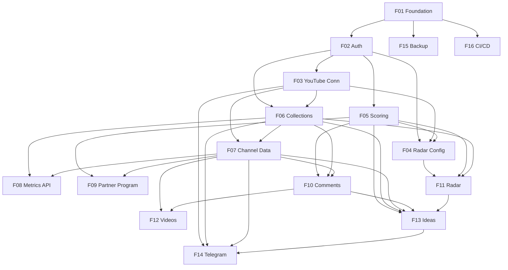

# Creator Insights Dashboard — Backend

## 1. Executive Summary

The Creator Insights Dashboard Backend (`creator-insights-backend`) is the server side of a personal, single-user analytics application for the YouTube channel "Codificando com Pedro". It is a Node.js 24 + TypeScript service, shipped as one Docker image with two entrypoints (`api` and `worker`), backed by a single PostgreSQL 17 instance that stores the data and also hosts the job queue and scheduler (pg-boss). It exposes a versioned REST API (`/api/v1`) with an OpenAPI contract consumed by the separate `creator-insights-frontend` repository.

It is built for Pedro, a technical content creator and senior software engineer who has little time each week to decide what video to record next. The core value is turning free, official YouTube API data into two weekly outputs in under 5 minutes of reading: a health snapshot of the channel (growth, retention, CTR, traffic, search terms and progress toward the YouTube Partner Program) and a prioritized, evidence-backed list of 3 to 5 content ideas — at zero operating cost, inside the free API quota, on the local machine.

At a high level, every Tuesday at 08:00 (America/Sao_Paulo) the worker runs a collection made of independent steps: own channel data and analytics, niche radar searches, competitor uploads, comments, and score calculation. Each step records quota usage and errors, so a failure degrades the run to "partial" instead of discarding it. Deterministic, rule-based domain services (no LLM) compute views-per-hour, outlier multiples, trend scores, comment categories, channel gaps and a language-balanced idea ranking. Results are pre-aggregated for fast reads, exposed via the API, and summarized in a Telegram message. The architecture follows clean architecture with a platform-agnostic port layer, so Instagram or Substack can be added later as new adapters without changing the domain.

## 2. Problem and Opportunity

### The Problem

**Content decisions rely on intuition and paid tools**
- Choosing the next video depends on gut feeling; there is no weekly ranked list of topics with evidence.
- The free vidIQ plan shows only 3–4 results per keyword section, which is not enough to map a niche with 30 relevant terms.
- Paid tools are not justified for a channel that is not monetized yet (0 revenue).

**Channel metrics and niche signals live in separate places**
- Growth, retention, CTR and traffic sit in YouTube Studio; niche trends require manual searches; comment requests are read one by one.
- Comparing this week against the previous week and month requires manual spreadsheet work (estimated 30–60 minutes per week).
- Progress toward Partner Program thresholds (subscribers, uploads in 90 days, watch hours in 12 months) is not projected over time.

**Audience demand is buried in raw data**
- Questions and video requests in comments on the last 90 days of videos are not classified or grouped.
- Search terms that already bring traffic but have no dedicated video go unnoticed.
- English-language trends that could be adapted to Portuguese are not systematically tracked.

**Free API quota is easy to exhaust and hard to reason about**
- The YouTube Data API allows 10,000 units/day, and `search.list` is the scarce resource (100 calls/day budget).
- Without accounting per call, a single careless manual run can block collections for the rest of the day.
- OAuth refresh tokens can expire (7 days for apps in "Testing" mode), silently breaking weekly runs.

### The Opportunity

- **Intuition → evidence-backed ranking:** a deterministic scoring engine (VPH, outlier multiple, trend score, gap detection) produces a weekly idea ranking where every idea links to reference videos, comments and search terms.
- **Scattered data → one API:** a single collection pipeline stores channel analytics, snapshots, radar hits and comments in one database, pre-aggregates weekly and monthly KPIs with variation, and projects Partner Program dates.
- **Buried demand → structured signals:** rule-based comment classification with editable term lists, search-term gap detection and an "adaptation opportunity" flag for English topics without Portuguese equivalents.
- **Quota risk → budgeted collections:** every external call records its cost per bucket; each step checks remaining budget before running; quota errors end the step without retries and mark the run partial; Telegram alerts report failures, including expired tokens.
- **Differentiator:** zero cost, fully local (Docker Compose, ports bound to 127.0.0.1), language-balanced (60% pt-BR / 40% en by default) and extensible to other platforms through ports.

## 3. Target Audience

### Primary Users

**Pedro — Creator (decision maker)**
- Opens the dashboard on Tuesday afternoon after the weekly collection and needs the week's summary and top 5 ideas in one call to the API.
- Needs evidence (reference videos, VPH, comments, search terms) behind each idea to decide in minutes.
- Receives the run summary on Telegram when away from the computer.

**Pedro — Operator and maintainer**
- Runs the whole stack locally with `docker compose up`, with no host dependency beyond Docker.
- Configures niche terms, competitors, scoring weights, YouTube and Telegram connections through the dashboard.
- Needs clear run history, per-step status, quota consumption, structured logs and backups to diagnose failures quickly.

### Behavioral Profile

Both profiles are the same person with limited weekly time, strong engineering background and high expectations for code quality (TypeScript strict, clean architecture, 80% coverage on domain and application). The user prefers deterministic, explainable rules over opaque models, tolerates estimates when they are clearly labeled, and expects the system to fail loudly (Telegram) rather than silently.

## 4. Objectives

### Product Objectives

1. **Deliver** a weekly ranked list of 3–5 content ideas with clickable evidence, computed automatically every Tuesday.
2. **Consolidate** channel health (growth, retention, CTR, traffic, search terms, Partner Program progress) into read endpoints with week-over-week and month-over-month variation.
3. **Operate** at zero cost within the free YouTube API quota, fully in local containers.
4. **Run reliably** with independent steps, catch-up execution and failure notifications.
5. **Maintain** a codebase that is extensible to new platforms and protected by automated tests and CI.

### Success Metrics

| Objective | Metric | Measurement condition |
| --- | --- | --- |
| Deliver ideas | At least 1 video per month recorded from an idea with status `recorded` | Counted from `ideas` status history over each calendar month |
| Deliver ideas | `GET /ideas` returns ≥ 5 ideas after a completed run | When ≥ 10 active niche terms and ≥ 5 active competitors are configured |
| Consolidate | Every dashboard read endpoint responds in < 500 ms (p95) | Measured with 2 years of seeded data on the local machine |
| Operate | Weekly collection consumes < 50% of each quota bucket (< 50 `search.list` calls, < 5,000 general units) | Read from `collection_runs` quota totals with 30 terms and 20 competitors |
| Run reliably | ≥ 95% of Tuesdays with the machine on end with status `completed` | Computed from `collection_runs` over a rolling 12-week window |
| Run reliably | A full weekly collection finishes in < 10 minutes | `finished_at - started_at` of scheduled runs |
| Maintain | ≥ 80% line coverage in `src/domain` and `src/application` | Enforced by Vitest coverage thresholds in CI |
| Maintain | Adding a new platform adapter requires 0 changes in `src/domain` and `src/application/use-cases` | Verified by an architecture lint rule (dependency-cruiser) in CI |

## 5. User Stories

### F01. Project Foundation
- As the operator, I want to run `docker compose up` and get api, worker, db and web running so that I need nothing installed besides Docker.
- As the operator, I want a development compose with hot reload and volumes so that code changes apply without rebuilding images.
- As the operator, I want a local "production" compose built from multi-stage images without devDependencies so that the runtime is small and reproducible.
- As the operator, I want structured JSON logs with a correlationId per request so that I can trace a request end to end.
- As the operator, I want a `/api/v1/health` endpoint and container health checks so that I know each service is alive.
- As the frontend developer, I want the OpenAPI spec published at `/api/docs` so that I can generate typed clients.
- As the system, I want versioned migrations applied on startup so that the schema is always in sync with the code.
- As the system, I want sensitive values encrypted with AES-256-GCM so that tokens are never stored in plain text.

### F02. Google Authentication
- As Pedro, I want to sign in with my Google account so that only I can access the dashboard data.
- As the system, I want to reject any Google account whose email differs from `ALLOWED_EMAIL` so that the app stays single-user.
- As Pedro, I want my session kept in an httpOnly cookie so that I don't sign in on every visit.
- As Pedro, I want to sign out so that the session is invalidated on the server.
- As Pedro, I want `GET /me` to show my profile and the status of YouTube and Telegram integrations so that the dashboard knows what is configured.

### F03. YouTube Channel Connection
- As Pedro, I want to connect my YouTube channel with read-only scopes so that the system can collect my data without being able to change anything.
- As the system, I want to store OAuth tokens encrypted and refresh them automatically so that weekly runs keep working.
- As the system, I want to create the Reporting API reach job when the channel is connected so that impressions and CTR become available.
- As Pedro, I want to see whether the connection is healthy or the token expired so that I can reconnect before Tuesday.

### F04. Radar Configuration
- As Pedro, I want to create, edit, activate, deactivate and delete niche terms with a language (pt-BR or en) so that the radar searches what matters.
- As Pedro, I want to add a competitor by channel URL, @handle or channel ID and see its resolved name and thumbnail before saving so that I avoid adding the wrong channel.
- As Pedro, I want to paste a list with one item per line and see a preview with duplicates and invalid items before confirming so that bulk setup is fast and safe.
- As Pedro, I want to see the active counters (e.g., 12/30 terms, 7/20 competitors) so that I know how much room is left.
- As the system, I want to reject activations beyond the configured limits so that collection quota stays protected.

### F05. Scoring Settings
- As Pedro, I want to read and update scoring weights, thresholds and the language ratio so that I can tune the ranking.
- As Pedro, I want to edit the comment classifier term lists so that categories match how my audience writes.
- As the system, I want Partner Program thresholds stored with effective dates so that projections use the threshold in force on the projected date.
- As Pedro, I want invalid settings (weights not summing to 100, out-of-range values) rejected with field-level errors so that the engine never runs with broken configuration.

### F06. Collection Orchestration
- As the system, I want to start a collection every Tuesday at 08:00 America/Sao_Paulo so that data is fresh at the start of the week.
- As the system, I want to run a catch-up collection on startup when the last completed run is older than 7 days so that a powered-off Tuesday is not lost.
- As Pedro, I want to see the estimated quota cost before triggering a manual collection so that I don't exhaust the daily budget.
- As Pedro, I want to trigger a manual collection and receive 202, or 409 with the current run status if one is already running, so that only one run happens at a time.
- As the system, I want each step to run independently and record status, quota and errors so that one failing step does not discard the others.
- As Pedro, I want to list past collections and see per-step status, quota per bucket and errors so that I can diagnose problems.

### F07. Channel Data Collection
- As the system, I want to collect my channel's videos, metadata and statistics as timestamped snapshots so that variation between runs can be computed.
- As the system, I want to classify each video as long-form or Short (≤ 180 s) and handle live/premiere state so that formats are filtered correctly.
- As the system, I want to collect daily channel metrics, per-video retention, retention curves, traffic sources and search terms from the Analytics API so that channel health can be analyzed.
- As the system, I want to download impressions and CTR from the Reporting API and record their reference date so that CTR is shown with its data delay.
- As the system, I want to pre-compute weekly and monthly aggregates at the end of the step so that reads stay under 500 ms.

### F08. Channel Metrics API
- As Pedro, I want week and month KPIs (subscribers gained/lost, views, watch hours, videos published) with variation vs. the previous period so that I see the trend at a glance.
- As Pedro, I want time series per metric and period (7, 28, 90 days, 12 months) so that the dashboard can draw charts.
- As Pedro, I want traffic distribution by source and the top search terms with views so that I know how people find my videos.
- As Pedro, I want to filter metrics by format (long-form or Shorts) so that Shorts don't distort long-form analysis.

### F09. Partner Program Progress
- As Pedro, I want to see the percentage reached for each Partner Program indicator per level so that I know how far I am from monetization.
- As Pedro, I want the weekly pace and projected date to reach each threshold so that I can plan.
- As the system, I want projections to use the threshold effective on the projected date (4,000 h before 2027-02-01, 8,000 h after) so that the forecast is not optimistic.
- As Pedro, I want to register the official watch-hours value from YouTube Studio so that the projection is calibrated.

### F10. Comment Collection and Classification
- As the system, I want to collect comments from my long-form videos published in the last 90 days so that audience demand is captured.
- As the system, I want to classify each comment as question, request, technical problem, praise or other by editable rules so that demand is structured without an LLM.
- As the system, I want to extract keywords and group recurring subjects so that repeated requests surface as topics.
- As Pedro, I want to list classified comments filtered by category and video, with a link to the comment on YouTube, so that I can read the original.

### F11. Niche Radar and Outliers
- As the system, I want to search each active niche term for long-form videos published in the last 7 days in the term's language and region so that the radar reflects recent niche activity.
- As the system, I want to compute VPH, outlier multiple, acceleration and a trend score normalized per language so that Portuguese topics are not hidden by English volume.
- As the system, I want to scan each active competitor's recent uploads and flag videos with multiple ≥ N (default 3) and ≥ 48 h of age so that outliers are reliable.
- As Pedro, I want to list trending topics by language with reference videos, and outliers from radar and competitors, so that I see what is working in the niche.

### F12. Video Ranking and Detail
- As Pedro, I want a paginated video ranking sortable by views, watch time, CTR, retention and relative performance so that I compare my videos.
- As Pedro, I want a video detail with all metrics, view evolution across snapshots, retention curve, traffic sources, search terms and classified comments so that I understand why a video performed well or badly.

### F13. Gap Detection and Idea Ranking
- As the system, I want to detect gaps (search terms without a matching video, trending topics without a matching video, recurring requests without a dedicated video) so that unmet demand becomes ideas.
- As the system, I want to consolidate all signals into ideas with a 0–100 score, origin language, signal sources and evidence so that I get one ranked list.
- As the system, I want the ranking composed by language ratio (default 60% pt-BR / 40% en) so that both audiences are represented.
- As Pedro, I want to change an idea's status (new, evaluating, approved, recorded, discarded) so that I track my pipeline.
- As the system, I want discarded ideas to stay out of the top unless their score rises more than 50% so that I am not shown the same rejected idea every week.

### F14. Telegram Notifications
- As Pedro, I want to configure the Telegram bot token and chat ID through the dashboard, stored encrypted, so that secrets are not in plain text.
- As Pedro, I want to send a test message so that I know the configuration works.
- As Pedro, I want a message at the end of each collection with status, top 3 ideas, weekly subscriber and view variation and a link to the dashboard so that I know the outcome away from the computer.
- As Pedro, I want failed or partial runs to list the failing steps with a short reason so that I know what to fix.

### F15. Backup and Operations
- As the operator, I want a daily database backup to a local volume with 30-day retention so that I can recover from mistakes.
- As the operator, I want a documented restore command so that recovery is fast and tested.
- As the operator, I want the worker to report health through a heartbeat so that Docker restarts it when it hangs.

### F16. CI/CD Pipeline
- As the maintainer, I want GitHub Actions to run lint, typecheck, unit, integration and e2e tests on every PR so that regressions are caught before merge.
- As the maintainer, I want the image published to GHCR when the pipeline passes on `main` so that the local production compose can pull it.
- As the maintainer, I want the build to fail when domain/application coverage drops below 80% or when the domain imports infrastructure code so that architecture and quality are enforced.

## 6. Functionalities

### F01. Project Foundation

**Provides:**
- Database connection, Drizzle schema module, migration runner and `settings` key-value store (used by every feature implicitly as infrastructure; not a functional data flow).

**Capabilities:**
- Runtime: Node.js 24, TypeScript 6 in strict mode, ESM; ESLint (flat config) + Prettier; path aliases per layer.
- Layout: `src/domain`, `src/application` (use-cases, ports, dto), `src/infrastructure` (youtube, telegram, db, scheduler, crypto), `src/interface` (http, jobs), `src/main` (`container.ts`, `api.ts`, `worker.ts`); `test/` (unit, integration, e2e, fixtures); `docker/`.
- DI: Awilix container assembled only in `src/main/container.ts`; domain has zero imports from Fastify, Drizzle, googleapis or pg-boss (enforced by dependency-cruiser rule).
- HTTP: Fastify 5 with `fastify-type-provider-zod`; all routes under `/api/v1`; OpenAPI 3.1 generated from Zod schemas and served at `/api/docs` (UI) and `/api/docs/json`.
- Standard error envelope: `{ "error": { "code": "VALIDATION_ERROR", "message": "...", "details": [...], "correlationId": "..." } }`; codes: `VALIDATION_ERROR` (400), `UNAUTHENTICATED` (401), `FORBIDDEN` (403), `NOT_FOUND` (404), `CONFLICT` (409), `UPSTREAM_ERROR` (502), `INTERNAL` (500).
- Pagination convention: `page` (1-based, default 1), `pageSize` (default 20, max 100); responses include `{ items, page, pageSize, total }`.
- Logging: pino JSON; `correlationId` from `x-correlation-id` header or generated UUID v7, echoed in the response header; redaction of `authorization`, `cookie`, `*.token`, `*.refreshToken`, `*.botToken`.
- Database: PostgreSQL 17, Drizzle ORM, drizzle-kit migrations in `src/infrastructure/db/migrations`, applied automatically by the `api` entrypoint before listening (advisory lock prevents concurrent migration).
- Crypto service: AES-256-GCM, key from `ENCRYPTION_KEY` (32 bytes, base64), random 12-byte IV per value, stored as `v1:<iv>:<tag>:<ciphertext>` (base64); startup fails if the key is missing or not 32 bytes.
- `ClockPort` injected everywhere time is read; `SystemClock` in production, `FixedClock` in tests.
- Health: `GET /api/v1/health` returns `200 { status: "ok", db: "ok", version }` or `503` when the DB ping fails (timeout 2 s).
- Containers: one multi-stage Dockerfile (deps → build → runtime on `node:24-slim`, non-root user), entrypoint selected by `APP_ROLE=api|worker`.
- Compose files: `docker-compose.yml` (local production: web from `ghcr.io/<owner>/creator-insights-frontend`, api, worker, db), `docker-compose.dev.yml` (hot reload with `tsx watch`, source mounted, web built from `FRONTEND_PATH`), `docker-compose.test.yml` (`test` service), `docker-compose.e2e.yml` (api, worker, db, WireMock).
- Only `web` publishes a port: `127.0.0.1:8080`; api, worker and db are internal. nginx in the web image proxies `/api` to `api:3000`.
- `.env.example` documents every variable: `DATABASE_URL`, `ENCRYPTION_KEY`, `ALLOWED_EMAIL`, `GOOGLE_CLIENT_ID`, `GOOGLE_CLIENT_SECRET`, `GOOGLE_REDIRECT_BASE_URL` (default `http://localhost:8080`), `YOUTUBE_API_KEY` (optional), `SESSION_SECRET`, `TZ_COLLECTION` (default `America/Sao_Paulo`), `DASHBOARD_URL`, `LOG_LEVEL`; `.env` is git-ignored.
- Config validated with Zod at boot; the process exits with code 1 and a list of invalid variables when validation fails.

**Experience:**
- `cp .env.example .env`, fill values, `docker compose up -d` → after the db health check passes, api runs migrations, then listens; worker starts after api is healthy.
- `docker compose -f docker/docker-compose.test.yml run --rm test` runs lint, typecheck and all test levels inside a container.
- Invalid config at boot logs `{"level":"fatal","msg":"Invalid configuration","invalid":["ENCRYPTION_KEY: must be 32 bytes base64"]}` and the container stops.

**Error Handling:**
- Migration fails → api logs `Migration <name> failed: <reason>`, exits with code 1, Docker restart policy stops after 3 attempts; data is untouched because each migration runs in a transaction.
- DB unreachable at boot → retry connection 10 times with 2 s backoff, then exit with `Database unreachable at <host>:<port>`.
- `ENCRYPTION_KEY` changed after data was encrypted → decryption fails with `ENCRYPTION_KEY_MISMATCH`; integrations are reported as `error` in `/me` and the user is told to reconnect; no data is overwritten automatically.
- Unhandled exception in a route → 500 with `INTERNAL` and the correlationId; stack trace only in logs.

### F02. Google Authentication

**Provides:**
- Authenticated user record (id, email, name, avatar) used to scope integration ownership (used by F03).

**Capabilities:**
- Routes: `GET /auth/google` (redirect to Google with `openid email profile`, `state` and PKCE S256), `GET /auth/google/callback`, `POST /auth/logout`, `GET /me`.
- Only the email exactly equal (case-insensitive, trimmed) to `ALLOWED_EMAIL` and with `email_verified=true` is accepted; the first successful login creates the single `users` row.
- Sessions: random 32-byte token, stored only as SHA-256 hash in `sessions` with `expires_at`; cookie `ci_session`, `HttpOnly`, `Secure`, `SameSite=Lax`, `Path=/`; sliding expiration of 30 days, absolute max 90 days.
- `state` and PKCE verifier stored in a short-lived signed cookie (10 minutes).
- Every route except `/health`, `/auth/*` and `/api/docs*` requires a valid session (Fastify `onRequest` hook) → otherwise 401.
- `GET /me` returns `{ user: { email, name, avatarUrl }, integrations: { youtube: { status: "connected"|"disconnected"|"expired"|"error", channelTitle?, lastRefreshAt? }, telegram: { status: "configured"|"not_configured"|"error" } } }`.
- After login, redirects to `DASHBOARD_URL` (default `http://localhost:8080/`).

**Experience:**
- User clicks "Sign in with Google" → `/auth/google` → Google consent → callback validates state, exchanges code, verifies ID token (issuer, audience, expiry) → checks email → creates session → 302 to dashboard.
- Rejected email → 302 to `DASHBOARD_URL/login?error=not_allowed`.
- Logout deletes the session row and clears the cookie → 204.

**Error Handling:**
- Email not equal to `ALLOWED_EMAIL` → no session created, redirect with `error=not_allowed`; log `Login rejected` with hashed email only.
- `state` mismatch or missing PKCE cookie → redirect with `error=invalid_state`; nothing persisted.
- Google token endpoint returns 4xx/5xx → redirect with `error=google_unavailable`; logged with status code, no tokens in logs.
- Expired or unknown session cookie → 401 `UNAUTHENTICATED` with message `Session expired. Sign in again.`; cookie cleared.

### F03. YouTube Channel Connection

**Consumes:**
- F02: authenticated user record (id) to own the platform account.

**Provides:**
- Connected account credentials (decrypted access token on demand, automatic refresh), own channel ID and uploads playlist ID (used by F04, F07).
- Reporting API reach job ID and reach report type (used by F07).
- Connection status (connected, expired, error) with last refresh time (used by F06, F14).

**Capabilities:**
- Route: `GET /integrations/youtube/connect` (redirects to Google with `access_type=offline`, `prompt=consent`, scopes `youtube.readonly` and `yt-analytics.readonly`), callback `GET /integrations/youtube/callback`, `DELETE /integrations/youtube` (disconnect, deletes tokens).
- Tokens stored in `platform_accounts` (`platform = 'youtube'`) encrypted with the F01 crypto service; one account allowed in v1 (connecting again replaces it).
- After connection: `channels.list(mine=true)` stores own channel (ID, title, thumbnail, uploads playlist ID) in `channels` with `is_own = true`.
- Reporting API: lists report types, creates a job for the channel reach report type (expected `channel_reach_basic_a1`, impressions and impression CTR; confirmed by the validation spike) if none exists, and stores the job ID.
- Refresh: access token refreshed when < 5 minutes to expiry; refresh failures with `invalid_grant` set status `expired`.
- `OAuthCredentialsProvider` port implemented by the adapter; use cases never see raw tokens.

**Experience:**
- From Settings, Pedro clicks "Connect YouTube" → consent screen showing read-only scopes → callback stores tokens, resolves channel, creates reporting job → 302 to `DASHBOARD_URL/settings?youtube=connected`.
- `/me` then shows `youtube.status = "connected"` with `channelTitle = "Codificando com Pedro"`.

**Error Handling:**
- User denies consent → redirect `settings?youtube=denied`; nothing stored.
- Granted scopes missing `yt-analytics.readonly` → tokens discarded, redirect `settings?youtube=missing_scopes`.
- Account has no YouTube channel → redirect `settings?youtube=no_channel`.
- Refresh fails with `invalid_grant` → status `expired`, collection steps needing OAuth fail with reason `token_expired`, Telegram reports `YouTube token expired — reconnect in Settings`.
- Reporting job creation fails → connection still succeeds; status flag `reporting: "pending"`, retried at the start of the next collection.

### F04. Radar Configuration

**Consumes:**
- F03: connected account credentials to call `channels.list` for competitor resolution (alternative: `YOUTUBE_API_KEY` when set, used for public lookups).
- F05: radar limits (max active terms, max active competitors).

**Provides:**
- Active niche terms (id, text, language) and active competitors (channel ID, uploads playlist ID, language) (used by F11).

**Capabilities:**
- Niche terms: `GET /settings/niche-terms`, `POST /settings/niche-terms`, `PATCH /settings/niche-terms/:id` (text, language, active), `DELETE /settings/niche-terms/:id`, `POST /settings/niche-terms/bulk`.
- Term rules: text 2–80 chars, trimmed, internal whitespace collapsed; language `pt-BR` or `en`; uniqueness by normalized text (lowercase, accents removed) + language.
- Competitors: `GET /settings/competitors`, `POST /settings/competitors/resolve` (input → preview), `POST /settings/competitors`, `PATCH /settings/competitors/:id` (language, active), `DELETE /settings/competitors/:id`, `POST /settings/competitors/bulk`.
- Accepted competitor inputs: `https://www.youtube.com/channel/UC…`, `https://www.youtube.com/@handle`, `@handle`, raw ID `UC` + 22 chars; resolution via `channels.list(id|forHandle)` costs 1 unit; preview returns `{ channelId, title, thumbnailUrl, subscriberCount, videoCount }`.
- Own channel cannot be added as competitor; duplicates by channel ID rejected.
- Limits: default 30 active terms and 20 active competitors (from F05 settings); counters returned in list responses as `{ active, limit }`; inactive items don't count.
- Bulk: max 100 lines per request; `mode=preview` returns `{ valid: [...], duplicates: [...], invalid: [{ line, input, reason }], wouldExceedLimit: boolean }`; `mode=commit` saves valid items inside one transaction; competitor bulk resolves each line (1 unit each) and caches resolutions for 10 minutes so commit does not re-spend quota.
- Bulk items over the limit are saved as inactive, never rejected silently.
- Deleting a term or competitor keeps historical `radar_hits` (soft reference by snapshot of text/channel).

**Experience:**
- Add term: Pedro types "nestjs microservices", selects `en` → 201 with the term; counter goes 12/30 → 13/30.
- Add competitor: paste `@fireship` → resolve shows name and thumbnail → confirm → 201.
- Bulk: paste 25 lines → preview shows 20 valid, 3 duplicates, 2 invalid ("line 7: not a channel URL, handle or ID") → confirm saves 20.

**Error Handling:**
- Activating beyond the limit → 409 `CONFLICT` `Active term limit reached (30/30). Deactivate a term or raise the limit in scoring settings.`
- Competitor not found → 404 `Channel not found for "@handle".`
- Quota exhausted during resolution → 502 `UPSTREAM_ERROR` `YouTube quota exceeded; try again after midnight Pacific Time.`; nothing saved.
- Bulk commit with stale preview (item became duplicate meanwhile) → that item reported in `duplicates`, others saved; transaction never partially writes an invalid item.

### F05. Scoring Settings

**Provides:**
- Trend score weights, outlier multiple N, minimum outlier age, median base size (used by F11).
- Language ratio (used by F11, F13).
- Idea score weights, multi-signal bonus, adaptation bonus, discard resurfacing threshold (used by F13).
- Comment classifier term lists per category and recurrence threshold (used by F10).
- Partner Program threshold table with effective dates (used by F09).
- Radar limits (max active terms, max active competitors) (used by F04).

**Capabilities:**
- Routes: `GET /settings/scoring`, `PUT /settings/scoring` (full document replace, versioned with `version` integer for optimistic locking), `POST /settings/scoring/reset` (restore defaults).
- Defaults:
  - Trend: median multiple 50, distinct channels 30, summed VPH 20 (must sum to 100).
  - Idea: trend 35, outlier 25, comments 20, gap 20 (must sum to 100); multi-signal bonus 10 (≥ 2 distinct signal types); adaptation bonus 5; cap 100.
  - Outlier: multiple N = 3 (range 1.5–10), min age 48 h (range 0–168), median base = last 30 long-form videos (range 10–50).
  - Language ratio: pt-BR 60 / en 40 (pt-BR 0–100, en = 100 − pt-BR).
  - Discard resurfacing: +50% score increase.
  - Comment recurrence: a keyword is a recurring subject when present in ≥ 3 comments (range 2–20).
  - Radar limits: 30 terms (range 1–50), 20 competitors (range 1–40); quota guard rejects values whose estimated weekly cost exceeds 50% of a bucket.
  - Classifier lists: question (`?`, "como", "por que", "porque", "qual", "how", "why", "what"), request ("faz um vídeo", "poderia fazer", "próximo vídeo", "ensina", "make a video", "please cover"), technical problem ("erro", "não funciona", "exception", "bug", "error", "doesn't work"), praise ("parabéns", "excelente", "ótimo", "muito bom", "great", "awesome", "thanks"); each list max 100 terms, 1–50 chars per term.
- Partner Program thresholds stored as rows `{ level, indicator, value, effective_from }`: fan funding — 500 subscribers, 3 public uploads in 90 days, 3,000 public long-form hours in 12 months (effective 2023-06-13); ad revenue — 1,000 subscribers and 4,000 hours (effective 2023-06-13), 8,000 hours for new applications effective 2027-02-01. Threshold rows editable via `PUT /settings/scoring` under `partnerProgram`.
- All values stored in `settings` (JSONB, key `scoring.v1`); seeded by migration.

**Experience:**
- Pedro changes outlier N from 3 to 4 → `PUT` with `version: 3` → 200 with `version: 4`; next collection uses N = 4; existing results are not recomputed.
- Validation errors return 400 with `details: [{ path: "idea.weights", message: "Weights must sum to 100 (got 95)" }]`.

**Error Handling:**
- Stale `version` → 409 `Settings were changed elsewhere. Reload and try again.`
- Weights not summing to 100 or values out of range → 400 with field paths; nothing persisted.
- Limits lowered below the current active count → 400 `Lower limit (20) is below active terms (24). Deactivate 4 terms first.`
- Reset → defaults restored in one transaction; previous document kept in `settings_history` for rollback.

### F06. Collection Orchestration

**Consumes:**
- F03: connection status (connected/expired) to fail OAuth-dependent steps early.

**Provides:**
- Collection run context for steps: run ID, correlationId, trigger (scheduled/manual/catch-up), started-at time, quota meter per bucket, `canAfford(estimate)` check and step result recording (used by F07, F10, F11, F13).
- Collection final result: run status, per-step status, error reason per failed step, quota consumed per bucket, start and end times (used by F08, F14).

**Capabilities:**
- Scheduler: pg-boss cron `0 8 * * 2`, tz `America/Sao_Paulo`, queue `collection.run`, `singletonKey = "collection"` and DB-level partial unique index on `collection_runs(status) WHERE status = 'running'` guaranteeing a single active run.
- Catch-up: on worker start, if no run with status `completed` or `partial` has `started_at` in the last 7 days (via `ClockPort`), enqueue a run with trigger `catch_up`.
- Manual: `GET /collections/estimate` returns `{ steps: [{ name, searchCalls, units }], totals: { searchCalls, units }, remainingToday: { searchCalls, units } }`; `POST /collections` → 202 `{ id, status: "queued" }` or 409 `{ error: { code: "CONFLICT", ... }, current: { id, status, currentStep, startedAt } }`.
- Steps run in fixed order: `channel` → `analytics` → `niche` → `competitors` → `comments` → `scores`; steps are registered by their features through a `CollectionStep` port (`name`, `estimate(context)`, `run(context)`, `requiresOAuth`).
- Each step: status `pending|running|completed|failed|skipped`, `started_at`, `finished_at`, quota per bucket, items processed, error `{ code, message }`; a step failure does not stop later steps unless a later step declares a hard dependency on its output (e.g., `scores` runs with whatever data exists).
- Run status: `completed` (all steps completed), `partial` (≥ 1 step failed or skipped, ≥ 1 completed), `failed` (no step completed).
- Quota buckets: `search` (daily limit 100 calls) and `units` (daily limit 10,000 units); usage per day is the sum of `quota_usage` rows since the last midnight America/Los_Angeles; before each step, `canAfford(step.estimate)` must be true or the step is `skipped` with reason `quota_budget`.
- Every external call goes through a `QuotaBudgetPort.record(bucket, cost, endpoint)` decorator.
- Resilience (shared HTTP wrapper): retries for 429 and 5xx with exponential backoff (base 1 s, factor 2, jitter ±20%, max 4 attempts); 403 `quotaExceeded`/`dailyLimitExceeded` aborts the step immediately without retries.
- Timeouts: 30 s per HTTP call; 4 minutes per step; 10 minutes per run (exceeding marks remaining steps `skipped` with reason `run_timeout`).
- History: `GET /collections?page=` (newest first) and `GET /collections/:id` with steps and errors; rows retained indefinitely.
- Orphan recovery: on worker start, runs stuck in `running` for > 15 minutes are marked `failed` with reason `worker_restart`.
- At the end of a run, emits a domain event `CollectionFinished` with the final result.

**Experience:**
- Pedro opens the collect dialog → frontend calls `/collections/estimate` → shows "≈ 30 search calls, ≈ 1,100 units; remaining today: 100 / 10,000" → confirm → 202 → polls `/collections/:id` every 5 s and sees steps progressing.
- A second click while running → 409 with the current step name.

**Error Handling:**
- Quota exceeded mid-step → step `failed` with `quota_exceeded`, remaining steps needing that bucket `skipped`, run `partial`.
- Token expired before start → OAuth steps (`channel`, `analytics`, `comments`) `failed` with `token_expired`; public steps run with API key if configured; run `partial` or `failed`.
- Worker crash mid-run → orphan recovery marks it `failed` on next start, data already written by completed steps is kept (each step commits its own transaction).
- Unhandled exception in a step → step `failed` with `internal_error` and message truncated to 200 chars; stack only in logs with run correlationId.
- Concurrent trigger race (cron and manual at the same second) → unique index rejects the second insert; manual caller gets 409.

### F07. Channel Data Collection

**Consumes:**
- F03: connected account credentials, own channel ID, uploads playlist ID, Reporting API reach job ID.
- F06: collection run context (run ID, quota meter, step recording).

**Provides:**
- Own channel videos with metadata (video ID, title, tags, duration, publish date, privacy status, format long/short, live state) and per-run snapshots (views, likes, comments, captured-at) (used by F08, F09, F10, F12, F13).
- Channel daily metrics (date, views, watch minutes, subscribers gained, subscribers lost, format split), current channel subscriber count, long-form public watch minutes for the last 365 days and pre-computed weekly/monthly aggregates (used by F08, F09, F14).
- Video period metrics (average view duration, average percentage viewed, retention curve points, impressions, impression CTR with reference date, traffic source distribution) (used by F08, F12).
- Search terms that brought views, per period and per video, with view counts (used by F08, F12, F13).

**Capabilities:**
- Step `channel` (units bucket): `playlistItems.list` on the uploads playlist (all pages, 50 per page, 1 unit each), `videos.list` in batches of 50 (`snippet,contentDetails,statistics,status,liveStreamingDetails`, 1 unit per call); upserts `videos` and inserts one `video_snapshots` row per video per run.
- Format rule: duration ≤ 180 s → `short`; otherwise `long`; `liveBroadcastContent = live|upcoming` → excluded until finished; finished lives/premieres (with `actualEndTime`) → `long`.
- Step `analytics` (Analytics API, not counted in Data API buckets, budget tracked separately as `analytics` calls):
  - Daily channel metrics for the last 400 days on first run, then the last 30 days on subsequent runs (upsert by date): `views, estimatedMinutesWatched, subscribersGained, subscribersLost`, dimension `day`, filtered by `creatorContentType` for long-form vs. Shorts.
  - Per-video metrics for the last 28 and 90 days and 12 months: `averageViewDuration, averageViewPercentage`, dimension `video`, top 200 videos.
  - Retention curve per long-form video published in the last 12 months (max 50 videos): `audienceWatchRatio` by `elapsedVideoTimeRatio` (100 points).
  - Traffic sources per period (7, 28, 90 days, 12 months): `insightTrafficSourceType`, channel-level and per video.
  - Search terms: `insightTrafficSourceDetail` filtered by `insightTrafficSourceType==YT_SEARCH`, top 50 per period channel-level and top 25 per video for the 50 most-viewed videos of the period.
  - Partner Program inputs: long-form public watch minutes for the last 365 days.
- Reporting API: downloads new reach reports since the last downloaded `createTime`, parses CSV into `video_period_metrics` (`impressions`, `impressions_ctr`, `reference_date`); data is typically 2 days behind and `reference_date` is stored and returned.
- Aggregation (end of `analytics` step): writes `channel_period_aggregates` for ISO weeks and calendar months (last 104 weeks, 24 months), per format, with previous-period values to support variation.
- Idempotent: re-running in the same day upserts metrics and adds a new snapshot.
- Estimated cost per run with 150 videos: ~3 playlist calls + 3 videos.list calls ≈ 6 units.

**Experience:**
- No direct user interaction; results visible through F08, F09, F12. The run detail shows `channel: completed (152 videos, 6 units)` and `analytics: completed (48 reports)`.

**Error Handling:**
- Analytics API 403 (insufficient permission) → step `failed` with `analytics_forbidden`; `channel` step results are kept.
- Reporting job not yet producing reports (first 48 h) → CTR fields remain null; step completed with warning `reach_report_pending`.
- Video removed or turned private between runs → stored `privacy_status` updated; snapshots stop; historical snapshots kept.
- Partial page failure after retries → step `failed` with `upstream_error`; already-upserted videos remain consistent because each batch commits independently.

### F08. Channel Metrics API

**Consumes:**
- F06: collection final result of the latest run (status, start and end times) for the `lastCollection` summary.
- F07: channel daily metrics and weekly/monthly aggregates (views, watch minutes, subscribers gained/lost, format split), own videos (publish date, format) for "videos published", video period metrics (impressions, impression CTR with reference date, traffic source distribution), search terms with views.

**Capabilities:**
- `GET /channel/overview?period=7d|28d|90d|12m&format=long|short|all` → KPIs: subscribers net, gained, lost, views, watch hours, videos published, average view duration, average percentage viewed, impressions, CTR; each with `{ value, previous, deltaAbs, deltaPct }`; plus `weekOverWeek` and `monthOverMonth` blocks, `lastCollection` summary and `partnerProgram` summary (from F09 when available, `null` otherwise).
- `GET /channel/timeseries?metric=views|watchHours|subscribersNet|subscribersGained|subscribersLost|impressions|ctr&period=&format=&granularity=day|week|month` → `[{ date, value }]`; default granularity: day for 7d/28d, week for 90d, month for 12m.
- `GET /channel/traffic?period=&format=` → `{ sources: [{ type, views, pct }], searchTerms: [{ term, views }], referenceDate }`, sources sorted by views desc, search terms top 50.
- `deltaPct` is `null` when the previous value is 0; values rounded to 2 decimals; watch time returned in hours.
- CTR and impressions include `referenceDate` (latest reach data date) to expose the ~2-day delay.
- Reads only pre-computed tables; p95 < 500 ms with 2 years of data.

**Experience:**
- Overview call on Tuesday returns `subscribersNet: { value: 42, previous: 30, deltaAbs: 12, deltaPct: 40 }`.
- Empty state (no collection yet) → 200 with `values: null` and `lastCollection: null` so the frontend renders "Run your first collection".
- Invalid `period` → 400 with allowed values.

### F09. Partner Program Progress

**Consumes:**
- F05: Partner Program threshold table with effective dates.
- F07: current channel subscriber count and daily subscribers gained/lost, own long-form videos (privacy status, publish date) for public uploads in 90 days, long-form public watch minutes for the last 365 days and daily watch minutes.

**Core Scope:**
- Progress per level and indicator with percentage reached, weekly pace and projected date using the threshold effective on that date.

**Full Scope additions:**
- Manual calibration with the official YouTube Studio watch-hours value.

**Capabilities:**
- `GET /channel/partner-program` → `{ levels: [{ level: "fan_funding"|"ad_revenue", indicators: [{ indicator: "subscribers"|"public_uploads_90d"|"watch_hours_12m", current, threshold, thresholdEffectiveFrom, pct, weeklyPace, projectedDate, met }] }], isEstimate: true, officialSourceHint: "YouTube Studio → Earn", calibration }`; also embedded (summary) in `/channel/overview`.
- Weekly pace: average weekly change over the last 8 weeks (subscribers net, watch hours added minus hours rolling out of the 12-month window, uploads counted in rolling 90 days).
- Projection: iterate week by week up to 104 weeks from today; at each week compare the projected value with the threshold effective on that week's date; if the pace is ≤ 0 or no date found within 104 weeks → `projectedDate: null` and `reason: "not_on_track"`.
- Example: ad-revenue watch-hours projection crossing 4,000 h after 2027-02-01 is checked against 8,000 h.
- Only long-form public videos count; Shorts views path not tracked.
- Calibration (Full Scope): `PUT /channel/partner-program/calibration { watchHours12m, subscribers?, measuredAt }` stores the official value; the projection uses `officialValue + (estimate(now) − estimate(measuredAt))`; `DELETE` removes it; calibration older than 60 days flagged `stale`.

**Experience:**
- Pedro sees "Ad revenue — watch hours: 1,240 / 4,000 (31%), +85 h/week, projected 2027-01-18".
- Response flags `isEstimate: true`; the frontend shows the note pointing to YouTube Studio.

### F10. Comment Collection and Classification

**Consumes:**
- F05: comment classifier term lists per category and recurrence threshold.
- F06: collection run context (run ID, quota meter, step recording).
- F07: own long-form videos published in the last 90 days (video ID, title, publish date, comment count from latest snapshot).

**Provides:**
- Classified comments (comment ID, video ID, author display name, text, published at, like count, category, keywords, YouTube link) (used by F12).
- Recurring subjects (keyword, category, comment count, sample comment IDs, related video IDs) (used by F13).

**Capabilities:**
- Step `comments` (units bucket): for up to 40 long-form videos published in the last 90 days (most recent first, skipping videos whose comment count did not change since the last run), `commentThreads.list(part=snippet, order=time, maxResults=100, textFormat=plainText)`, 1 page per video (1 unit each); top-level comments only; Pedro's own comments excluded by author channel ID.
- Upsert by comment ID; edited text updates the row and triggers reclassification.
- Classification precedence (first match wins): request → technical problem → question → praise → other; matching is case-insensitive and accent-insensitive on word boundaries, `?` matched as a character.
- Keywords: lowercase, accents removed, URLs/emojis/mentions removed, pt and en stopwords removed, tokens ≥ 3 chars; unigrams and bigrams; up to 5 keywords per comment ranked by TF-IDF across the run's corpus.
- Recurring subject: keyword present in ≥ threshold comments (default 3) across the window; grouped per category; recomputed each run.
- Reclassification of all stored comments when classifier lists change (on next run, not synchronous).
- `GET /comments?category=&videoId=&subject=&page=` → items with `link = https://www.youtube.com/watch?v={videoId}&lc={commentId}`; `GET /comments/subjects?category=` → recurring subjects sorted by count desc.
- `CommentClassifier` is a port; v1 implementation `RuleBasedCommentClassifier` (LLM adapter possible later without changing use cases).
- Estimated cost: ≤ 40 units per run.

**Experience:**
- Comment "Faz um vídeo sobre testes com Testcontainers?" → category `request` (request precedes question), keywords `["testes", "testcontainers", "testes testcontainers"]`.
- Pedro filters `category=request` and sees grouped subject "testcontainers (5 comments)".

**Error Handling:**
- Comments disabled on a video (403 `commentsDisabled`) → video skipped and counted in step metadata, step continues.
- Quota exceeded → step `failed` with `quota_exceeded`; comments already upserted remain; classification runs on the stored set.
- Malformed comment payload → comment skipped with a warning log including comment ID only (no text in logs).

### F11. Niche Radar and Outliers

**Consumes:**
- F04: active niche terms (id, text, language) and active competitors (channel ID, uploads playlist ID, language).
- F05: trend score weights, outlier multiple N, minimum outlier age, median base size, language ratio.
- F06: collection run context (run ID, started-at time, quota meter, step recording).

**Provides:**
- Trending topics per run (term, language, trend score 0–100, component values, distinct channel count, reference video IDs with VPH and multiple) (used by F13).
- Outliers per run (video ID, title, channel ID, channel title, language, VPH, channel median VPH, multiple, acceleration, source radar|competitor, publish date) (used by F13).

**Capabilities:**
- Step `niche` (search + units buckets): for each active term, one `search.list` call (`type=video`, `order=viewCount`, `publishedAfter = run start − 7 days`, `maxResults=50`, `relevanceLanguage=pt` + `regionCode=BR` for pt-BR, `relevanceLanguage=en` + `regionCode=US` for en; 100 units, 1 search call); `videos.list` in batches of 50 for details; Shorts (≤ 180 s) and live/upcoming removed.
- Medians: for channels of the top 100 radar videos by VPH, fetch the last 30 long-form uploads (`playlistItems.list` + `videos.list`), compute median VPH; cached per channel for 7 days in `channel_vph_medians`.
- Step `competitors` (units bucket): for each active competitor, uploads playlist last 50 items, `videos.list` details, median VPH of the last 30 long-form videos, candidates published in the last 30 days.
- Formulas: `VPH = views / hoursSincePublish` (hours ≥ 1); `multiple = VPH_video / median(VPH last 30 long-form of channel)`; `acceleration = (views_t2 − views_t1) / hours(t2 − t1)` when the video exists in the previous run's `radar_hits`.
- Outlier: `multiple ≥ N` (default 3) and age ≥ 48 h; computed for both radar and competitor videos; deduplicated by video ID (source list keeps both).
- Trend score per term: components (median multiple of term videos, distinct channels, summed VPH) normalized as percentile rank within the same language; score = 0.5·p1 + 0.3·p2 + 0.2·p3 scaled to 0–100.
- `radar_hits` stores per run: term ID + term text snapshot, video ID, views, VPH, multiple, captured-at.
- `GET /radar/topics?language=pt-BR|en|all&runId=` (default latest run) → topics sorted by score; `all` composed by language ratio (interleave algorithm shared with F13); each with up to 5 reference videos.
- `GET /radar/outliers?source=radar|competitor|all&language=&page=` → sorted by multiple desc.
- Estimated cost with 30 terms and 20 competitors: 30 calls in the `search` bucket plus ≈ 300–900 units in the `units` bucket for video details, channel medians and competitor uploads.

**Experience:**
- After a run, `/radar/topics?language=pt-BR` returns "nestjs" with score 87 and 5 reference videos with multiples 4.2×, 3.8×…
- Empty state (no active terms) → step `skipped` with reason `no_active_terms`; endpoints return empty lists.

**Error Handling:**
- `search.list` budget insufficient for all terms → step processes terms ordered by last-run score until budget allows, marks the rest `skipped_terms` in metadata, step `completed` with warning; run status `partial`.
- Competitor channel deleted/terminated → competitor flagged `unavailable`, skipped, step continues.
- Quota exceeded mid-step → step `failed` with `quota_exceeded`; hits already stored remain and scores are computed on them.

### F12. Video Ranking and Detail

**Consumes:**
- F07: own videos with metadata and snapshots, video period metrics (average view duration, average percentage viewed, retention curve, impressions, CTR with reference date, traffic sources), search terms per video.
- F10: classified comments per video.

**Capabilities:**
- `GET /videos?sort=views|watchHours|ctr|retention|relative&order=desc|asc&type=long|short|all&period=28d|90d|12m|lifetime&page=` → items `{ id, title, thumbnailUrl, publishedAt, format, views, watchHours, ctr, avgPercentageViewed, vph, relativePerformance }`.
- `relativePerformance` = video VPH / median VPH of the channel's last 30 long-form videos (long-form videos only; Shorts compared against Shorts median).
- `GET /videos/:id` → metadata, latest stats, `snapshots: [{ capturedAt, views, likes, comments }]` (all, max 200 most recent), `viewsDelta` between the last two snapshots, retention metrics and curve (100 points), CTR and impressions with `referenceDate`, traffic sources, top 25 search terms, comment counts by category and the 20 latest classified comments.
- Sorting by CTR/retention places nulls last.

**Experience:**
- Pedro sorts by `relative` and sees "Docker para iniciantes — 4.1× median".
- Unknown video ID → 404 `Video not found.`

### F13. Gap Detection and Idea Ranking

**Consumes:**
- F05: idea score weights, multi-signal bonus, adaptation bonus, discard resurfacing threshold, language ratio.
- F06: collection run context (run ID, step recording).
- F07: own video titles and tags; search terms with views (channel-level, last 90 days).
- F10: recurring subjects (keyword, category, comment count, sample comment IDs).
- F11: trending topics (term, language, trend score, reference videos) and outliers (video, channel, multiple, language).

**Provides:**
- Top ideas of the latest run (title, score, origin language, signal sources, status) (used by F14).

**Capabilities:**
- Step `scores` (no external quota): runs last; consumes whatever data the run produced.
- Coverage rule: a term is covered when all its significant words (stopwords removed, accents and case normalized, simple plural stemming for pt/en) appear in the title or tags of any own video.
- Gap signals:
  - Search gap: own search term with ≥ 10 views in 90 days and not covered → gap value = views.
  - Trend gap: trending topic not covered by own videos.
  - Request gap: recurring subject in category `request` or `question` not covered.
  - Adaptation opportunity: en topic with trend score ≥ 50 and no pt-BR term/topic sharing ≥ 50% of significant words.
- Idea identity: normalized key (sorted significant words); signals with the same key merge into one idea; ideas persist across runs (`ideas` table) and evidence is appended per run (`idea_evidence` with type `video|outlier|comment|search_term|topic`, reference ID, run ID).
- Idea score (0–100): 0.35·trend + 0.25·outlier + 0.20·comments + 0.20·gap, each component normalized 0–100 by percentile within the run; +10 when ≥ 2 distinct signal types; +5 adaptation bonus; capped at 100; stored per run in `idea_scores` for history.
- Language composition: interleave best ideas per language to approach the ratio (at each position pick the language furthest below its target share; tie → pt-BR); when one language runs out, the other fills remaining positions.
- Status: `new` (default), `evaluating`, `approved`, `recorded`, `discarded`; transitions free except `recorded` → only `discarded`; each change stored in `idea_status_history` with timestamp.
- Discard rule: a discarded idea is excluded from default listing unless current score > 1.5 × score at discard time; then it returns with status `new` and `resurfaced: true`.
- `GET /ideas?status=&source=trend|outlier|comments|gap|adaptation&language=&page=` → sorted by composed ranking of the latest run; `GET /ideas/:id` → idea with score breakdown, history of scores per run and evidence with deep links (YouTube video URL, comment URL, search term); `PATCH /ideas/:id { status }`.
- Pre-computation: ranking materialized at the end of the step; reads are simple ordered selects.

**Experience:**
- After the run, `GET /ideas?pageSize=5` returns 3 pt-BR and 2 en ideas, e.g., "testcontainers node" score 82 with sources `[comments, gap, trend]`.
- Pedro sets an idea to `discarded`; next week it scores 60 vs. 50 at discard → stays hidden; if 76 → resurfaces.

**Error Handling:**
- Invalid status transition (`recorded` → `approved`) → 409 `Invalid status transition: recorded → approved.`
- Unknown idea ID on PATCH → 404; nothing changed.
- Step runs with missing inputs (e.g., `niche` failed) → computes with available signals, records `inputs_missing: ["niche"]` in step metadata; previous ideas keep their last score and are not deleted.
- Concurrent PATCH on the same idea → last write wins with `updated_at` check; both history entries recorded.

### F14. Telegram Notifications

**Consumes:**
- F03: YouTube connection status (to report expired tokens).
- F06: collection final result (status, per-step status and error reasons, quota per bucket, times).
- F07: weekly aggregates for subscribers net and views with variation vs. the previous week.
- F13: top 3 ideas of the latest run (title, score, language).

**Capabilities:**
- Routes: `PUT /integrations/telegram { botToken, chatId }`, `DELETE /integrations/telegram`, `POST /integrations/telegram/test`.
- `botToken` format `^\d{6,12}:[A-Za-z0-9_-]{30,50}$`; validated with `getMe` before saving; `chatId` integer or `@channel`; both stored encrypted (F01); token never returned by any endpoint (only `botUsername` and masked chat ID).
- `NotifierPort` with `TelegramNotifier` adapter using native `fetch` to `https://api.telegram.org/bot<token>/sendMessage`, `parse_mode=HTML`, max 4,096 chars, 10 s timeout, 3 retries on 429 honoring `retry_after`.
- Triggered by `CollectionFinished` (worker), for every trigger type.
- Message content: status emoji + status, trigger, duration, quota used per bucket; top 3 ideas with score and language flag; subscribers net and views this week with delta %; link `DASHBOARD_URL`; for `partial`/`failed`: list of failed/skipped steps with reason (`quota_exceeded`, `token_expired`, `upstream_error`, `quota_budget`, `run_timeout`, `internal_error`) in plain words.
- Notification failure never changes the run status; result stored in `collection_runs.notification_status` (`sent|failed|not_configured`).

**Experience:**
- Pedro pastes token and chat ID → `getMe` validates → 200 `{ status: "configured", botUsername: "@ci_pedro_bot" }` → "Send test" → message "✅ Creator Insights: Telegram connected."
- Tuesday 08:07 message: "✅ Collection completed (6m 12s) · Subs +12 (+40%) · Views 3,410 (+8%) · Top ideas: 1) testcontainers node (82) 🇧🇷 …"

**Error Handling:**
- Invalid token (`getMe` 401) → 400 `Telegram rejected the bot token.`; nothing saved.
- Bot not in chat / chat not found (400 `chat not found`) on test → 400 `Bot cannot write to this chat. Start a conversation with the bot or add it to the channel.`
- Telegram unreachable on run end → 3 retries, then `notification_status = failed`, logged without token.
- Decryption failure (key mismatch) → `/me` telegram status `error`; notification skipped with `notification_status = failed`.

### F15. Backup and Operations

**Capabilities:**
- `backup` service in compose (image `postgres:17`) running a loop: `pg_dump -Fc` daily at 03:00 America/Sao_Paulo to volume `db_backups` as `creator-insights-YYYYMMDD-HHmm.dump`; files older than 30 days deleted after a successful dump.
- Backup writes to a `.tmp` file and renames on success; failure logs JSON `{"level":"error","msg":"Backup failed"}` and keeps previous files.
- `scripts/restore.sh <file>` restores into the db container (stops api and worker, `pg_restore --clean --if-exists`, restarts).
- Worker heartbeat: worker updates `worker_heartbeat.last_seen_at` every 30 s; worker container healthcheck runs `node dist/main/healthcheck.js worker` → unhealthy when the heartbeat is older than 90 s; api healthcheck calls `/api/v1/health`.
- Restart policy `unless-stopped` for api, worker, db, backup.
- `GET /ops/status` → `{ lastBackupAt, lastBackupSizeBytes, lastBackupError, workerLastSeenAt }` (backup service writes a `backup_status` row after each attempt).

**Experience:**
- Operator checks `docker compose ps` → all services `healthy`; `ls` on the backups volume shows up to 30 daily dumps.

**Error Handling:**
- Disk full during dump → `.tmp` removed, error logged, old backups kept, `/ops/status` shows `lastBackupError`.
- Restore with wrong file → `pg_restore` fails before `--clean` applies (validated with `pg_restore --list` first); services restarted with original data.
- Heartbeat stale → Docker restarts worker; orphan recovery (F06) closes any stuck run.

### F16. CI/CD Pipeline

**Capabilities:**
- GitHub Actions workflow `ci.yml` on `pull_request` and `push` to `main`: jobs `lint` (ESLint + Prettier check), `typecheck` (`tsc --noEmit`), `architecture` (dependency-cruiser: domain → no imports from application/infrastructure/interface/frameworks; application → no infrastructure), `unit` (Vitest, coverage thresholds 80% lines/branches for `src/domain` and `src/application`), `integration` (Vitest + Testcontainers PostgreSQL 17 + MSW with recorded YouTube/Telegram fixtures), `e2e` (`docker-compose.e2e.yml` with WireMock serving fixtures; flows: simulated login, manual collection, list ideas, change status, 409 on concurrent collection).
- No test calls real Google or Telegram APIs; network egress to googleapis.com blocked in test containers.
- Fixtures in `test/fixtures` anonymized (channel IDs, names, comment authors replaced).
- `publish` job on `main` when all jobs pass: builds multi-stage image, pushes `ghcr.io/<owner>/creator-insights-backend:<sha>` and `:latest`.
- npm cache and Docker layer cache enabled; target pipeline duration < 15 minutes.

**Experience:**
- A PR breaking a domain rule fails `architecture` with the offending import path; a PR dropping coverage to 78% fails `unit` with the threshold report.

## 7. Out of Scope

**YouTube write operations**
- Editing titles, descriptions, tags, thumbnails, playlists; replying to or moderating comments.

**Monetization and revenue**
- Estimated revenue, RPM, CPM and the `yt-analytics-monetary.readonly` scope (added after Partner Program acceptance).
- Tracking the Shorts views path to the Partner Program.

**Content formats**
- Shorts in radar, outliers and ideas (Shorts appear only in own-channel metrics filtered by format).
- Live streams or premieres still in progress or scheduled.

**Intelligence**
- LLM-based classification, summarization or idea generation (the `CommentClassifier` port allows it later).
- Keyword search volume (no official YouTube API provides it).

**Platforms and tenancy**
- Instagram, Substack and other networks (architecture ready via ports, no adapters in v1).
- Multiple users, multiple channels, SaaS features (billing, onboarding, roles).

**Infrastructure**
- Cloud or VPS deployment, public domains and HTTPS certificates.
- Redis or any external queue (pg-boss on PostgreSQL only).
- Off-machine backups.

**Frontend**
- UI implementation (separate `creator-insights-frontend` repository); the backend only provides the API contract and the compose wiring.

## 8. Dependency Graph

### Part 1: Dependency Table

| # | Feature | Priority | Dependencies |
|---|---------|----------|--------------|
| F01 | Project Foundation | 1 | None |
| F02 | Google Authentication | 1 | F01 |
| F03 | YouTube Channel Connection | 1 | F02 |
| F05 | Scoring Settings | 1 | F02 |
| F04 | Radar Configuration | 1 | F02, F03, F05 |
| F06 | Collection Orchestration | 1 | F02, F03 |
| F07 | Channel Data Collection | 1 | F03, F06 |
| F08 | Channel Metrics API | 1 | F06, F07 |
| F09 | Partner Program Progress | 2 | F05, F07 |
| F10 | Comment Collection and Classification | 1 | F05, F06, F07 |
| F11 | Niche Radar and Outliers | 1 | F04, F05, F06 |
| F12 | Video Ranking and Detail | 2 | F07, F10 |
| F13 | Gap Detection and Idea Ranking | 1 | F05, F06, F07, F10, F11 |
| F14 | Telegram Notifications | 2 | F03, F06, F07, F13 |
| F15 | Backup and Operations | 2 | F01 |
| F16 | CI/CD Pipeline | 2 | F01 |

### Part 2: Foundation Features
These features set up shared project infrastructure. In a greenfield project they must be implemented sequentially before or alongside any feature that depends on them:
- **F01 Project Foundation** — scaffolds the TypeScript/ESM project, clean architecture layout, Awilix composition root, Fastify + Zod + OpenAPI, pino logging, Drizzle + migrations, crypto service, `ClockPort`, Dockerfile and compose files.
- **F02 Google Authentication** — adds the users/sessions schema and the session middleware that protects every subsequent route.

### Part 3: Execution Waves
Features within the same wave can be built in parallel. A wave starts only after every feature in earlier waves is complete.

**Note:** Foundation features (see "Foundation Features" above) cannot run in parallel in a greenfield project even if they appear together in a wave — they share scaffolding files and must be implemented sequentially until the base is in place.

- **Wave 1**: F01
- **Wave 2**: F02, F15, F16
- **Wave 3**: F03, F05
- **Wave 4**: F04, F06
- **Wave 5**: F07, F11
- **Wave 6**: F08, F10, F09
- **Wave 7**: F13, F12
- **Wave 8**: F14

### Part 4: Priority levels
- **1** = Essential — product does not work without it
- **2** = Important — significant value addition
- **3** = Desirable — incremental improvement

### Part 5: Mermaid Diagram

## 9. Acceptance Criteria

### F01. Project Foundation
- [ ] `docker compose up -d` with a valid `.env` brings web, api, worker and db to `healthy` within 90 seconds on a clean machine with only Docker installed.
- [ ] Only `127.0.0.1:8080` is published on the host; `docker compose port api 3000` returns nothing.
- [ ] `GET /api/v1/health` returns 200 `{status:"ok",db:"ok"}`; with db stopped it returns 503 within 3 seconds.
- [ ] `GET /api/docs/json` returns a valid OpenAPI 3.1 document listing every `/api/v1` route.
- [ ] Migrations apply on first boot and are idempotent on a second boot; two api instances starting together apply each migration once.
- [ ] Missing or 31-byte `ENCRYPTION_KEY` makes the process exit with code 1 and lists the invalid variable.
- [ ] Encrypting and decrypting a value round-trips; tampering with one byte of ciphertext makes decryption fail.
- [ ] Every log line is JSON with `correlationId`; logs never contain values of cookies, tokens or bot tokens (verified by a log-redaction test).
- [ ] dependency-cruiser reports zero imports from `src/domain` to Fastify, Drizzle, googleapis or pg-boss.
- [ ] The production image contains no devDependencies and runs as a non-root user.

### F02. Google Authentication
- [ ] Login with the email in `ALLOWED_EMAIL` creates a session and sets `ci_session` with HttpOnly, Secure and SameSite=Lax.
- [ ] Login with any other email redirects with `error=not_allowed` and creates no session row.
- [ ] Callback with a mismatched `state` redirects with `error=invalid_state`.
- [ ] Protected routes return 401 without a cookie and 200 with a valid one.
- [ ] `POST /auth/logout` returns 204, deletes the session row and later requests with the old cookie return 401.
- [ ] Session tokens are stored only as SHA-256 hashes.
- [ ] Sessions expire after 30 days of inactivity and after 90 days absolute.

### F03. YouTube Channel Connection
- [ ] Connect flow requests only `youtube.readonly` and `yt-analytics.readonly` with offline access.
- [ ] After callback, `platform_accounts` holds encrypted tokens (no plain token substring in the DB) and `channels` holds the own channel with `is_own = true` and uploads playlist ID.
- [ ] A Reporting API reach job is created when none exists, and not duplicated on reconnect.
- [ ] An access token within 5 minutes of expiry is refreshed before use.
- [ ] A refresh returning `invalid_grant` sets status `expired` and `/me` shows `youtube.status = "expired"`.
- [ ] Consent missing `yt-analytics.readonly` stores nothing and redirects with `youtube=missing_scopes`.

### F04. Radar Configuration
- [ ] Creating a term with text "  NestJS   Microservices " and language `en` stores "NestJS Microservices"; a second term "nestjs microservices" in `en` is rejected as duplicate, in `pt-BR` it is accepted.
- [ ] Inputs `https://www.youtube.com/@handle`, `@handle`, `/channel/UC…` and raw `UC…` resolve to the same channel ID.
- [ ] Resolve returns name and thumbnail without saving anything.
- [ ] Adding the own channel as competitor returns 400.
- [ ] Activating the 31st term returns 409 with the limit message; inactive terms are not counted.
- [ ] Bulk preview of 25 lines returns separate `valid`, `duplicates` and `invalid` arrays with line numbers; commit saves only valid items in one transaction.
- [ ] Bulk items beyond the limit are saved as inactive.
- [ ] Deleting a term keeps its past `radar_hits` readable.

### F05. Scoring Settings
- [ ] `GET /settings/scoring` on a fresh install returns all defaults listed in Section 6, including the Partner Program rows with effective dates.
- [ ] `PUT` with idea weights summing to 95 returns 400 with path `idea.weights`.
- [ ] `PUT` with a stale `version` returns 409 and leaves settings unchanged.
- [ ] Lowering the term limit below the active count returns 400 naming how many to deactivate.
- [ ] `POST /settings/scoring/reset` restores defaults and stores the prior document in `settings_history`.

### F06. Collection Orchestration
- [ ] With `FixedClock` at Tuesday 08:00 America/Sao_Paulo, the cron enqueues exactly one run.
- [ ] Worker start with the last completed run 8 days ago enqueues a `catch_up` run; with 6 days ago it does not.
- [ ] `POST /collections` returns 202 when idle and 409 with `current.currentStep` when a run is in progress.
- [ ] `GET /collections/estimate` returns per-step and total estimates plus remaining daily budget per bucket.
- [ ] A step throwing an error is `failed`, later steps still run, and the run ends `partial`.
- [ ] A 403 `quotaExceeded` produces exactly one call (no retries); a 503 is retried up to 4 attempts with backoff.
- [ ] A step whose estimate exceeds the remaining budget is `skipped` with `quota_budget`.
- [ ] Every external call adds a `quota_usage` row; run totals equal the sum of its rows.
- [ ] A run left `running` for 16 minutes is marked `failed` with `worker_restart` on worker start.
- [ ] A weekly run with 30 terms and 20 competitors (WireMock fixtures) finishes in < 10 minutes.

### F07. Channel Data Collection
- [ ] A video of 180 s is stored as `short`; 181 s as `long`; a finished premiere as `long`; an upcoming live is not stored as eligible.
- [ ] Each run inserts one snapshot per video; a second run on the same day adds a new snapshot and does not overwrite the first.
- [ ] Daily metrics for the first run cover 400 days; later runs upsert the last 30 days without duplicates.
- [ ] Retention curves have 100 points for each long-form video published in the last 12 months (max 50).
- [ ] Search terms are stored per period channel-level (top 50) and per video (top 25).
- [ ] Reach report CSV rows are parsed into impressions and CTR with `reference_date`.
- [ ] Weekly and monthly aggregates include previous-period values for the last 104 weeks and 24 months.
- [ ] Analytics 403 fails only the `analytics` step; `channel` data remains.

### F08. Channel Metrics API
- [ ] `/channel/overview?period=7d` returns each KPI with `value`, `previous`, `deltaAbs`, `deltaPct`; `deltaPct` is null when previous is 0.
- [ ] `format=long` excludes Shorts metrics; `format=short` returns only Shorts.
- [ ] `/channel/timeseries` uses day/week/month granularity defaults by period and accepts an override.
- [ ] `/channel/traffic` returns sources summing to 100% (±0.1) and up to 50 search terms sorted by views.
- [ ] CTR values include `referenceDate`.
- [ ] Before any collection, endpoints return 200 with null values.
- [ ] p95 latency < 500 ms with 2 years of seeded data.

### F09. Partner Program Progress
- [ ] With 400 subscribers and +25/week, fan-funding subscribers shows 80% and a projected date 4 weeks ahead.
- [ ] With watch hours projected to cross 4,000 h only after 2027-02-01, the ad-revenue projection uses 8,000 h.
- [ ] Zero or negative pace returns `projectedDate: null` with `reason: "not_on_track"`.
- [ ] Only public long-form videos count toward uploads and watch hours.
- [ ] Responses include `isEstimate: true` and the YouTube Studio hint.
- [ ] (Full Scope) After `PUT /calibration` with official 1,500 h, the current value equals 1,500 plus the estimated growth since `measuredAt`; calibration older than 60 days is flagged `stale`.

### F10. Comment Collection and Classification
- [ ] Comments are collected from at most 40 long-form videos published in the last 90 days, 1 page of 100 each.
- [ ] Pedro's own comments are excluded.
- [ ] "Faz um vídeo sobre testes?" is classified `request`; "Deu erro no build, como resolvo?" is `technical_problem`; "Qual extensão você usa?" is `question`; "Excelente conteúdo" is `praise`; "Primeiro!" is `other`.
- [ ] Matching ignores case and accents ("nao funciona" matches "não funciona").
- [ ] A keyword in 3 comments becomes a recurring subject with threshold 3; in 2 it does not.
- [ ] Each comment item includes a working `https://www.youtube.com/watch?v=…&lc=…` link.
- [ ] A video with comments disabled is skipped without failing the step.
- [ ] Changing classifier lists reclassifies stored comments on the next run.

### F11. Niche Radar and Outliers
- [ ] Each active term produces exactly one `search.list` call with the correct `relevanceLanguage`, `regionCode`, `order=viewCount` and `publishedAfter` = run start − 7 days.
- [ ] Videos ≤ 180 s and live/upcoming videos never appear in topics or outliers.
- [ ] A video with VPH 300 on a channel with median 90 has multiple 3.33 and is an outlier only if ≥ 48 h old.
- [ ] Acceleration is computed only for videos present in the previous run.
- [ ] Trend score components are percentile-normalized within each language; the best pt-BR term can reach 100 even when en terms have higher raw VPH.
- [ ] `/radar/topics?language=all` follows the 60/40 interleave and fills from the other language when one runs out.
- [ ] With budget for only 20 searches, 20 terms are processed and 10 are reported in `skipped_terms`.
- [ ] Channel medians are reused from cache within 7 days (no repeated uploads calls).

### F12. Video Ranking and Detail
- [ ] `/videos?sort=relative` orders by relative performance; null CTR/retention values sort last.
- [ ] `type=long` excludes Shorts.
- [ ] `/videos/:id` returns snapshots, views delta between the last two snapshots, retention curve, CTR with reference date, traffic sources, search terms and classified comments.
- [ ] Unknown ID returns 404.

### F13. Gap Detection and Idea Ranking
- [ ] Search term "docker compose volumes" with 40 views and no own title/tag containing all three significant words becomes a search-gap idea; with a video titled "Volumes no Docker Compose" it is covered.
- [ ] Signals with the same normalized key merge into one idea with multiple evidence items.
- [ ] An idea with trend and comments signals receives the +10 bonus; an en topic without pt-BR equivalent receives +5; no score exceeds 100.
- [ ] Top 5 with default ratio contains 3 pt-BR and 2 en when both have ≥ 3 ideas; with only 1 en idea it contains 4 pt-BR and 1 en.
- [ ] A discarded idea with score 50 at discard stays hidden at 75 and resurfaces as `new` with `resurfaced: true` at 76.
- [ ] `PATCH` from `recorded` to `approved` returns 409; valid transitions are stored in `idea_status_history`.
- [ ] When `niche` failed, the step completes with `inputs_missing: ["niche"]` and existing ideas are not deleted.

### F14. Telegram Notifications
- [ ] `PUT /integrations/telegram` with an invalid token returns 400 and stores nothing; with a valid one stores encrypted values and returns `botUsername` without the token.
- [ ] No endpoint response or log line contains the bot token.
- [ ] `POST /integrations/telegram/test` sends one message; a "chat not found" error returns 400 with the guidance message.
- [ ] After a completed run, exactly one message is sent with status, top 3 ideas, weekly subscriber and view variation and the dashboard link.
- [ ] After a partial run with `quota_exceeded` and `token_expired`, the message lists both failing steps with readable reasons.
- [ ] Telegram outage marks `notification_status = failed` and leaves the run status unchanged.

### F15. Backup and Operations
- [ ] With a fixed clock at 03:00, a `.dump` file is created and restorable with `scripts/restore.sh`.
- [ ] Dumps older than 30 days are deleted only after a successful new dump.
- [ ] A failed dump leaves no partial file and keeps previous backups.
- [ ] The worker becomes `unhealthy` when the heartbeat is older than 90 seconds and Docker restarts it.
- [ ] `GET /ops/status` returns last backup time, size and worker last-seen time.

### F16. CI/CD Pipeline
- [ ] A PR runs lint, typecheck, architecture, unit, integration and e2e jobs; any failure blocks merge.
- [ ] Coverage below 80% in `src/domain` or `src/application` fails the unit job.
- [ ] An import from `src/domain` to `drizzle-orm` fails the architecture job.
- [ ] No job performs a network request to googleapis.com or api.telegram.org.
- [ ] A green push to `main` publishes `ghcr.io/<owner>/creator-insights-backend:<sha>` and `:latest`.
- [ ] E2E suite covers login, manual collection, idea listing, status change and 409 on concurrent collection.

### Cross-Feature Integration
- [ ] F03 → F02: the platform account created on connect references the authenticated user's ID.
- [ ] F04 → F03: competitor resolution uses the connected account credentials (or `YOUTUBE_API_KEY` when set) and records 1 unit per lookup.
- [ ] F04 → F05: changing the term limit in scoring settings to 10 makes the 11th activation return 409.
- [ ] F06 → F03: with the YouTube connection `expired`, OAuth steps fail with `token_expired` before any API call.
- [ ] F07 → F03: the channel step reads the own channel's uploads playlist ID stored at connection and the analytics step downloads reports from the stored reach job ID.
- [ ] F07 → F06: channel and analytics steps record status and quota in the run created by the orchestrator.
- [ ] F08 → F06: `lastCollection` in the overview matches the status and times of the latest `collection_runs` row.
- [ ] F08 → F07: overview KPIs equal the sums of `channel_daily_metrics` for the period; traffic and search terms match the stored video period metrics and search terms; CTR shows the reach report reference date.
- [ ] F09 → F05: editing the 8,000 h effective date in settings changes the projection threshold for dates after it.
- [ ] F09 → F07: the uploads indicator counts only public long-form videos from F07 published in the last 90 days, and the watch-hours indicator equals stored long-form public watch minutes / 60.
- [ ] F10 → F05: adding "tutorial de" to the request list makes "tutorial de kafka?" classify as `request` on the next run.
- [ ] F10 → F06: the comments step records its quota usage and status in the active run.
- [ ] F10 → F07: comments are collected only for videos marked `long` by F07 and published in the last 90 days.
- [ ] F11 → F04: deactivating a term removes it from the next run's `search.list` calls; competitor uploads are read only for active competitors.
- [ ] F11 → F05: setting outlier N = 4 excludes a video with multiple 3.5 from the next run's outliers; the median base size and trend weights from settings are applied.
- [ ] F11 → F06: niche and competitor steps check `canAfford` against the run's quota meter before calling `search.list`.
- [ ] F12 → F07: video detail snapshots and retention curve match F07's stored rows for that video.
- [ ] F12 → F10: video detail lists the classified comments stored by F10 for that video ID.
- [ ] F13 → F05: changing the language ratio to 50/50 changes the next composed top 4 to 2 pt-BR and 2 en.
- [ ] F13 → F06: the scores step runs last within the run and records its status.
- [ ] F13 → F07: coverage checks use the titles and tags of own videos stored by F07, and search gaps use stored search terms with views.
- [ ] F13 → F10: a recurring `request` subject from F10 not covered by own videos becomes an idea with comment evidence links.
- [ ] F13 → F11: a trending topic and an outlier from F11 with the same normalized key produce one idea with both evidence types.
- [ ] F14 → F03: when the YouTube connection is `expired`, the run message states the token expired and asks to reconnect.
- [ ] F14 → F06: the message status, failed steps and quota values match the `CollectionFinished` result.
- [ ] F14 → F07: weekly subscriber and view variation in the message match the weekly aggregates.
- [ ] F14 → F13: the top 3 ideas in the message match the first 3 items of `GET /ideas` after the run.
